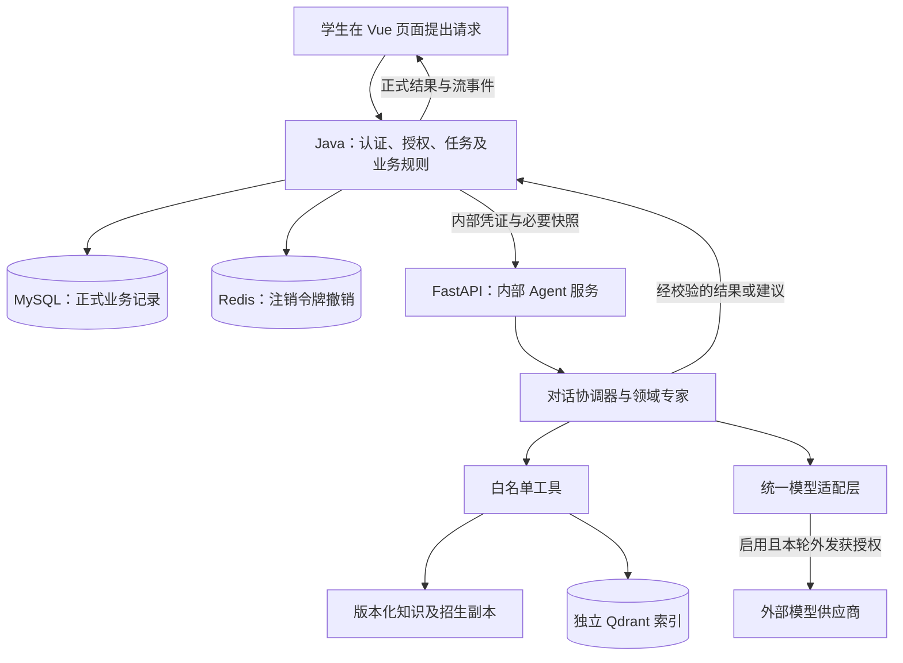
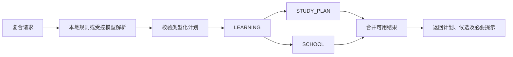
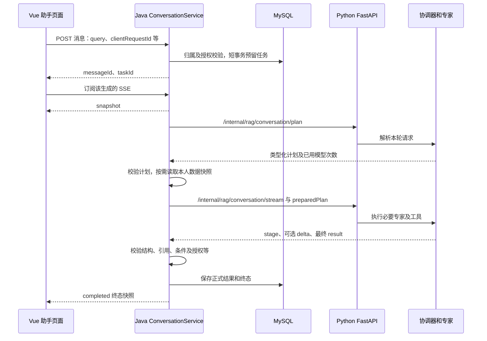

# 用 HelloAgents 理解当前考研 Agent 项目

核对日期：2026-10-30。对象：当前工作树中的 `kaoyan-agent/`，结合 Java、Vue 的调用边界说明。阅读目标：理解项目解决什么问题、各层怎样配合，以及哪些能力来自框架、哪些由项目自己实现。

本文是一份源码解读，不新增业务契约。接口细节以[搭建文档](../考研Agent平台搭建文档.md)、[会话契约](conversations.md)、[RAG契约](rag.md)和[学情及隐私契约](assistant-learning-contract.md)为准。当前工作树包含未提交修改，不能只用 HEAD `369e236` 代表这里讲解的全部实现。

## 1. 先看项目整体：Agent 在平台中负责什么

平台面向计算机考研学习，围绕知识问答、择校、刷题、错题解释、学情分析和复习笔记组织功能。当前 Agent 部分可以概括为：**由一个对话协调器组织六类专家，调用受控工具处理本轮任务；Java 提供可信业务快照并保存正式结果。**

这里的 Agent 是有明确职责、输入和执行入口的程序对象。它可以使用模型，也可以先执行规则、检索或结构校验。一次专家执行不必对应一次模型请求。



图表示代码职责，不表示本文启动或探测了这些服务。

| 层 | 主要职责 | 一个具体例子 |
| --- | --- | --- |
| Vue 前端 | 收集输入、展示进度和来源、预览及确认操作 | 展示复习计划，用户点击确认保存笔记 |
| Java 业务后端 | 认证、归属校验、判分、任务配额、快照、正式持久化 | 验证错题确属本人且已判错，再提供该次作答版本 |
| Python Agent | 识别请求、组织专家、检索、生成解释、校验结果 | 基于授权统计给出学习建议，或解释已筛选的院校候选 |
| 模型供应商 | 在允许输入范围内生成结构化内容 | 根据本轮来源生成知识解释 |

普通登录、查询、判分等操作可以直接由 Java 完成。Python 不连接业务 MySQL，也不负责授予权限、改变判分或直接保存个人笔记。

## 2. 这套实现怎样对应《Hello-Agents》

依据为 Datawhale《Hello-Agents》V1.0.3。下表页序从 PDF 第一页计数，不是印刷页码。原迁移已抽读相关原文并核对锁定包源码接口，本轮沿用既有版本，不新增框架功能。

| 原书内容 | PDF 页序 | 当前项目的落点 |
| --- | --- | --- |
| 第7章 7.1、7.3—7.5：分层、统一接口、模型及工具扩展 | 206—208、217—240 | `core/`、`agents/`、`tools/`；继承真实框架基类 |
| 第8章 8.1.3：记忆与 RAG 分开 | 259—260 | 会话历史来自 Java；知识证据来自独立版本化资料 |
| 第9章 9.3：GSSC 上下文构建 | 312—327 | `AuthorizedContextBuilder` 继承 `ContextBuilder` |
| 第13章 13.2—13.4：类型化输入输出、专业分工、协作及连接复用 | 561—599；协作573、575—576，连接581 | Pydantic 计划、六类专家、依赖调度及共享客户端 |
| 第12章 12.1：正确性、效率、鲁棒性和任务完成度 | 497—499 | 对应已有测试与评测的阅读维度；不等于效果已经通过 |
| 第16章：目录、依赖与交付组织 | 702—708 | 独立依赖声明、提示模板、测试和验证记录 |

需要把三个层次分开：

1. **书中的通用思路**：分层、消息、工具、上下文工程、专业 Agent 协作。
2. **已发布包的真实接口**：项目锁定 `hello-agents==0.2.8`，以这一版本实际导出为准。书中第7章早期示例使用其他版本，不能混用签名。
3. **本项目补充规则**：六类专家、Java 独占业务持久化、四次模型预算、隐私授权、题目快照和引用白名单。这些不是书中规定的唯一架构。

项目没有复制一套 `hello_agents/` 到仓库。真实依赖通过 [core/framework.py](../kaoyan-agent/core/framework.py) 导入；具体版本见 [requirements.txt](../kaoyan-agent/requirements.txt) 与 [helloagents-constraints.txt](../kaoyan-agent/helloagents-constraints.txt)，其中 OpenAI SDK 锁定为 `1.109.1`。

第13章用旅行规划展示多个专家协作；这里借用其分工与组合方法，换成考研业务。书中共享 MCP 实例的思路，在本项目体现为共享模型客户端、资料和检索器；同日后续增加可选的只读资料MCP，共享一个stdio客户端会话，默认仍走本地工具。MCP不会自动扩展专家权限。

## 3. 目录不是摆设：每层具体装什么

下面只列与理解主链直接相关的文件，省略缓存和构建产物。

```text
kaoyan-agent/
├── main.py                 FastAPI 装配、内部接口、流式任务生命周期
├── mcp_server.py           可选只读资料MCP的固定stdio入口
├── admission_mcp_server.py 独立招生官网取证MCP；默认关闭
├── admission_pdf_worker.py 可回收的文字PDF解析子进程；无网络／模型
├── config.py               受控配置及供应商端点标识
├── schemas.py              请求、计划、专家名和输出结构
├── conversation.py         旧会话调用入口，委托协调器
├── workflows.py            旧领域调用入口、工具装配和任务分派
├── llm_client.py            旧模型入口，委托 core/model.py
├── core/
│   ├── framework.py        导入真实 HelloAgents 接口
│   ├── model.py            异步模型适配、结构化生成和连接关闭
│   ├── context.py          GSSC 上下文适配
│   ├── runtime.py          请求上下文、调用预算和每日计数
│   ├── mcp_runtime.py      独立生命周期任务、连接状态、取消及固定错误分类
│   ├── mcp_client.py       知识证据校验及原生HelloAgents工具
│   ├── mcp_contract.py     仅检索的子进程配置及双端证据Schema
│   ├── admission_client.py 招生证据校验及原生工具适配
│   ├── admission_contract.py 招生查询、实时证据及字段比对契约
│   ├── admission_pdf.py    PDF工作进程协议、并发及资源监测
│   └── streaming.py        增量 JSON 正文投影及完整 JSON 解析
├── agents/
│   ├── base.py             StructuredAgent：统一执行及临时消息清理
│   ├── coordinator.py      对话协调器、依赖调度及结果合并
│   ├── planning.py         本地意图识别和受控计划构造
│   ├── knowledge.py        知识问答与错题辅导
│   ├── school.py           院校候选筛选及可选解释
│   ├── learning.py         授权学情分析
│   ├── practice.py         练习专家，独立规则建议与操作反馈
│   ├── note.py             笔记草稿及修改建议
│   ├── study.py            复习安排
│   └── summary.py          旧批次总结专用实现
├── tools/
│   ├── registry.py         工具参数校验、严格注册与执行
│   ├── knowledge.py        版本化知识检索工具
│   └── schools.py          院校硬筛选与稳定排序工具
├── intents.py              统一意图、条件和受控操作解析
├── learning.py             授权上下文投影及兼容解析入口
├── retrieval.py            原有语料、词项/BM25/向量及混合检索
├── question_search.py      独立的题目语义索引与检索
├── grounding.py            引用支持度的词项核对基线
├── prompts/                集中保存提示模板
└── tests/                  框架、契约、隐私、预算及领域回归
```

`core/` 是项目对框架的适配层。模型、消息、工具等通用基类仍由依赖提供。

三个旧文件继续存在是为了保留调用和测试注入入口。例如 `ConversationWorkflow.run()` 每次创建新的 `ConversationCoordinator`，`Workflows.qa()` 委托 `KnowledgeAgent`；它们没有另行维护旧 LangChain 编排。

## 4. 六类专家各负责什么

协调器对应 [ConversationCoordinator](../kaoyan-agent/agents/coordinator.py)，六类专家名定义在 [schemas.py](../kaoyan-agent/schemas.py) 的 `ExpertName`。

| 专家名 | 实现 | 输入依据及工作 | 主要输出与边界 |
| --- | --- | --- | --- |
| `LEARNING` | [LearningAgent](../kaoyan-agent/agents/learning.py) | Java 提供的本轮统计、错题或收藏等快照；可补充相关知识资料 | 学情文字和证据；不重算正式判分、画像权重 |
| `SCHOOL` | [SchoolAgent](../kaoyan-agent/agents/school.py) | 版本化招生副本、年份、专业和学位等明确条件 | 最多5个规则候选、排除原因、来源；模型只解释候选 |
| `KNOWLEDGE` | [KnowledgeAgent](../kaoyan-agent/agents/knowledge.py) | 普通知识问题检索当前资料；错题分支使用 Java 核验的 `attempt` | 带来源问答或历史错题解释；不能改标准答案 |
| `PRACTICE` | [PracticeAgent](../kaoyan-agent/agents/practice.py) | 使用Java已审核候选快照，独立生成规则建议及操作反馈 | 练习建议，随后由 Java 现有确认流程建卷；不生成正式题目 |
| `NOTE` | [NoteAgent](../kaoyan-agent/agents/note.py) | 当前选中的笔记及版本、授权学习资料，或规划专家的结构化计划 | `documentProposal` 草稿；预览确认后由 Java 保存 |
| `STUDY_PLAN` | [StudyPlannerAgent](../kaoyan-agent/agents/study.py) | 本轮画像或记录中的知识点、用户给出的天数和时间 | `studyPlan.days` 与依据；默认7天，最多30天，不虚构可用小时 |

这里的“专家”表示职责和校验边界，当前没有为它们分别训练六个模型。调用模型时，解析使用路由模型配置，生成使用主模型配置；这些模型也可以配置为同一个供应商模型。

两个容易数错的地方：

- `SummaryAgent` 保留旧 `PRACTICE_SUMMARY` 入口，直接计算有效作答的题数、正确数及正确率，再按授权补充文字总结。它不在六类协作专家枚举中。
- `WRONG_QUESTION_TUTOR` 是兼容任务类型，执行 `KnowledgeAgent.tutor()`，不是第七类专家。

规划专家的规则路径当前从画像分组、统计知识点和题目中收集主题，并轮换安排“复习定义、独立练习、核对错因”等任务。它没有实现经效果验证的自适应课表优化，也不校准掌握指数或录取概率。

## 5. 协调器怎样组织一次复合请求

例如学生输入：

> 分析薄弱点，安排7天复习计划，并推荐院校。

假定 Java 已有本人统计，且年份、专业和学位条件齐全。本地 `local_orchestration()` 可以直接构造下面的计划，不必先调用模型。以下是合法计划的简化表示，省略的字段由模型默认值补齐；它不是浏览器提交格式。

```json
{
  "action": "MULTI_AGENT",
  "standaloneQuery": "分析薄弱点，安排7天复习计划，并推荐院校",
  "planVersion": 2,
  "reads": ["stats"],
  "operation": "NONE",
  "studyDays": 7,
  "modelCallsUsed": 0,
  "steps": [
    {"agent": "LEARNING", "dependsOn": []},
    {"agent": "STUDY_PLAN", "dependsOn": ["LEARNING"]},
    {"agent": "SCHOOL", "dependsOn": ["LEARNING"]}
  ]
}
```

`ConversationResolution.ordered_steps()` 拒绝重复专家、重复依赖和指向尚未出现专家的依赖。步骤最多6个，以此构成有向无环图（DAG：依赖不能绕回自身）。



`collaborate()` 按已验证计划顺序执行专家，实际模型调用合计最多两次，分配不再依赖检索或调度时序。子专家得到本轮请求和计划的深拷贝；模型客户端、语料和检索器共享，消息历史不共享。若前置步骤没有得到 `COMPLETED`，依赖它的步骤会跳过并给出提示。

**依赖边目前主要控制执行顺序和是否继续，不自动把前一个专家的回答传给后一个专家。** 例如规划和院校专家仍主要读取各自请求中的可信快照，并不把学情专家的自然语言重新当成画像。当前明确传递上游产物的例子是 `NOTE` 接收已完成 `STUDY_PLAN` 的 `studyPlan`，通过显式类型化 `StepContext` 把它整理为待确认笔记；仅声明了该依赖才传递快照，不使用动态属性补丁。

合并按显式字段归属保留 `studyPlan`、`candidates`、`documentProposal` 及练习操作摘要，冲突及超限引用拒绝。`sections`逐项对应计划，`partial`表示同时有完成及未完成分项；总终态沿用原枚举。预期外部故障保留其他可用结果，未知程序错误仍整体FAILED。Java继续生成正式证据及actions，复合练习不覆盖其他专家回答。

可选的模型汇总有额外条件：各分项都来自已授权的 AI 路径、全部完成、没有notice，并且当前允许外发。三个以上需要模型生成的专家或含规则结果时通常不会汇总。规则产生的私人摘要不会因为需要汇总而自动再发给供应商。汇总失败时保留各专家结果。

## 6. 从浏览器发送到数据库保存：完整聊天主链

聊天使用“先创建生成任务，再订阅事件”的方式。SSE（服务器发送事件）是一条由服务器持续推送进度和正文的 HTTP 连接。



关键源码是 [ConversationService.java](../kaoyan-B/src/main/java/com/kaoyan/service/ConversationService.java) 的 `generate()`，以及 [main.py](../kaoyan-agent/main.py) 的 `conversation_plan()`、`conversation_stream()`。

这里有几项实际工程安排：

- **分两段调用 Python**：先知道本轮需要哪些数据，再由 Java 读取并投影必要业务快照。Python 的计划不能自行取得业务库权限。
- **短事务保存、网络调用在锁外**：等待模型时不占着数据库事务。重连和订阅读取已有生成，不创建新任务。
- **临时正文和正式结果分开**：`streaming.py` 从尚未完整的 JSON 中投影允许展示的正文；只有完整 JSON 通过结构和业务校验，才可以成为正式结果。
- **多专家阶段避免混写正文**：各专家的模型 delta 被关闭，先展示阶段进度；单专家及可选最终汇总可以流式显示正文。
- **取消与恢复由两端配合**：Java 关闭上游连接、竞争终态并保存状态；Python 清理 worker、模型响应及临时历史。服务重启后，Java 按原机制处理遗留运行任务。

原同步链仍然保留：Java 通过 [AgentFeignClient](../kaoyan-B/src/main/java/com/kaoyan/feign/AgentFeignClient.java) 调用 `/internal/rag/chat`，由 `Workflows.run()` 分派领域任务。连续聊天的规划和流式请求使用 Java HTTP 客户端，不是所有调用都走 OpenFeign。

## 7. HelloAgents 在代码中真正执行了什么

### 7.1 Agent 与 Message：有生命周期的领域处理器

[StructuredAgent](../kaoyan-agent/agents/base.py) 继承真实 `hello_agents.core.Agent`，初始化时使用框架 `Config`。统一调用路线为：

```text
execute(领域上下文)
  → arun(本轮文本, context=领域上下文)
  → add_message(框架 Message，role=user)
  → handle(具体业务)
  → 序列化结果并添加 assistant Message
  → finally: clear_history()
```

`arun()` 返回框架入口约定的字符串，`execute()` 再转回现有服务使用的字典。同步 `run()` 只供没有运行中事件循环的调用方使用；异步环境必须用 `arun()`，避免阻塞 FastAPI。

这里的框架消息用于本轮执行生命周期。真正发给供应商的历史，来自 Java 授权快照及模型输入组装，不能把 `Agent` 自带消息列表误认成跨轮持久会话。

### 7.2 模型适配：同一个入口控制外部请求

[ModelClient.generate()](../kaoyan-agent/core/model.py) 负责调用预算、复用 `AsyncOpenAI` 客户端、拼装上下文、解析完整 JSON，并用指定 Pydantic 模型校验结果。

实际模型类 `AsyncHelloAgentsLLM` 继承 `HelloAgentsLLM`，扩展异步调用和异步流。它复用应用注入的客户端，并阻止基类另建同步 SDK 客户端。SDK 明确设置 `max_retries=0`。

共享连接只共享传输资源，不共享不同账号的可变聊天历史。服务关闭时由 FastAPI lifespan 调用 `model.close()`，同时关闭检索相关资源。供应商参数和密钥来自受控配置，前端不持有密钥。

### 7.3 工具：明确参数和结果的受控能力

[ValidatedTool](../kaoyan-agent/tools/registry.py) 继承真实 `Tool`，`get_parameters()` 使用 `ToolParameter` 描述参数；`StrictToolRegistry` 继承 `ToolRegistry`。执行前用 Pydantic 拒绝非法参数和额外字段，注册时拒绝重名，执行时拒绝未知工具。

| 工具名称 | 装配位置 | 能做什么 |
| --- | --- | --- |
| `retrieve_knowledge` | `tools/knowledge.py`，由 `Workflows` 注册 | 检索当前版本知识并还原来源结构 |
| `filter_programs` | `tools/schools.py` | 按年份、专业、学位等条件筛选 |
| `rank_programs` | `tools/schools.py` | 按地区偏好、记录日期和编号稳定排序，最多5项 |
| `read_document` | `agents/note.py` 的本轮注册表 | 读取本轮已选中的授权笔记快照 |
| `propose_document` | 同上 | 调用统一模型入口生成待确认草稿 |

异步模型工具直接 await；本地同步检索通过 `asyncio.to_thread()` 移出事件循环。可选`KNOWLEDGE_TOOL_TRANSPORT=mcp_stdio`时，`McpKnowledgeSearchTool`仍继承原生工具适配基类，通过异步MCP会话调用固定子进程；服务端用最多2个工作线程执行原检索，再返回带releaseId及后端的完整证据。客户端重验Schema、64KiB上限、版本、来源及当前文档成员，转换成原RetrievalHit。工具描述只说明调用方式，输出仍需领域结构校验。

知识MCP默认未启用；启动及发现10秒、单次5秒、每轮最多3次，错误不静默转本地。取消通知只针对对应请求，其他共享连接请求继续执行；已运行的同步线程不能被强制中止。子进程不加载根.env或业务／模型凭证，不自动下载权重或建索引；实际验收及运行边界见[MCP记录](mcp-knowledge-verification-2026-10-29.md)。

2026-10-30调用可靠性扩展：两个MCP各由独立任务持有SDK上下文，单个启动或运行故障只停用对应工具；健康接口读取内存中的启用状态、连接状态及固定故障码，断连后需维护者重启恢复。招生调用使用共享CallBudget(1)，取消／超时仍占本轮已提交次数，子任务不能各复制一次额度。固定错误、日志脱敏及真实协议／关闭回收检查见[可靠性记录](mcp-reliability-verification-2026-10-30.md)。

同日新增招生取证MCP：`ADMISSION_MCP_ENABLED`默认关闭，SCHOOL专家通过原生执行入口调用独立的`AdmissionCheckTool`；其固定stdio服务只读官方来源，返回独立`admissionCheck`证据，不进入知识引用或正式推荐。普通推荐不联网，明确查询才执行；同年基线及完整招生组合不能对齐时返回限制。Java校验后保存在现有会话JSON，管理员和学生均使用本人助手入口，不增加第七类专家、业务数据库连接或在线发布。文字型PDF同日扩展复用该原生工具，解析属于确定性辅助函数，不另包一套Agent；页码／坐标、进程回收及验证见[PDF扩展记录](mcp-admission-pdf-verification-2026-10-29.md)。实现、来源登记、解析边界和本轮验证见[招生MCP记录](mcp-admission-verification-2026-10-29.md)。


当前主要由可信程序代码固定选择工具，没有让模型无限循环决定下一步。没有终端、任意 SQL、任意 URL 请求或直接修改业务库的工具。用户确认后的建卷、收藏和笔记保存仍由 Java 完成。

## 8. 上下文工程：GSSC 在这里怎样落地

上下文是模型本次能够看到的全部信息。GSSC 是收集（Gather）、选择（Select）、组织（Structure）、压缩（Compress）四步流程。

[AuthorizedContextBuilder](../kaoyan-agent/core/context.py) 继承真实 `ContextBuilder`，沿用已安装版本的 `build()` 调度四步，但覆盖了每一步的策略：

| 阶段 | 当前实际行为 | 为什么这样处理 |
| --- | --- | --- |
| Gather | 收集可信系统说明和已投影的 JSON 数据包 | 不借助框架工具再读取额外私人数据 |
| Select | 保留系统说明和已授权数据包 | 相关资料选择、最近历史选择已在检索及 Java 等上游完成 |
| Structure | 用框架 `Message` 组织为 system + user | 规则留在 system，用户输入、历史和资料作为 user 中的结构化数据 |
| Compress | 只做 JSON 规范化，不截断 | 避免丢失来源编号、资格条件、版本或授权范围 |

这是真实调用框架流水线，但**没有启用其默认相关性／新近性评分，也没有使用默认 token 截断或付费摘要**。代码中的 `token_count` 用字节长度作本地估计，不是供应商 tokenizer 的精确计数；这个适配器也没有执行硬性的总输入 token 上限。

当前输入规模主要靠请求字符上限、最近3轮历史、记录数量上限、检索条数和授权投影约束。它们控制规模，但不能等同于精确的 token 预算守护。这是理解当前实现时需要保留的限制。

外发前还会通过 [learning.py](../kaoyan-agent/learning.py) 中的函数分别核对：`model_allowed()` 检查开关、用户许可与当前供应商端点；`has_scope()` 检查类别；`model_messages()` 过滤授权不明或不满足当前范围的历史；`safe_learning_context()` 剔除不必要字段、未请求记录和未提交答案。

## 9. RAG、题目检索和聊天记忆是三件事

RAG（检索增强生成）先取回相关资料，再把资料交给模型作为回答依据。它不等于让模型凭记忆回答。

### 9.1 知识与招生：独立版本化副本

[retrieval.py](../kaoyan-agent/retrieval.py) 的 `Corpus` 读取已配置语料，检查来源域名，将规范化内容的 SHA256 摘要用于生成 `releaseId`，再按450字符、350字符步长切块，保留定位。

`Retriever` 支持四种后端：

| 后端 | 实际机制 |
| --- | --- |
| `lexical` | 词项重叠和关键词加权，默认值 |
| `bm25` | 中文字符及二元片段、英文词项的 BM25 排序 |
| `qdrant` | FastEmbed 本地向量表示及独立 Qdrant 检索 |
| `hybrid` | BM25 与向量结果按 RRF 排名融合；向量不可用的指定情形回退 BM25 |

知识专家取回资料后，先准备来源摘要。启用且获授权时，模型可以生成解释；来源编号必须属于本次资料。知识问答还会用 `grounding.verify()` 核对结论与引用词项是否对齐，完全不支持时保留摘要降级结果。

词项支持度只是基线，不能可靠判断否定、逻辑矛盾和全部事实错误。学情专家当前主要校验返回证据及来源编号范围，也不能因此认定所有专家输出都经过同等内容核查。

院校推荐则先在结构化招生记录上执行硬条件筛选，不用向量相似度判断年份或专业是否符合。模型解释不能新增候选或偷偷放宽条件；缺少必填条件则追问，资料无覆盖则明确说明。

### 9.2 题目语义检索：由 Java 限定可检索集合

[question_search.py](../kaoyan-agent/question_search.py) 及 `/internal/rag/questions/*` 是另一条索引链。Java 提供经过业务校验的题目副本，Python 在独立题目索引中做语义匹配，再由 Java 结合当前范围和操作确认处理结果。

题目索引不代替 Java 的题目版本与作答快照，也不会因为题目变多就自动扩充知识／招生 RAG。根据[同日资料记录](data-collection/co-questions-2026-10-29.md)，本机题目索引记录为404题，而知识及招生 RAG 仍为31条；这是已有记录的状态，本文未查询日常库或运行索引。

### 9.3 记忆：Java 保存，Python 临时恢复

正式聊天、生成尝试和个人笔记保存在 MySQL，由 Java 管理。后续提问由 Java 重新读取最近有效历史，并执行归属、成功状态、授权及30天保留范围检查。

Python 的每个协调器和专家只保留本轮临时消息，结束、失败或取消后清理。当前没有另建框架持久记忆，也没有使用书中 NoteTool 文件笔记、SQLite 或 Neo4j 作为个人会话存储。

个人笔记与模型总结属于用户上下文，不能自动升级为审核知识或招生事实。错题辅导历史通过原始父任务链重建，不复制旧正文来延长保留期；已清除或过期来源不能从较新任务中复活，细节见[隐私修复记录](pr15-helloagents-verification-2026-10-29.md)。

## 10. 为什么不会每次调用六遍模型

模型调用次数由共享预算控制，规则路径可以不发起模型请求。复合计划里的专家即使超过两个，也不能各自获得独立的两次调用额度。

| 路径或阶段 | 当前限制 |
| --- | --- |
| 旧同步／单项路径 | 单请求最多2次模型尝试；默认单次20秒，Python全流程42秒 |
| 复合聊天解析 | 最多1次模型尝试，解析阶段10秒 |
| 复合聊天专家阶段 | 所有专家合计最多2次模型尝试，整个阶段20秒 |
| 可选模型汇总 | 最多1次，10秒 |
| 复合计划合计 | plan 与 stream 共用最多4次；`modelCallsUsed` 携带解析已用次数 |
| Java 生成保护 | 后台总保护48秒；不会把各阶段超时简单相加作为承诺耗时 |

[CallBudget.reserve()](../kaoyan-agent/core/runtime.py) 使用锁原子预留总预算和阶段预算，拒绝阶段请求时不消耗总预算；协调器已按计划顺序执行，不依赖竞争分配模型额度。后续尝试额度不足时，有规则后备的专家保留后备结果，其他失败由协调器注明；没有保证每个专家都能使用 AI。

另有 `ModelBudget` 按 UTC 日记录单 Python 进程的模型尝试次数，默认100次，失败尝试也占额度。重启会重置，不能作为跨重启或多实例的账单硬上限。Java 的任务配额是另一层业务控制。

异步流使用上下文管理器关闭底层响应，取消不会只把页面隐藏。即使本地连接已关闭，也不能据此承诺供应商没有处理或计费。当前没有自动重试、自动反思或无边界工具循环。

## 11. 返回“成功”究竟说明什么

需要同时区分任务状态、领域完成度和生成方式：

| 维度 | 值 | 解释 |
| --- | --- | --- |
| Java 任务状态 | `RUNNING / SUCCESS / FAILED / CANCELLED` | 生成是否运行、处理成功、失败或被停止 |
| Python 正式响应状态 | `SUCCESS / FAILED` | 内部处理是否成功；取消通过流生命周期及 Java 终态处理 |
| `result.outcome` | `COMPLETED / NEEDS_INPUT / UNSUPPORTED` | 领域任务完成、需要补充条件，或当前资料／能力不支持 |
| `explanationMode` | `rules / ai / fallback` | 规则结果、模型结果，或模型不可用后的后备结果 |

例如择校缺专业时，可以处理成功并返回 `NEEDS_INPUT`；模型不可用时，可以成功返回规则候选；复合任务也可能部分完成并附未完成提示。HTTP 200、`SUCCESS` 和模型参与都不能单独证明答案正确或目标全部完成。

对外任务类型仍为 `KNOWLEDGE_QA / SCHOOL_RECOMMEND / PRACTICE_SUMMARY / CHAT / WRONG_QUESTION_TUTOR`。内部 `MULTI_AGENT`、`STUDY_PLAN` 是协调动作，不能直接当成新增公开任务类型。`planVersion=2` 也只是内部计划版本。

## 12. 按什么顺序读源码最容易理解

| 阅读顺序 | 文件与关键符号 | 读完应能回答 |
| --- | --- | --- |
| 1 | [main.py](../kaoyan-agent/main.py)：`create_app` | 依赖在哪里创建，内部接口如何认证及关闭资源？ |
| 2 | [schemas.py](../kaoyan-agent/schemas.py)：`ConversationRequest`、`ConversationResolution`、`ExpertStep` | 哪些输入、专家和依赖合法？ |
| 3 | [conversation.py](../kaoyan-agent/conversation.py) 与 [coordinator.py](../kaoyan-agent/agents/coordinator.py)：`resolve`、`handle`、`collaborate` | 单任务和复合任务如何选择及执行？ |
| 4 | [planning.py](../kaoyan-agent/agents/planning.py)：`local_orchestration` | 什么请求直接走本地规则？ |
| 5 | [base.py](../kaoyan-agent/agents/base.py)：`execute`、`arun` | 框架接口怎样执行，消息何时释放？ |
| 6 | [knowledge.py](../kaoyan-agent/agents/knowledge.py)、[school.py](../kaoyan-agent/agents/school.py) | 先检索／筛选、后解释分别怎样实现？ |
| 7 | [registry.py](../kaoyan-agent/tools/registry.py) 与 [retrieval.py](../kaoyan-agent/retrieval.py) | 工具边界和检索算法如何分开？ |
| 8 | [model.py](../kaoyan-agent/core/model.py)、[context.py](../kaoyan-agent/core/context.py)、[runtime.py](../kaoyan-agent/core/runtime.py) | 上下文、模型连接和调用预算由谁约束？ |
| 9 | [ConversationService.java](../kaoyan-B/src/main/java/com/kaoyan/service/ConversationService.java)：`generate`、`wireContext` | 谁读取私人数据、校验结果并保存？ |
| 10 | [test_multiagent.py](../kaoyan-agent/tests/test_multiagent.py) 与 [test_tutor_conversation.py](../kaoyan-agent/tests/test_tutor_conversation.py) | 哪些框架、隔离和预算行为有回归断言？ |

可以用三道问题检查自己是否读懂：没有模型时哪些功能仍可用？为什么 Python 不自己维护长期聊天记录？为什么“学情分析完成后再择校”不意味着把学情文字直接当作招生条件？

## 13. 初次解读的证据与尚未证明的部分

初次编写本文时，只阅读原书相关内容、锁定包接口、当前源码和已有验证记录，并做静态一致性检查；没有启动／停止服务、运行业务测试、读取真实 `.env`、调用模型或查询日常业务库。同日后续MCP任务增加独立环境和真实stdio回归，新增实现及验证另见[MCP记录](mcp-knowledge-verification-2026-10-29.md)，不与下述历史批次计数相加。

已有[HelloAgents重构记录](helloagents-multiagent-verification-2026-10-29.md)与随后[PR #15整合记录](pr15-helloagents-verification-2026-10-29.md)记载了框架执行、工具拒绝、历史清理、跨账号隔离、调用预算、取消、降级及三端兼容回归。后者记录 Python 328项、Java 175项、浏览器198项通过；这些是对应环境的历史结果，本次没有重新运行，也不把不同批次计数相加。

| 可以据此理解的当前实现 | 仍需保留的限制 |
| --- | --- |
| 真正继承并执行 HelloAgents 接口 | 采用框架本身不能证明效果优于旧实现 |
| 按白名单专家和依赖执行、支持局部后备 | 没有无限自主探索；并非每条依赖都传递上游产物 |
| 保留原检索、来源及版本规则 | 页面资料量不等于 RAG 覆盖量，词项支持度不等于事实正确性 |
| 外发授权投影、请求隔离和受控持久化 | Python 每日预算仍是单进程计数，GSSC没有精确总 token 硬限制 |
| 规则复习安排、确定性筛选和待确认笔记 | 未证明长期学习收益、录取预测或自动权重校准 |

初次文档任务的真实供应商、真实 token／费用、数据库／HTTP联调、浏览器、远端 CI 和部署检查均**未运行**；后续MCP任务的独立验证范围单独记录。关联聊天「按PDF规范更新AGENTS.md」另有启动记录；它只用于理解演进顺序，本文不据此宣称当前进程必然加载当前全部源码。

若需要介绍这套架构，可以这样表述：平台将认证、判分和正式记录留在 Java；Python 通过 HelloAgents 组织对话协调器及六类领域专家，使用版本化证据、受控工具和统一模型适配完成本轮任务，并由 Java 校验和保存结果。学习规划和解释能力受资料、授权、预算及现有评测范围约束。
