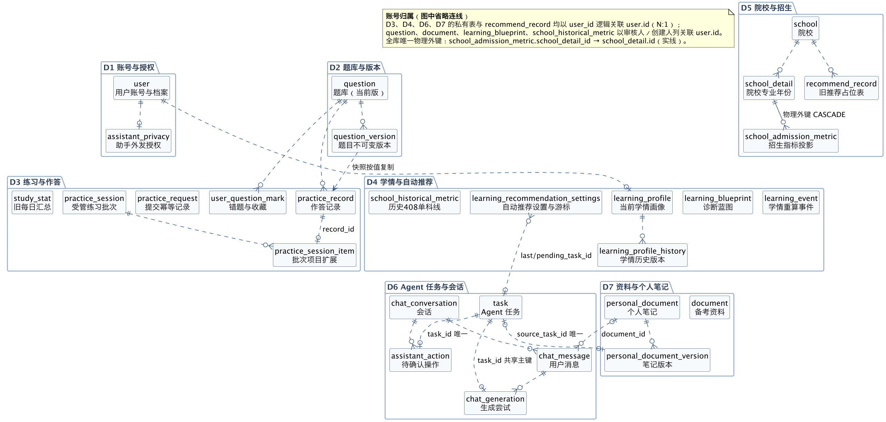
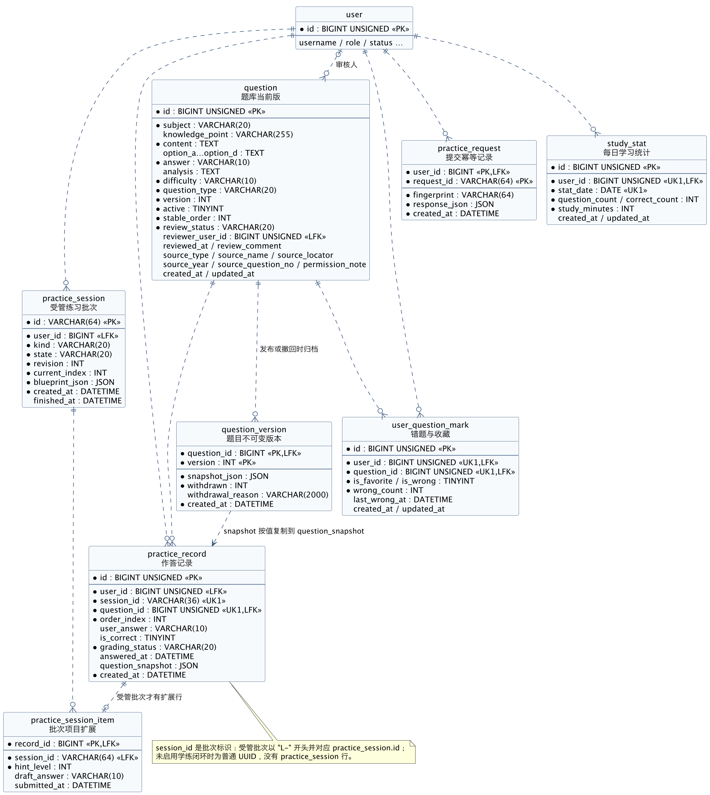
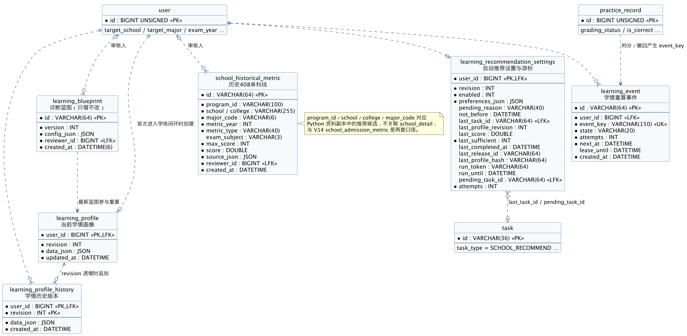
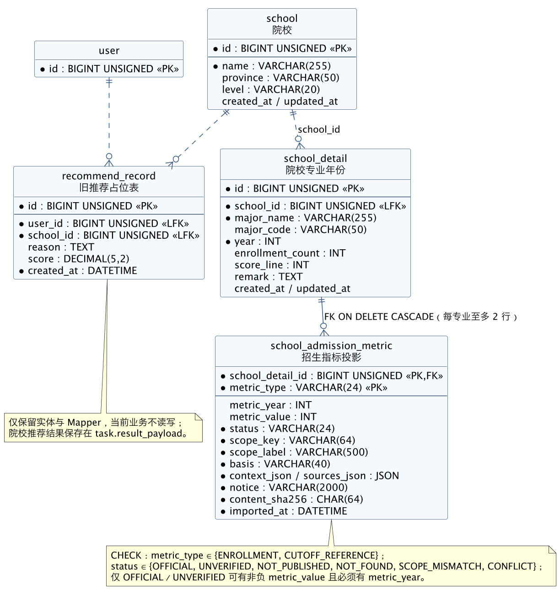
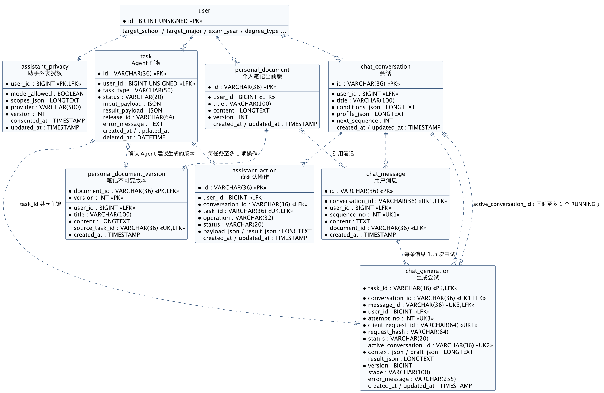
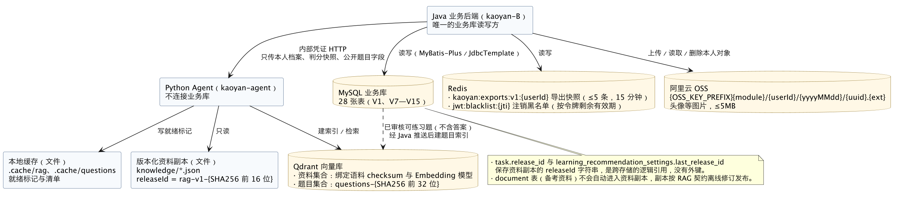

# 408小组 考研 Agent 平台 数据库设计说明书

| 项目 | 内容 |
| --- | --- |
| 文档版本 | v0.3（2026-11-06） |
| 对应 Issue | [T06 ER、关系模型与数据库说明书](https://github.com/fzu-404-team/kaoyan-agent-platform/issues/23) |
| 主编 | T06 负责人（GitHub：5-bin） |
| 字段字典 | 由 [T07](https://github.com/fzu-404-team/kaoyan-agent-platform/issues/24) 提供，作为附录 A、B 整合于第 5.1 节 |
| 排版 | 由 [T12](https://github.com/fzu-404-team/kaoyan-agent-platform/issues/33) 转为 Word／PDF |
| 状态 | 评审稿：结构与模型已按代码核对，并与 T07 数据字典、T10 SQL 结构摘录逐项交叉核对 |

> 本说明书描述仓库当前代码与迁移脚本中的**实际结构**，并单独标出设计目标和风险。文中“逻辑外键”指应用代码按该列关联但数据库没有外键约束；“物理外键”指数据库中实际存在的 `FOREIGN KEY` 约束。

## 目录

1. [引言](#1-引言)
2. [外部设计](#2-外部设计)
3. [结构设计](#3-结构设计)
4. [数据存储与生命周期](#4-数据存储与生命周期)
5. [运用设计](#5-运用设计)
6. [需求可追踪性](#6-需求可追踪性)
7. [已知问题与改进建议](#7-已知问题与改进建议)

---

## 1. 引言

### 1.1 编写目的

说明考研 Agent 平台业务数据库的概念模型、关系模式、物理结构、数据生命周期、事务与权限、备份恢复和迁移方式，供后端开发、测试、文档排版（T12）、博客（T11）和交付检查（T13）使用。读者应具备基本的 SQL 与关系模型知识。

### 1.2 背景

- 系统名称：考研 Agent 平台（面向计算机考研 408 的刷题、学情分析、院校查询与 Agent 助手）。
- 数据库服务对象：Java 业务后端 `kaoyan-B`（Spring Boot + MyBatis-Plus + JdbcTemplate）。
- 不直接访问业务库的组件：前端 `kaoyan-frontend` 仅通过 Java `/api` 访问；Python Agent `kaoyan-agent` 只读版本化资料副本和独立 Qdrant，不连接业务库。
- 数据库版本：README 要求 MySQL 8；V14 的 `CHECK` 约束需 MySQL 8.0.16 及以上才会实际执行。

### 1.3 定义

| 术语 | 含义 |
| --- | --- |
| 业务域 | 按业务职责划分的表集合，每张表只归属一个域（第 3.1 节） |
| 逻辑外键（LFK） | 应用层按该列关联、数据库无约束的列 |
| 物理外键（FK） | 数据库中声明的 `FOREIGN KEY`，全库仅 `fk_admission_detail` 一条 |
| 快照 | 在某时点按值复制的 JSON 数据，之后不随源数据变化（如 `practice_record.question_snapshot`） |
| 受管批次 | 启用学练闭环（`kaoyan.learning.enabled=true`）后创建的练习批次，有 `practice_session` 行，编号以 `L-` 开头 |
| releaseId | Python 资料副本的不可变版本号，格式 `rag-v1-` 加 16 位十六进制 |
| 迁移脚本 | `kaoyan-B/src/main/resources/db/` 下的 SQL，人工按顺序各执行一次，项目未使用 Flyway／Liquibase |

### 1.4 参考资料

| 资料 | 位置 |
| --- | --- |
| 建表与增量迁移 | [db 目录](../../../kaoyan-B/src/main/resources/db/)：`V1__init.sql`、`V7`—`V15` |
| 实体与 Mapper | [entity](../../../kaoyan-B/src/main/java/com/kaoyan/entity/)、[mapper](../../../kaoyan-B/src/main/java/com/kaoyan/mapper/)、[SchoolMapper.xml](../../../kaoyan-B/src/main/resources/mapper/SchoolMapper.xml) |
| 直接 SQL 访问 | [ChatRepository](../../../kaoyan-B/src/main/java/com/kaoyan/service/ChatRepository.java)、[ConversationService](../../../kaoyan-B/src/main/java/com/kaoyan/service/ConversationService.java)、[learning 包](../../../kaoyan-B/src/main/java/com/kaoyan/learning/) |
| 外部存储 | [ExportCache](../../../kaoyan-B/src/main/java/com/kaoyan/export/ExportCache.java)、[OssUtil](../../../kaoyan-B/src/main/java/com/kaoyan/util/OssUtil.java) |
| 业务契约 | [搭建文档](../../../考研Agent平台搭建文档.md)、[RAG 契约](../../rag.md)、[会话说明](../../conversations.md) |
| 模型与证据索引 | [T06_模型与存储设计](T06_模型与存储设计.md) |
| SQL 结构摘录 | [T10_SQL结构摘录](../evidence/T10_SQL结构摘录.md)、[T10_迁移索引](../evidence/T10_迁移索引.md) |
| 格式参考 | GB/T 8567-2006《计算机软件文档编制规范》中的数据库设计说明书 |

---

## 2. 外部设计

### 2.1 标识符和状态

- 数据库名：由环境变量 `DB_NAME` 指定，默认 `kaoyan`；连接参数 `serverTimezone=Asia/Shanghai`。
- 表名使用小写下划线；`user` 是 MySQL 保留字，SQL 中需写作 `` `user` ``。
- 28 张表全部处于使用中，唯一例外是 `recommend_record`：保留实体和 Mapper，当前业务不读写（第 7 节）。
- 学练闭环 10 张表（V13）仅在 `kaoyan.learning.enabled=true` 时使用；启用时启动检查缺表则以 `LEARNING_V13_MIGRATION_REQUIRED` 拒绝启动。

### 2.2 使用数据库的程序

| 程序 | 访问方式 | 访问范围 |
| --- | --- | --- |
| Java 业务后端 | V1 的 10 张表有 MyBatis-Plus 实体（`task`、`user_question_mark` 等也有直接 SQL 更新）；其余 18 张表只用 `JdbcTemplate` 直接 SQL | 唯一的业务读写方 |
| 运维脚本 `scripts/*.py` | 备份、隔离恢复预演、受控导入（如 `import-school-metrics.py`、`activate-server-release.py`） | 默认只读，显式授权后执行 |
| Python Agent | 无数据库连接 | 通过 Java 传入的本人档案与判分快照工作 |
| 前端 | 无数据库连接 | 只调用 Java `/api` |

> `kaoyan-agent/sql/init.sql` 的注释仍写着“Agent 只读 question 表”“由后端 Flyway 维护”，与当前实现和契约不符，属于历史遗留说明，以本说明书和 RAG 契约为准（第 7 节）。

### 2.3 约定

**命名与类型**

- 主键：V1 表使用 `BIGINT UNSIGNED AUTO_INCREMENT`；`task` 与 V10—V13 新表使用字符串 UUID 或业务编号；一对一扩展表直接以 `user_id` 或 `record_id` 作主键。
- 时间：V1、V13、V14 使用 `DATETIME`；V10—V12 使用 `TIMESTAMP`。学练闭环写入北京时间；任务每日额度按 UTC 日计算。
- JSON：`task`、`practice_record`、V13、V14 使用 MySQL `JSON` 类型；V10—V12 使用 `LONGTEXT` 存 JSON 文本，列名以 `_json` 结尾，`ChatRepository` 读取时自动解码。
- 布尔：V1 使用 `TINYINT`（1／0），V12 使用 `BOOLEAN`，V13 使用 `INT`。

**编码值**（以代码实际写入为准）

| 列 | 取值 |
| --- | --- |
| `user.role` | `STUDENT`、`ADMIN` |
| `user.status` | `1` 正常、`0` 禁用 |
| `user.degree_type` | `academic` 学硕、`professional` 专硕、`NULL` 未填（CHECK 约束） |
| `task.task_type` | `KNOWLEDGE_QA`、`SCHOOL_RECOMMEND`、`PRACTICE_SUMMARY`、`CHAT`、`WRONG_QUESTION_TUTOR` |
| `task.status` | `RUNNING`、`SUCCESS`、`FAILED`、`CANCELLED`（列默认值 `PENDING` 与注释为历史遗留，服务不创建该状态） |
| `question.subject`、`document.subject` | `数据结构`、`计算机组成原理`、`操作系统`、`计算机网络` |
| `question.difficulty` | `EASY`、`MEDIUM`、`HARD` |
| `question.review_status` | `PENDING_REVIEW`、`APPROVED`、`REJECTED` |
| `question.source_type` | `REAL_EXAM`、`MOCK`、`ORIGINAL`、`NULL`（来源未登记） |
| `document.status` | `DRAFT`、`PENDING_REVIEW`、`PUBLISHED`、`REJECTED` |
| `practice_record.grading_status` | `valid`、`withdrawn` |
| `practice_session.kind`／`state` | `PRACTICE`、`DIAGNOSTIC`／`RUNNING`、`FINISHED` |
| `learning_event.state` | `PENDING`、`DONE`（查询中出现的 `PROCESSING` 当前不会被写入） |
| `chat_generation.status` | `RUNNING`、`SUCCESS`、`FAILED`、`CANCELLED` |
| `assistant_privacy.scopes_json` 键 | `wrong`、`favorite`、`stats`、`profile`、`document`（各为布尔授权） |
| `learning_recommendation_settings.pending_reason` | `CONDITIONS_CHANGED`、`SOURCE_CHANGED`、`INITIAL_PROFILE`、`ABILITY_CHANGED`、`BLUEPRINT_CHANGED`、`EVIDENCE_INVALIDATED`、`NULL` |
| `school_historical_metric.metric_type` | `TOTAL_CUTOFF`、`SUBJECT_CUTOFF`、`ADMISSION_MIN`、`ADMISSION_MEAN`（请求校验；推荐对照当前只用 `SUBJECT_CUTOFF`） |
| `assistant_action.operation`／`status` | `FAVORITE_ADD`、`FAVORITE_REMOVE`、`WRONG_REMOVE`、`PRACTICE_CREATE`／`PENDING`、`SUCCESS`、`DISMISSED` |
| `school_admission_metric.metric_type` | `ENROLLMENT`、`CUTOFF_REFERENCE`（CHECK 约束） |
| `school_admission_metric.status` | `OFFICIAL`、`UNVERIFIED`、`NOT_PUBLISHED`、`NOT_FOUND`、`SCOPE_MISMATCH`、`CONFLICT`（CHECK 约束） |
| `school_admission_metric.basis` | `ORDINARY_EXAM`、`TOTAL_INCLUDING_RECOMMENDED`、`TOTAL_UNSPECIFIED`、`NOT_APPLICABLE` |

字段级含义、默认值与可空性见第 5.1 节（T07 数据字典）。

### 2.4 支持软件

MySQL 8（InnoDB）、Redis（注销黑名单与导出缓存）、阿里云 OSS（头像图片）、Qdrant（Python 侧向量索引）。备份使用 `mysqldump --single-transaction`。

---

## 3. 结构设计

### 3.1 概念结构设计

#### 3.1.1 业务域划分与表归属

| 业务域 | 表（28 张） | 写入方（代码位置） | 数据归属 |
| --- | --- | --- | --- |
| D1 账号与授权 | `user`、`assistant_privacy` | `UserServiceImpl`、`AssistantPrivacyService` | 账号本人 |
| D2 题库与版本 | `question`、`question_version` | `QuestionServiceImpl`、`ManagedPracticeService` | 管理员审核发布的公共数据 |
| D3 练习与作答 | `practice_session`、`practice_session_item`、`practice_record`、`practice_request`、`user_question_mark`、`study_stat` | `PracticeServiceImpl`、`ManagedPracticeService`、`UserQuestionMarkServiceImpl`、`StudyStatServiceImpl` | 账号本人 |
| D4 学情与自动推荐 | `learning_blueprint`、`learning_profile`、`learning_profile_history`、`learning_event`、`learning_recommendation_settings`、`school_historical_metric` | `LearningProfiles`、`LearningWorker`、`LearningRecommendations` | 蓝图与历史线为审核公共数据，其余属本人 |
| D5 院校与招生 | `school`、`school_detail`、`school_admission_metric`、`recommend_record` | `SchoolServiceImpl`、`SchoolDetailServiceImpl`、导入脚本、`SchoolAdmissionMetrics`（只读） | 公共数据；`recommend_record` 为遗留 |
| D6 Agent 任务与会话 | `task`、`chat_conversation`、`chat_message`、`chat_generation`、`assistant_action` | `TaskStore`、`TaskServiceImpl`、`ConversationService`、`AssistantLearningService` | 账号本人 |
| D7 资料与个人笔记 | `document`、`personal_document`、`personal_document_version` | `DocumentServiceImpl`、`PersonalDocumentService` | `document` 为审核公共资料，笔记属本人 |

各表的实体／Mapper／直接 SQL 映射由 T07《实体表映射》提供。

#### 3.1.2 E-R 图

图源均为 PlantUML，位于 [er/](er/)，导出图位于 `er/export/`。实线表示物理外键，虚线表示逻辑关联。

| 图号 | 名称 | 图源 |
| --- | --- | --- |
| 图 3-1 | 总览 E-R 图（28 张表、7 个业务域） | [T06-00_总览ER图.puml](er/T06-00_总览ER图.puml) |
| 图 3-2 | 题库与练习 E-R 图 | [T06-01_题库练习ER图.puml](er/T06-01_题库练习ER图.puml) |
| 图 3-3 | 学情与自动推荐 E-R 图 | [T06-02_学情推荐ER图.puml](er/T06-02_学情推荐ER图.puml) |
| 图 3-4 | 院校与招生 E-R 图 | [T06-03_院校招生ER图.puml](er/T06-03_院校招生ER图.puml) |
| 图 3-5 | Agent 任务、会话与个人笔记 E-R 图 | [T06-04_任务会话笔记ER图.puml](er/T06-04_任务会话笔记ER图.puml) |
| 图 3-6 | 资料与外部存储图 | [T06-05_资料与外部存储图.puml](er/T06-05_资料与外部存储图.puml) |

总览图为保证可读性省略了各表指向 `user` 的归属连线，改在图内注释说明；归属连线见各分域图。

#### 3.1.3 主要实体与联系

| 联系 | 基数 | 实现方式 | 说明 |
| --- | --- | --- | --- |
| 用户—任务 | 1:N | `task.user_id` 逻辑外键 | 所有 Agent 任务按账号计数和隔离 |
| 用户—练习批次—作答 | 1:N:N | `practice_session.user_id`；`practice_record.session_id` | 受管批次才有 `practice_session` 行 |
| 作答—批次项目扩展 | 1:0..1 | `practice_session_item.record_id` 即 `practice_record.id` | 共享主键扩展草稿、提示与提交时间 |
| 题目—题目版本 | 1:N | `question_version(question_id, version)` | 发布修订、撤回或首次进入受管批次时归档 |
| 题目版本—作答快照 | 按值复制 | `practice_record.question_snapshot` | 快照不随题目修改，历史判分依据不变 |
| 用户×题目—错题收藏 | M:N 关联实体 | `user_question_mark` 唯一键 `(user_id, question_id)` | 一人一题一行 |
| 用户—学情画像 | 1:0..1 | `learning_profile.user_id` 主键 | 每次实质变化另写 `learning_profile_history` |
| 用户—自动推荐设置 | 1:0..1 | `learning_recommendation_settings.user_id` 主键 | `last_task_id`、`pending_task_id` 指向 `task` |
| 院校—专业年份 | 1:N | `school_detail.school_id` 逻辑外键 | 应用层删除院校时连带删除专业 |
| 专业年份—招生指标 | 1:0..2 | **物理外键** `fk_admission_detail`，`ON DELETE CASCADE` | 主键 `(school_detail_id, metric_type)` |
| 会话—消息—生成尝试 | 1:N:N | `chat_message.conversation_id`；`chat_generation.message_id` | 重试产生新的 `attempt_no` |
| 任务—生成尝试 | 1:0..1 | `chat_generation.task_id` 即 `task.id` | 共享主键 |
| 任务—待确认操作 | 1:0..1 | `assistant_action.task_id` 唯一 | 确认后由 Java 执行收藏、移出错题或建批次 |
| 笔记—笔记版本 | 1:N | `personal_document_version(document_id, version)` | 每次保存追加不可变版本 |
| 任务—笔记版本 | 1:0..1 | `personal_document_version.source_task_id` 唯一 | 同一 Agent 建议只能确认保存一次 |

### 3.2 逻辑结构设计

#### 3.2.1 关系模式

记法：**加粗**为主键；`UK(...)` 为唯一键；`→表.列` 为逻辑外键；`⇒表.列` 为物理外键；`{JSON}` 为 JSON 文本或 JSON 类型列。

**D1 账号与授权**

- user(**id**, username UK, password_hash, role, status, avatar_url, target_school, target_major, exam_year, degree_type, background, created_at, updated_at)
- assistant_privacy(**user_id**→user.id, model_allowed, scopes_json{JSON}, provider, version, consented_at, updated_at)

**D2 题库与版本**

- question(**id**, subject, knowledge_point, content, option_a, option_b, option_c, option_d, answer, analysis, difficulty, question_type, version, active, stable_order, review_status, reviewer_user_id→user.id, reviewed_at, review_comment, source_type, source_name, source_locator, source_year, source_question_no, permission_note, created_at, updated_at)
- question_version(**question_id**→question.id, **version**, snapshot_json{JSON}, withdrawn, withdrawal_reason, created_at)

**D3 练习与作答**

- practice_session(**id**, user_id→user.id, kind, state, revision, current_index, blueprint_json{JSON}, created_at, finished_at)
- practice_record(**id**, user_id→user.id, session_id→practice_session.id（仅受管批次）, question_id→question.id, order_index, user_answer, is_correct, grading_status, answered_at, created_at, question_snapshot{JSON})，UK(session_id, question_id)
- practice_session_item(**record_id**→practice_record.id, session_id→practice_session.id, hint_level, draft_answer, submitted_at)
- practice_request(**user_id**→user.id, **request_id**, fingerprint, response_json{JSON}, created_at)
- user_question_mark(**id**, user_id→user.id, question_id→question.id, is_favorite, is_wrong, wrong_count, last_wrong_at, created_at, updated_at)，UK(user_id, question_id)
- study_stat(**id**, user_id→user.id, stat_date, question_count, correct_count, study_minutes, created_at, updated_at)，UK(user_id, stat_date)

**D4 学情与自动推荐**

- learning_blueprint(**id**, version, config_json{JSON}, reviewer_id→user.id, created_at)
- learning_profile(**user_id**→user.id, revision, data_json{JSON}, updated_at)
- learning_profile_history(**user_id**→user.id, **revision**, data_json{JSON}, created_at)
- learning_event(**id**, user_id→user.id, event_key UK, state, attempts, next_at, lease_until, created_at)
- learning_recommendation_settings(**user_id**→user.id, revision, enabled, preferences_json{JSON}, pending_reason, not_before, last_task_id→task.id, last_profile_revision, last_score, last_sufficient, last_completed_at, last_release_id, last_profile_hash, run_token, run_until, pending_task_id→task.id, attempts)
- school_historical_metric(**id**, program_id, school, college, major_code, metric_year, metric_type, exam_subject, max_score, score, source_json{JSON}, reviewer_id→user.id, created_at)

**D5 院校与招生**

- school(**id**, name, province, level, created_at, updated_at)
- school_detail(**id**, school_id→school.id, major_name, major_code, year, enrollment_count, score_line, remark, created_at, updated_at)
- school_admission_metric(**school_detail_id**⇒school_detail.id, **metric_type**, metric_year, metric_value, status, scope_key, scope_label, basis, context_json{JSON}, sources_json{JSON}, notice, content_sha256, imported_at)
- recommend_record(**id**, user_id→user.id, school_id→school.id, reason, score, created_at)

**D6 Agent 任务与会话**

- task(**id**, user_id→user.id, task_type, status, input_payload{JSON}, result_payload{JSON}, release_id, error_message, created_at, updated_at, deleted_at)
- chat_conversation(**id**, user_id→user.id, title, conditions_json{JSON}, profile_json{JSON}, next_sequence, created_at, updated_at)
- chat_message(**id**, conversation_id→chat_conversation.id, user_id→user.id, sequence_no, content, document_id→personal_document.id, created_at)，UK(conversation_id, sequence_no)
- chat_generation(**task_id**→task.id, conversation_id→chat_conversation.id, message_id→chat_message.id, user_id→user.id, attempt_no, client_request_id, request_hash, status, active_conversation_id→chat_conversation.id, context_json{JSON}, draft_json{JSON}, result_json{JSON}, version, stage, error_message, created_at, updated_at)，UK(conversation_id, client_request_id)、UK(active_conversation_id)、UK(message_id, attempt_no)
- assistant_action(**id**, user_id→user.id, conversation_id→chat_conversation.id, task_id→task.id UK, operation, status, payload_json{JSON}, result_json{JSON}, created_at, updated_at)

**D7 资料与个人笔记**

- document(**id**, title, subject, content, source_url, status, creator_user_id→user.id, reviewer_user_id→user.id, reviewed_at, created_at, updated_at)
- personal_document(**id**, user_id→user.id, title, content, version, created_at, updated_at)
- personal_document_version(**document_id**→personal_document.id, **version**, user_id→user.id, title, content, source_task_id→task.id UK, created_at)

#### 3.2.2 规范化分析与有意冗余

除下列有意冗余外，各关系的非主属性完全且直接依赖于主键，满足第三范式（3NF）。

| 冗余或非 1NF 设计 | 位置 | 原因 | 一致性保障 |
| --- | --- | --- | --- |
| 子表重复保存 `user_id` | `chat_message`、`chat_generation`、`assistant_action`、`personal_document_version`、`practice_record` 等 | 私有查询可直接按 `user_id` 过滤，不必联表即可校验归属，跨账号返回 404 | 写入时取自认证上下文，不信任客户端 |
| 题目快照 | `practice_record.question_snapshot`、`question_version.snapshot_json` | 保证历史判分、总结和撤回依据不随题目修订变化 | 快照只写一次；缺快照的旧作答在总结时返回 409，不按现行题目补造 |
| 当前版与历史版并存 | `question`／`question_version`、`learning_profile`／`learning_profile_history`、`personal_document`／`personal_document_version` | 当前版供快速读取，历史版供追溯 | 同一事务内先锁当前行再追加历史 |
| 聚合计数 | `user_question_mark.wrong_count` | 错题列表读取 | 判错时累加；撤回题目时按有效作答重算 |
| 旧每日汇总 | `study_stat` | 早期统计方案遗留 | 只在旧批次（非 `L-` 前缀）提交时累加；统计接口改为从 `practice_record` 实时计算，不读取本表（第 7 节 R11） |
| JSON 列 | `task.*_payload`、`chat_generation.*_json`、V13 各 `*_json` 等 | Agent 输入输出、蓝图、画像结构多变，按整体读写 | 由 Java 白名单结构校验后保存，不按 JSON 内部字段做关联查询 |
| 院校名称字符串 | `school_historical_metric.school/college/major_code` | 对应 Python 资料副本的候选，不属于院校库口径 | 与 `school_detail`、V14 指标明确分开，不互相回填 |

### 3.3 物理结构设计

#### 3.3.1 存储引擎与字符集

V1、V14 显式声明 `ENGINE=InnoDB DEFAULT CHARSET=utf8mb4`；V10—V13 未声明，依赖服务器默认值（MySQL 8 默认 InnoDB、utf8mb4）。在非默认配置的服务器执行前需核对。

#### 3.3.2 主键与编号策略

| 编号类型 | 表 | 生成方式 |
| --- | --- | --- |
| 自增整数 | V1 中除 `task` 外的 9 张表 | `AUTO_INCREMENT` |
| 带横线 UUID（36 位） | `task`、`chat_*`、`assistant_action`、`personal_document`、`learning_event` | Java `UUID.randomUUID()`；自动推荐任务用账号、设置版本、画像版本和 releaseId 生成确定性 UUID，重复调度不重复建任务 |
| 受管批次号 | `practice_session.id`、`practice_record.session_id` | `L-` ＋ 32 位无横线 UUID；未启用学练闭环时为普通 UUID |
| 业务编号 | `learning_blueprint.id`、`school_historical_metric.id` | 管理员发布编号／UUID |
| 复合主键 | `question_version`、`learning_profile_history`、`personal_document_version`、`practice_request`、`school_admission_metric` | 业务键组合 |
| 共享主键 | `assistant_privacy`、`learning_profile`、`learning_recommendation_settings`（=user_id）；`practice_session_item`（=record_id）；`chat_generation`（=task_id） | 一对一扩展 |

#### 3.3.3 索引设计

| 表 | 索引 | 服务的查询 |
| --- | --- | --- |
| `user` | UK `username` | 登录、注册查重 |
| `task` | `(user_id, created_at)` | 本人历史分页；每日／每分钟额度计数 |
| `question` | `(subject, active)`、`difficulty`、`review_status` | 抽题、审核列表 |
| `practice_record` | UK `(session_id, question_id)`、`user_id`、`question_id`、`session_id` | 批次内题目唯一；撤回时按题目查找受影响作答 |
| `user_question_mark` | UK `(user_id, question_id)`、`(user_id, is_wrong)`、`(user_id, is_favorite)` | 错题本、收藏列表 |
| `study_stat` | UK `(user_id, stat_date)` | 每日统计一行 |
| `school` | `province`、`level` | 院校筛选 |
| `school_detail` | `school_id`、`(school_id, year)`、`major_code` | 院校详情、专业筛选 |
| `document` | `(subject, status)`、`creator_user_id` | 资料列表与审核 |
| `chat_conversation` | `(user_id, updated_at)` | 会话列表 |
| `chat_message` | UK `(conversation_id, sequence_no)` | 消息顺序唯一 |
| `chat_generation` | UK `(conversation_id, client_request_id)`、UK `active_conversation_id`、UK `(message_id, attempt_no)`、`(conversation_id, created_at)` | 请求幂等、同一会话至多一个运行中生成、重试编号 |
| `assistant_action` | UK `task_id`、`(user_id, created_at)` | 每任务一个操作、本人操作列表 |
| `personal_document` | `(user_id, updated_at)` | 笔记列表 |
| `personal_document_version` | UK `source_task_id` | Agent 建议只保存一次 |
| `practice_session` | `(user_id, created_at)` | 本人批次列表 |
| `practice_session_item` | `session_id` | 批次项目读取 |
| `learning_event` | UK `event_key`、`(state, next_at)` | 事件去重、后台轮询到期事件 |
| `school_admission_metric` | 主键即 `(school_detail_id, metric_type)` | 按专业批量读取指标 |

`school_historical_metric` 只有主键，推荐时按 `(program_id, school, college, major_code, metric_year, metric_type)` 过滤；当前数据量小，数据增多后应补组合索引（第 7 节）。

#### 3.3.4 约束

- 物理外键：仅 `school_admission_metric.school_detail_id ⇒ school_detail.id ON DELETE CASCADE`。
- CHECK 约束：`ck_user_degree_type`（V15）、`ck_admission_type`、`ck_admission_status`、`ck_admission_value`（V14）。
- 其余引用完整性由 Java 服务保证：私有资源按认证账号过滤，不存在或不属于本人时返回 404，题目不可练习或版本已撤回时返回 409。

**不使用外键的现状与代价。** 项目从 V1 起由应用层维护关联，仓库中没有记录这一决定的原因。可以确认的事实是：V10—V13 的 `user_id`、`question_id`、`record_id` 为有符号 `BIGINT`，与 V1 主键的 `BIGINT UNSIGNED` 类型不一致，现在直接补加外键会失败；演示种子和会话清理按任意顺序删除或插入，也依赖没有外键约束。代价是孤儿记录只能靠代码和巡检发现（第 7 节列出已知风险）。

---

## 4. 数据存储与生命周期

### 4.1 存储位置总览

| 存储 | 内容 | 持久性 | 备份要求 |
| --- | --- | --- | --- |
| MySQL 业务库 | 28 张表 | 持久 | `mysqldump`，变更前必须备份并预演恢复 |
| Redis | `jwt:blacklist:{jti}` 注销黑名单；`kaoyan:exports:v1:{userId}` 导出预览快照（每人最多 5 条，15 分钟过期，单条上限 2MB） | 临时 | 不备份，丢失后需重新登录或重新预览 |
| 阿里云 OSS | `{OSS_KEY_PREFIX}{module}/{userId}/{yyyyMMdd}/{uuid}.{ext}` 头像等图片，5MB 以内，jpg／jpeg／png／gif／webp | 持久 | 不在 `mysqldump` 范围内；`user.avatar_url` 只存 URL |
| 资料副本文件 | `kaoyan-agent/knowledge/*.json`，每份对应一个 releaseId | 不可变版本 | 随仓库和发布包保存，保留旧版本用于历史核对和回滚 |
| Qdrant | 资料向量集合（绑定语料 checksum 与 Embedding 模型）；题目集合 `questions-{SHA256 前 32 位}` | 可重建 | 集合与就绪标记需一起备份 |
| Python 本地缓存 | `.cache/rag`、`.cache/questions` | 可重建 | 不提交仓库 |

题目索引的内容来自 Java：`QuestionSearchService` 只推送 `active=1` 且 `APPROVED` 题目的题干、选项、科目、难度、知识点和版本，不推送答案与解析。`document` 表中的备考资料**不会**自动进入 RAG 语料；资料副本需按 RAG 契约离线修订和发布。`task.release_id` 与 `learning_recommendation_settings.last_release_id` 保存的是资料副本 releaseId，属于跨存储的逻辑引用。

### 4.2 知识数据（题库与资料）

| 阶段 | 题目 `question` | 备考资料 `document` |
| --- | --- | --- |
| 创建 | 管理员录入或批量导入，`review_status=PENDING_REVIEW`；`source_*` 未登记时保持 `NULL`，不补造来源 | 管理员创建，`status=DRAFT` |
| 审核 | 通过后 `APPROVED`，记录审核人与时间 | 送审、发布或驳回 |
| 修订 | 待审或驳回的题目可原地修改，`version` 加 1；已发布题目只能走修订发布流程：先把当前版归档到 `question_version`，再写入新版并审核通过 | 原位修改 |
| 归档 | 题目首次进入受管批次时也会写入 `question_version`；同一版本只归档一次 | — |
| 撤回 | 指定版本 `withdrawn=1`；所有用该版本快照作答的记录改为 `withdrawn` 并重算错题标记；当前版被撤回时 `active=0` | — |
| 删除 | 服务层提供硬删除，不检查作答引用（第 7 节风险） | 服务层提供硬删除 |

### 4.3 交互数据（作答、会话与笔记）

| 数据 | 产生 | 变化 | 保留与清理 |
| --- | --- | --- | --- |
| 作答 `practice_record` | 创建批次时按顺序插入未答行 | 提交写入答案与判分；撤回改为 `withdrawn` | 长期保留，作为错题、统计和学情的依据 |
| 批次 `practice_session`、`practice_session_item` | 受管批次创建时 | 草稿、提示级别和 `revision` 递增；全部有效题提交后 `FINISHED` | 长期保留 |
| 提交幂等 `practice_request` | 每次成功提交 | 不变 | 当前无清理，持续增长 |
| 旧每日汇总 `study_stat` | 旧批次提交时按北京时间日期累加 | 题量、正确数递增；学习分钟固定加 0 | 长期保留；统计接口不读取 |
| 会话 `chat_*`、`assistant_action` | 用户发送消息 | 生成尝试的草稿每 500 毫秒刷新 | 超过 30 天：删除消息、生成尝试和操作，空会话删除，保留的会话壳清空标题和条件；用户可随时清空单个或全部会话 |
| 个人笔记 | 手动保存或确认 Agent 建议 | 每次保存追加版本 | 当前无删除接口，长期保留 |
| 学情画像与事件 | 判分、结束批次、撤回、发布蓝图 | 事件由后台每 5 秒批量处理，每个事件最多尝试 3 次，失败间隔 30 秒 | 历史版本和已完成事件当前无清理 |

### 4.4 任务结果

`task` 是全部 Agent 结果的统一账本：

1. 短事务内锁定账号并检查额度（默认每 UTC 日 30 项、滚动 60 秒 6 项），插入 `RUNNING`。
2. 事务外调用 Python Agent。
3. 短事务内写入 `SUCCESS`／`FAILED`、结果、releaseId；会话类结果同时写入 `chat_generation.result_json`。
4. 服务启动时把遗留 `RUNNING` 改为 `FAILED`。
5. 用户隐藏推荐历史只设置 `deleted_at`；超过 30 天的任务清空输入、结果、releaseId 与错误信息并设置 `deleted_at`。行本身保留，继续计入额度。

---

## 5. 运用设计

### 5.1 数据字典设计

字段级数据字典与实体—库表映射由 T07 编写，作为本说明书的附录：

| 附录 | 文件 | 内容 |
| --- | --- | --- |
| 附录 A 数据字典 | [T07_数据字典.md](T07_数据字典.md) | 28 张表、264 个字段的类型、可空、默认值、键与索引、业务含义和定义行；第 4 章为 JSON 列专项说明 |
| 附录 B 实体—库表映射 | [T07_实体表映射.md](T07_实体表映射.md) | 10 张表的实体字段对照；18 张无实体表的直接 SQL 位置；各业务的持久化链路 |

**依据与核对。** T07 以团队仓库提交 `ffb6b49` 为固定依据，该提交与本说明书所依据的代码一致。T06 用独立脚本重新解析 V1、V7—V15 迁移，得到 28 张表、264 列，与 T07 的列名、类型、可空性逐项一致；JSON 列共 21 个，其中原生 `JSON` 13 个、`LONGTEXT` 存 JSON 8 个。T10 依据提交 `94b8a9f`／`7c9ab82` 独立摘录迁移原文，三个提交的迁移目录无差异；2026-11-06 将附录 A 与 [T10_SQL结构摘录](../evidence/T10_SQL结构摘录.md) 逐项比对：28 张表、264 个字段的类型（含 UNSIGNED）、可空性和默认值一致；11 个唯一键、25 个普通索引的列序、5 个复合主键、1 条物理外键和 4 条 CHECK 一致；差异仅为写法（如 T07 注“无显式DEFAULT”）。核对过程与发现见 [T06_模型与存储设计](T06_模型与存储设计.md) 第 5 节。

**字典记法。** `PK` 主键、`UK` 唯一键、`IX` 普通索引，`(1/2)` 表示列在复合键中的次序；“逻辑关联”表示无外键约束，与本说明书 `LFK` 同义。

**按业务域查阅字典。** 附录 A 按建表版本排列（3.1—3.28），与第 3.1.1 节业务域的对应如下：

| 业务域 | 表（附录 A 小节，字段数） | 字段合计 |
| --- | --- | --- |
| D1 账号与授权 | `user`（3.1，13）、`assistant_privacy`（3.16，7） | 20 |
| D2 题库与版本 | `question`（3.7，27）、`question_version`（3.21，6） | 33 |
| D3 练习与作答 | `practice_session`（3.18，9）、`practice_session_item`（3.19，5）、`practice_record`（3.8，11）、`practice_request`（3.20，5）、`user_question_mark`（3.9，9）、`study_stat`（3.10，8） | 47 |
| D4 学情与自动推荐 | `learning_blueprint`（3.22，5）、`learning_profile`（3.23，4）、`learning_profile_history`（3.24，4）、`learning_event`（3.25，8）、`learning_recommendation_settings`（3.26，17）、`school_historical_metric`（3.27，13） | 51 |
| D5 院校与招生 | `school`（3.4，6）、`school_detail`（3.5，10）、`school_admission_metric`（3.28，13）、`recommend_record`（3.6，6） | 35 |
| D6 Agent 任务与会话 | `task`（3.2，11）、`chat_conversation`（3.11，8）、`chat_message`（3.12，7）、`chat_generation`（3.13，17）、`assistant_action`（3.17，10） | 53 |
| D7 资料与个人笔记 | `document`（3.3，11）、`personal_document`（3.14，7）、`personal_document_version`（3.15，7） | 25 |
| 合计 | 28 张表 | 264 |

字段含义冲突时以迁移脚本和实际写入代码为准。

### 5.2 安全保密设计

| 措施 | 实现 |
| --- | --- |
| 身份与归属 | 私有表的 `user_id` 只取自 JWT 认证上下文；私有查询按 `user_id` 过滤，或先校验上级记录属于本人再按子表主键读取，跨账号访问返回 404 |
| 管理权限 | `/api/admin/**`、`/api/*/admin/**` 要求 `ADMIN` 角色；公开注册只能创建 `STUDENT`；注册可由 `REGISTRATION_ENABLED` 关闭 |
| 密码 | `password_hash` 使用 BCrypt，对外响应使用白名单 DTO，不序列化哈希 |
| 答案保护 | 提交前的题目、抽题、提示接口不返回 `answer` 与 `analysis`；题目索引不含答案 |
| 外发授权 | `assistant_privacy` 按类别记录是否允许向模型外发及端点版本；授权变化会取消运行中的生成 |
| 数据最小化 | Python 不连接业务库，只接收本轮所需的本人档案与已判分快照 |
| 保留期 | 会话类数据 30 天清理，任务内容 30 天清空（第 4.3、4.4 节） |
| 凭证 | 数据库、Redis、OSS、模型密钥只来自环境变量或受保护配置，不写入源码、文档和日志 |

建议（尚未核实当前部署是否已做到）：业务连接账号只授予业务库的 DML 权限，迁移使用单独账号；运维脚本使用只读账号做预检。

### 5.3 事务与并发控制

当前设计只支持**单个 Java 实例**：额度检查、启动恢复和后台轮询都按单实例假设实现。

**账号行锁串行化。** 涉及额度、会话、隐私和学情的写操作先执行 `SELECT id FROM user WHERE id=? FOR UPDATE`，同一账号的并发请求因此串行执行。

**锁顺序**（避免死锁）：

| 操作 | 加锁顺序 |
| --- | --- |
| 提交答案 | `user` → `learning_profile` → `practice_session` → `question` |
| 结束批次 | `user` → `learning_profile` → `practice_session` |
| 创建受管批次 | `user` → 按题目编号升序锁 `question` |
| 撤回题目版本 | 受影响账号按编号升序依次锁 `user`、`learning_profile` → `question` → 相关 `practice_session` |
| 后台学情重算 | `user` → `learning_profile` → 到期 `learning_event` → `learning_recommendation_settings` |

**远程调用不在事务内。** Agent 任务、聊天生成和自动推荐都采用“短事务登记 → 事务外远程调用 → 短事务落结果”的方式；自动推荐落结果时用 `run_token` 和 `revision` 做比较更新，过期结果只留作历史，不覆盖当前推荐。

**幂等与乐观版本：**

| 机制 | 位置 |
| --- | --- |
| 请求编号＋内容指纹 | `practice_request`（同编号不同内容返回 409）；`chat_generation` 的 `client_request_id`＋`request_hash` |
| 唯一键防重复 | `learning_event.event_key`、`assistant_action.task_id`、`personal_document_version.source_task_id`、`practice_record(session_id, question_id)` |
| 版本号比较 | `practice_session.revision`（草稿）、`personal_document.version`（`baseVersion` 不符返回 409）、`chat_generation.version`、`assistant_privacy.version`、`learning_recommendation_settings.revision` |

### 5.4 备份与恢复

1. **备份**：`mysqldump --single-transaction --no-tablespaces --set-gtid-purged=OFF` 导出整库，文件权限 600，存放在不纳入版本控制的私有目录（现有脚本使用已被忽略的 `.cache/` 子目录）。
2. **恢复预演**：把备份恢复到独立的临时库，核对表数量和行数后再操作正式库（`import-school-metrics.py --rehearse`、`activate-server-release.py` 已实现该流程）。
3. **服务器发布**：先开启 API 维护模式，停止 Java／Python，再备份、预演，然后执行经哈希核对的增量 SQL；失败时恢复旧程序与配置。
4. **范围外数据**：OSS 对象、Redis、Qdrant 集合不在 `mysqldump` 中。Qdrant 集合与就绪标记需一起备份；Redis 数据可丢失。
5. **禁止事项**：不得用 `V1__init.sql` 修复已有库（含 `DROP TABLE`）；不得通过清空正式数据解决迁移或验证问题。

### 5.5 迁移说明

| 顺序 | 脚本 | 类型 | 内容 |
| --- | --- | --- | --- |
| 1 | `V1__init.sql` | **破坏性初始化** | 建 10 张基础表，含 `DROP TABLE IF EXISTS`；只用于可丢弃的新库 |
| — | `V2`—`V6` | 演示种子 | 演示账号、题目、院校；`V4`、`V5`、`V6` 含 `DELETE FROM`，**不得**在业务库执行 |
| 2 | `V7__practice_snapshot.sql` | 增量 | `practice_record` 加 `question_snapshot` |
| 3 | `V8__task_soft_delete.sql` | 增量 | `task` 加 `deleted_at` |
| 4 | `V9__question_source.sql` | 增量 | `question` 加 6 个来源列 |
| 5 | `V10__chat_conversation.sql` | 增量 | 会话 3 表 |
| 6 | `V11__personal_document.sql` | 增量 | 个人笔记 2 表 |
| 7 | `V12__assistant_privacy.sql` | 增量 | 外发授权与待确认操作 2 表 |
| 8 | `V13__learning_loop.sql` | 增量 | 学练闭环 10 表 |
| 9 | `V14__school_admission_metrics.sql` | 增量 | 招生指标表，含唯一物理外键和 CHECK |
| 10 | `V15__profile_degree_type.sql` | 增量 | `user` 加 `degree_type` 及 CHECK |

规则：

- 项目没有迁移工具和版本登记表，执行记录写入对应验证文档（如 `docs/server-release-activation-2026-11-03.md`）。每个增量只执行一次，执行前确认前序脚本已生效、目标列或表完全不存在；部分存在时停止人工核对。
- 增量脚本只增加表或可空列，不改写旧数据；旧作答快照为 `NULL`、旧档案 `degree_type` 为 `NULL` 都是预期状态。
- 应用启动不会自动建表。V13 缺表时开启学练闭环会拒绝启动；V8 的 `deleted_at` 必须在当前 Java 版本启动前存在。

---

## 6. 需求可追踪性

| 功能 | 主要读写表 |
| --- | --- |
| 注册、登录、个人档案 | `user`；Redis 注销黑名单；OSS 头像 |
| 刷题与判分 | `question`、`question_version`、`practice_session`、`practice_session_item`、`practice_record`、`practice_request` |
| 错题本与收藏 | `user_question_mark`、`practice_record` |
| 单选诊断 | `learning_blueprint`、`practice_session(kind=DIAGNOSTIC)` 及作答表 |
| 学习统计 | `practice_record`（有效且已判分的作答，实时计算） |
| 学情画像 | `learning_profile`、`learning_profile_history`、`learning_event`、`practice_session_item`（提示级别） |
| 学情触发的院校推荐 | `learning_recommendation_settings`、`school_historical_metric`、`task` |
| 院校库查询 | `school`、`school_detail`、`school_admission_metric` |
| Agent 助手会话 | `chat_conversation`、`chat_message`、`chat_generation`、`task`、`assistant_privacy` |
| 助手操作确认 | `assistant_action`、`user_question_mark`、`practice_*` |
| 知识问答、练习总结、错题辅导 | `task`（及作答快照）；资料副本与 Qdrant |
| 个人笔记 | `personal_document`、`personal_document_version`、`chat_message.document_id` |
| 题目录入与审核 | `question`、`question_version` |
| 资料审核 | `document` |
| 结果导出 | Redis 导出快照；数据来源为本人任务和学情 |

---

## 7. 已知问题与改进建议

以下问题根据代码与脚本核对得出，本说明书只记录，不代表已修复。

| 编号 | 问题 | 影响 | 建议 |
| --- | --- | --- | --- |
| R1 | 题目删除为硬删除，不检查 `practice_record`、`user_question_mark`、`question_version` 引用 | 留下孤儿作答与错题标记；错题列表可能查不到题目 | 已有作答的题目改为撤回或停用，禁止硬删除 |
| R2 | 删除院校先删 `school`，再在事务外删 `school_detail` | 中途失败会留下孤儿专业；删除专业会经外键级联删除招生指标 | 两步放入同一事务，并在删除前提示级联范围 |
| R3 | `V6_school_detail_seed.sql` 含 `DELETE FROM school_detail` | 在已执行 V14 的库上运行会经外键级联清空全部招生指标 | 种子脚本只用于独立测试库，执行前检查目标库 |
| R4 | V10—V13 的 `user_id` 等为有符号 `BIGINT`，`practice_session.id` 为 `VARCHAR(64)` 而 `practice_record.session_id` 为 `VARCHAR(36)` | 无法直接补加外键；当前受管批次号为 34 位，仍在 36 位以内，但两列长度约束不一致 | 今后补外键前先统一类型与长度 |
| R5 | `recommend_record` 无业务读写 | 结构冗余，容易被误认为推荐结果存储 | 确认无外部依赖后经迁移移除，或在字典中标为废弃 |
| R6 | `practice_request`、`learning_event`、`learning_profile_history` 无清理策略 | 数据长期增长 | 制定保留期，例如提交幂等记录保留 30 天 |
| R7 | `school_historical_metric` 无查询索引 | 数据量增大后推荐时全表扫描 | 增加 `(program_id, metric_type, metric_year)` 组合索引 |
| R8 | `learning_event.lease_until` 未被代码读写 | 冗余列 | 在字典中注明预留或移除 |
| R9 | `task.status` 列默认值与注释仍为 `PENDING` | 与实际状态集不一致 | 后续迁移修正默认值与注释 |
| R10 | `kaoyan-agent/sql/init.sql` 注释与现行“Python 不连接业务库”契约不符 | 误导部署 | 由维护者更新或删除该说明 |
| R11 | `study_stat` 仍被旧批次提交写入，但统计接口不读取 | 表内数据与页面统计口径不同，容易被误用 | 停止写入并标为废弃，或在字典中明确“仅旧批次累加、不作统计依据” |

---

## 附：修订记录

| 版本 | 日期 | 内容 | 作者 |
| --- | --- | --- | --- |
| v0.1 | 2026-11-05 | 初稿：业务域、6 张图源、28 张表关系模式、生命周期、事务、备份迁移和风险 | T06（5-bin） |
| v0.2 | 2026-11-05 | 整合 T07 数据字典与实体映射为附录 A、B；补充 3 项编码值；更正 `study_stat` 为旧汇总表并新增风险 R11 | T06（5-bin） |
| v0.3 | 2026-11-06 | 与 T10 SQL 结构摘录交叉核对并登记结果；明确格式参考为 GB/T 8567-2006；删除排版流程说明 | T06（5-bin） |
