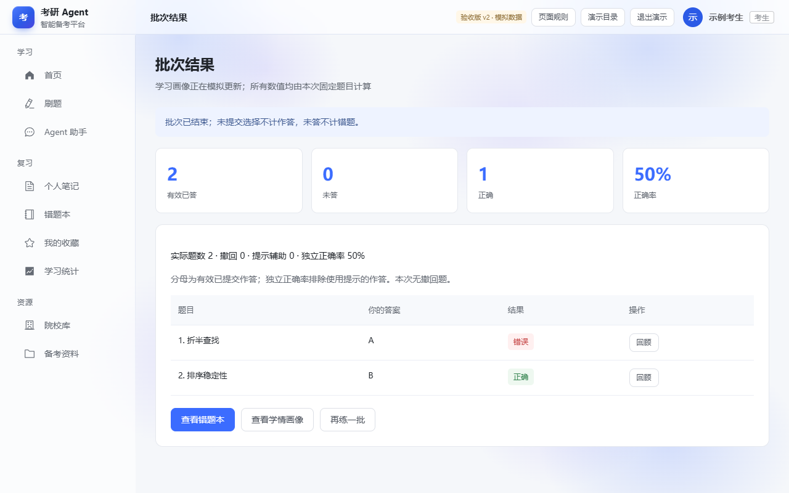
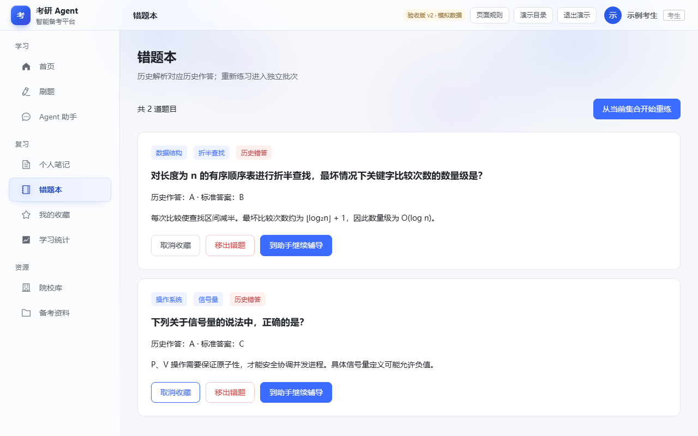
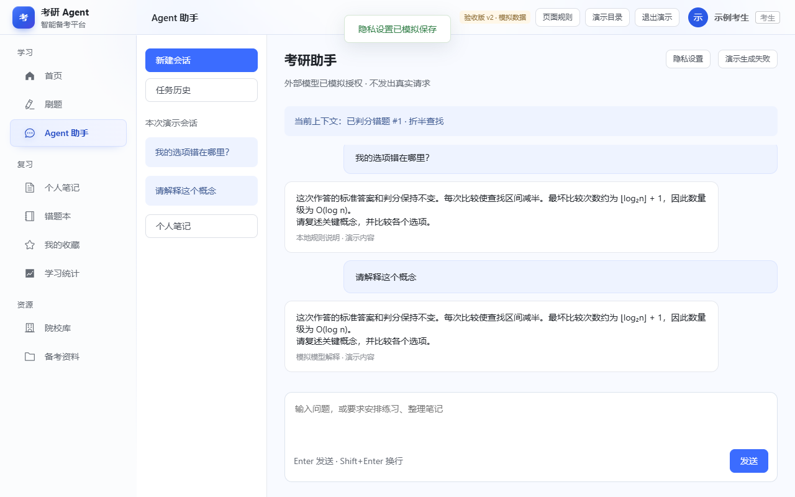
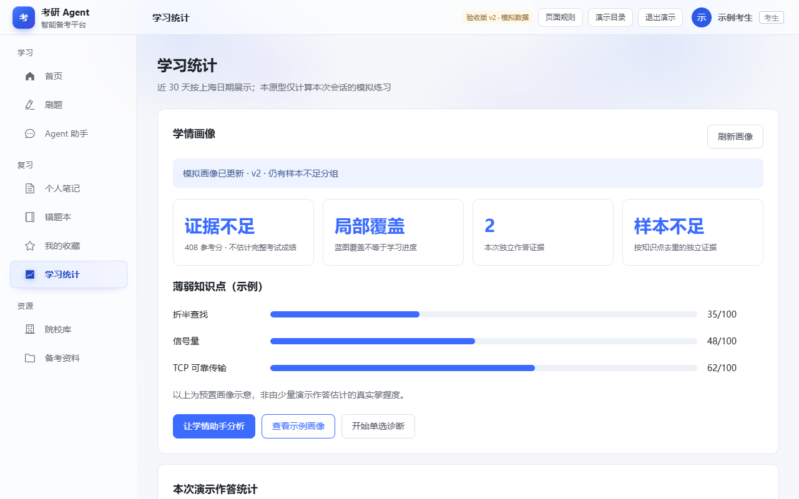

# T01 学习闭环与 Agent 交互重构

- 对应任务：[Issue #18](https://github.com/fzu-404-team/kaoyan-agent-platform/issues/18)。
- 业务核对基线：`94b8a9fbcba2ae7ad6a9895a9623a0572ca18bf4`。本地业务仓库较旧，核对时读取了该提交的前端与 Java 源码；没有把旧版本行为当作本轮基线。
- 负责人：当前认领人；姓名、学号由本人补充。
- 形式：可编辑 HTML 组件中的离线交互原型。HTML 快照是视觉底稿，已补脚本、页面状态与跳转；最终演示使用 `T01_T02_交互原型`。用户已确认删除墨刀中的原生分层初稿，本地交付文件也已清理。
- 所有业务记录、隐私开关和生成结果均为模拟，不访问后端、数据库或模型。状态只保留在当前 HTML 组件实例的内存中，刷新恢复初始状态。

## 页面与入口

入口为 `html/00_交互演示入口.html`；各独立 HTML 均内含完整导航，可在同一个组件内连续演示。独立打开不同入口不会共享演示记录。

| 编号 | 原快照 | 本轮入口 | 补齐的主要状态 |
| --- | --- | --- | --- |
| L01 | practice | L01_练习首页.html | 范围／科目／难度／题量、缺题实际数量、零候选、练习记录 |
| L02 | practice-session | L02_答题未判分.html | 选择、模拟保存、提交、提示辅助、提前结束 |
| L03 | practice-session-answered | L03_答题已判分.html | 固定判分、解析、锁定选择、错题辅导 |
| L04 | wrong | L04_错题本.html | 收藏／取消、移出确认、历史错答上下文 |
| L05 | favorite | L05_收藏.html | 收藏列表、无历史作答时隐藏答案、集合重练 |
| L06 | assistant | L06_Agent助手.html | 规则模式、模拟授权、生成、停止、失败重试、操作确认、笔记建议 |
| L07 | stat | L07_学习统计.html | 空画像、示例画像、样本不足、作答统计、补强入口 |
| L08 | 补充状态 | L08_单选诊断.html | 局部诊断、结束前隐藏判分、统一判分、无提示 |
| L09 | 补充状态 | L09_批次结果.html | 有效已答、未答、正确、辅助及独立正确率、回顾 |

## 演示一：练习 → 错题 → 辅导

1. 从演示目录进入“练习 → 错题 → 辅导”，保持“普通练习／数据结构／中等／5 题”。
2. 点击“开始刷题”。该科演示题库只有 2 题，批次显示实际 2 题。
3. 第一题选择 A，观察模拟草稿已保存；此时没有正确选项或完整解析。
4. 点击“提交本题”，展示回答错误、标准答案 B 和解析。
5. 点击“下一题”，第二题选择 B 并提交；批次自动结束，结果为已答 2、正确 1、正确率 50%。
6. 点击“查看错题本”，在折半查找题点击“到助手继续辅导”。
7. 输入“我的选项错在哪里？”并发送；未授权时展示本地规则说明，标准答案和判分不变。
8. 如需演示授权，打开“隐私设置”，勾选模拟外部模型及“错题”类别，再发起追问。这里只切换展示状态，不发生真实外发。

## 演示二：学情 → 分析 → 补强

1. 进入“学习统计”，先展示暂无画像和样本不足。
2. 点击“查看示例画像”，说明掌握指数为预置示意，不能由几次模拟作答推导出真实掌握度。
3. 点击“让学情助手分析”，携带学情上下文进入助手，出现生成中状态。
4. 结果附带“建议创建补强练习”卡片，点击“取消”不创建批次；重新提问可再生成建议。
5. 点击“开始练习”确认创建，再点击“进入已创建练习”。已创建卡片再次进入时使用同一模拟批次。
6. 完成或提前结束批次，再返回统计页查看本次作答统计。

## 关键规则与代码依据

- v2 顶栏“页面规则”提供当前页面说明；难度筛选无候选时不创建批次，进行中批次先结束才展示最终结果。
- 普通练习有效提交即时进入本次统计，首页与学习统计口径一致；生成中离开助手页面，迟到结果不会替换当前页面。
- 助手解释和补强建议匹配知识点／错题上下文，超出覆盖资料时明确说明。
- 普通练习提交本题后判分；诊断结束后统一判分。选择不等于提交，提前结束时未提交选择不计作答、未答不计错题。
- 提示仅用于普通练习，按概念／方向两级演示，使用后保留辅助标记；诊断不提供提示。
- 正确率分母为有效已答，独立正确率排除提示辅助；分母为零显示暂无数据。
- 错题解释以该次历史作答为上下文，不改变标准答案。新收藏且无历史作答的题目不展示答案与解析。
- 模型开关与相应私人记录类别均需模拟授权，才能显示相应模型解释模式；否则使用本地规则模式。
- 代码依据（均为上述提交）：`ManagedPracticeSession.vue`、`PracticeSessionEntry.vue`、`DiagnosticEntry.vue`、`WrongQuestionTutor.vue`、`ChatAssistant.vue`、`Statistics.vue`、`LearningProfilePanel.vue`、`ManagedPracticeService.java` 与 `ConversationService.java`。

## 实际验证与待核对

v2 已通过 27 项本地验收、13 项交互回归和 7 项匿名墨刀分享检查，详细对应课程要求见 [原型验收报告 v2](原型验收报告_v2.md)。本地截图和实际墨刀截图分别标明，完整报告包含对应来源。

尚未完成：T04／T05 业务走查与反馈确认、T13 正式走查。未运行真实后端、数据库、模型及学习效果评估。
