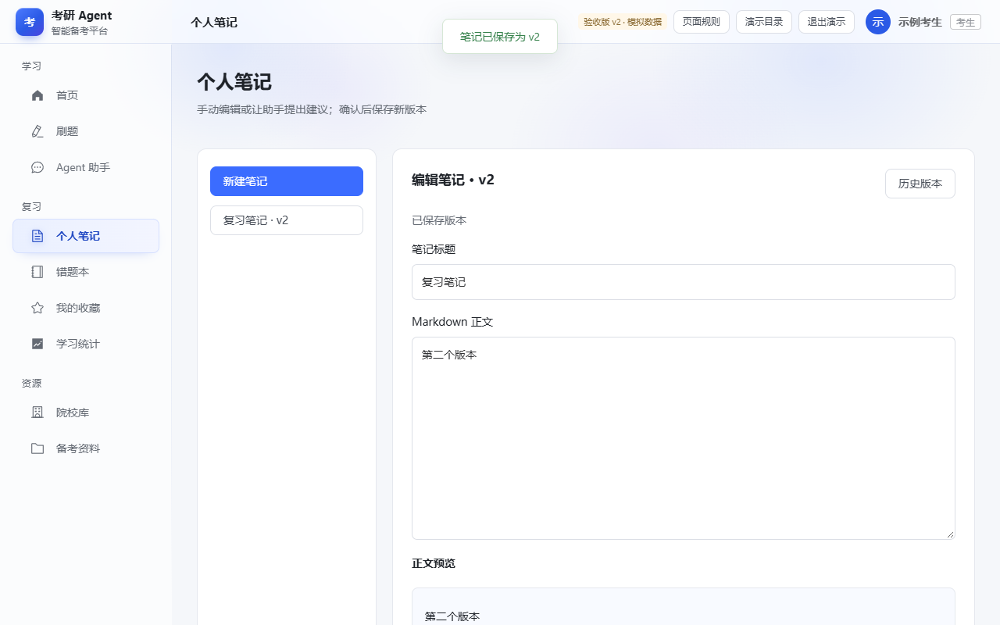
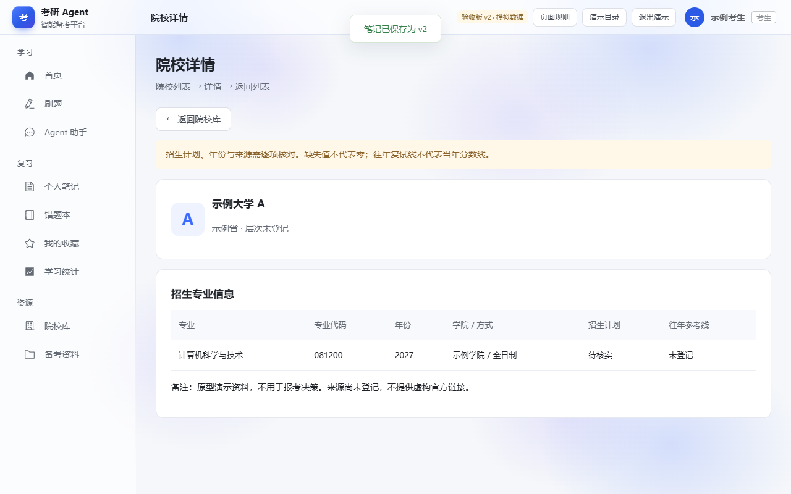
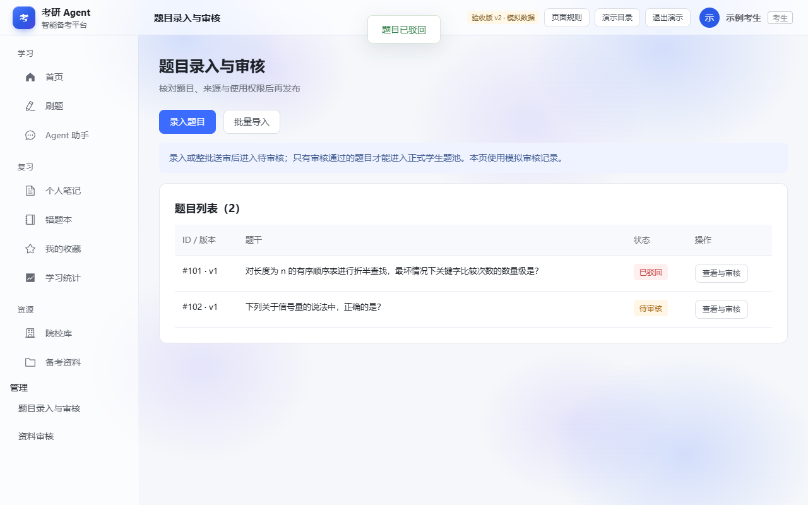
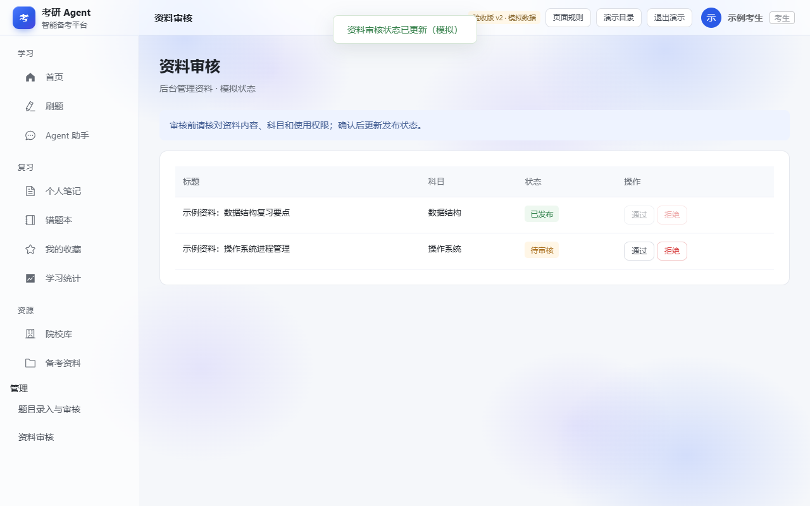

# T02 账号资源与后台原型集成

- 对应任务：[Issue #19](https://github.com/fzu-404-team/kaoyan-agent-platform/issues/19)。
- 业务核对基线：`94b8a9fbcba2ae7ad6a9895a9623a0572ca18bf4`。
- 负责人：当前认领人；姓名、学号由本人补充。
- 与 T01 共用一个交互稿和导航。14 个原 HTML 是静态快照底稿，脚本与展开状态为本轮补建；最终交付采用 `T01_T02_交互原型` 中的 HTML 组件。用户已确认删除墨刀中的原生分层初稿，本地交付文件也已清理。

## 页面覆盖

| 编号 | 入口文件 | 主要交互与边界 |
| --- | --- | --- |
| A01 | A01_登录.html | 必填检查、模拟登录、进入学生首页；不校验真实账号 |
| A02 | A02_注册.html | 用户名／密码／确认密码校验；模拟注册后学生身份进入首页 |
| A03 | A03_首页.html | 原快照外观、全局导航、练习／资源入口 |
| A04 | A04_个人中心.html | 备考档案、年份校验、模拟保存反馈 |
| A05 | A05_院校列表.html | 名称筛选、空结果、条件推荐演示、进入详情 |
| A06 | A06_备考资料.html | 科目筛选、阅读正文弹窗、来源缺失说明 |
| A07 | A07_个人笔记.html | 新建、编辑、正文预览、版本保存、只读历史、离开确认、冲突提示 |
| A08 | A08_院校详情.html | 院校／专业／年份／口径；缺失与待核实不填零 |
| M01 | M01_题目录入与审核.html | 单题录入、批量 JSON 预览、整批送审、审核通过或驳回 |
| M02 | M02_资料审核.html | 标题／科目／状态列表、通过、拒绝及反馈 |

所有入口在 `html/` 中。`00_交互演示入口.html` 是推荐总入口，避免切换独立组件时重置模拟记录。

## 统一样式与导航

- 主色 `#3B6CFF`，浅背景 `#F5F7FA`，白色卡片，正文 `#1F2329`，边框 `#E5E8EE`。
- 延续原快照的侧栏、顶栏、中文字体与圆角；新增页面沿用同一视觉风格。主要验证视口为 1280 × 800。
- 侧栏接通首页、练习、助手、笔记、错题、收藏、统计、院校和资料。顶栏提供演示目录、个人中心和退出演示。
- 管理菜单仅在预设管理员演示身份显示；这仅模拟角色行为，实际权限仍需正式后端验证。

## 演示步骤

### 账号与资源

1. 从目录打开登录，空表单点击登录观察提示；使用任意非空演示用户名和演示密码进入学生首页，不输入真实密码。
2. 注册页演示密码不一致提示；合法表单模拟注册并进入学生首页。
3. 个人中心修改考试年份和专业，点击保存查看反馈。
4. 院校列表搜索“示例大学 A”，点击卡片进入详情，再返回列表。
5. 详情中的人数和分数保留待核实／未登记，不伪造招生事实或官方来源。
6. 备考资料选择科目并筛选，点击阅读正文，查看后关闭弹窗。

### 笔记与助手建议

1. 新建笔记，填写标题与正文，观察同步正文预览。
2. 保存得到 v1，再次修改保存得到 v2；打开历史版本，检查 v1 只读内容仍在。
3. 修改后点击侧栏其他入口，出现未保存离开确认；选择继续编辑保留当前草稿。
4. “演示版本冲突”仅展示冲突处理状态，不模拟真实并发写入。
5. 在已保存笔记点击请求助手建议，生成后预览原文与建议，再确认保存为同一笔记的新版本；历史版本保留。建议期间版本变化时不覆盖，提示核对。也可直接在助手请求创建新的复习笔记。

### 题目与资料后台

1. 从目录点击“演示管理员流程”，进入预设管理员身份。
2. 单题录入检查题干、四个选项、答案、解析、来源定位及使用权限；保存后进入待审核。
3. 批量导入点击“填入自编题示例”，得到两道完整题目 JSON。
4. 点击校验预览：显示标准答案、解析和来源，但尚未加入审核列表。
5. 点击确认整批送审：两题全部处于待审核，不自动发布。预览后修改 JSON 必须重新预览。
6. 查看题目并尝试空意见驳回，观察必填提示；填写意见后驳回，可修改重新送审。也可审核通过。
7. 进入资料审核，分别通过或拒绝待审资料；二次确认后状态变化，取消保持原状态。真题录入需填写年份和题号，修订时保留来源类型及元数据。

## 维护与验收

- 源码：`source/build.py`、`source/prototype.js`、`source/prototype.css`；底稿随仓库存放于 `source/snapshots/`。构建只需 Python 3 标准库，不再依赖仓库外目录、BeautifulSoup4 或 tinycss2。
- 重建：在仓库根目录执行 `python -X utf8 docs/coursework-02/prototype/source/build.py`。
- 打包：执行 `python -X utf8 docs/coursework-02/prototype/source/package.py`；依赖、成品打开方式和目录说明见 [交付说明](README.md)。
- 浏览器验证：现有前端 Playwright 依赖和 Microsoft Edge 可用时，执行 `node docs/coursework-02/prototype/source/verify.cjs`。
- 浏览器实测报告：[validation.json](validation.json)。截图来自本地 HTML 渲染。
- v2 完整验收：27 项本地验收、13 项回归、7 项匿名墨刀分享检查通过，见 [原型验收报告 v2](原型验收报告_v2.md)。完整验收命令与交付包也在报告中。
- 编辑／展示链接与墨刀实测状态：[原型设计展示链接](原型设计展示链接.md)。

非成员分享访问已用全新隔离浏览器验证，结果见展示链接文档。未运行真实认证、数据库、上传、模型或公网业务服务。T13 走查与 T04／T05 业务核对仍待实际反馈。
