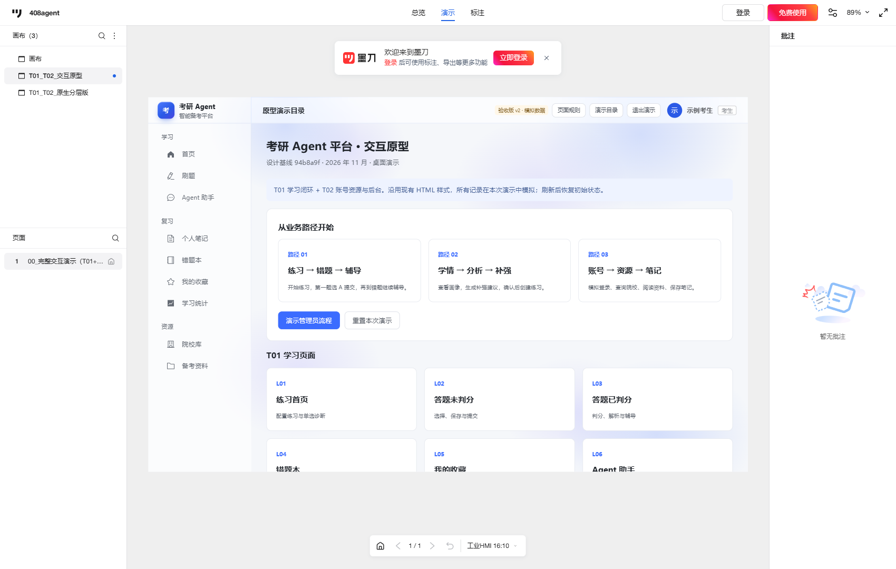
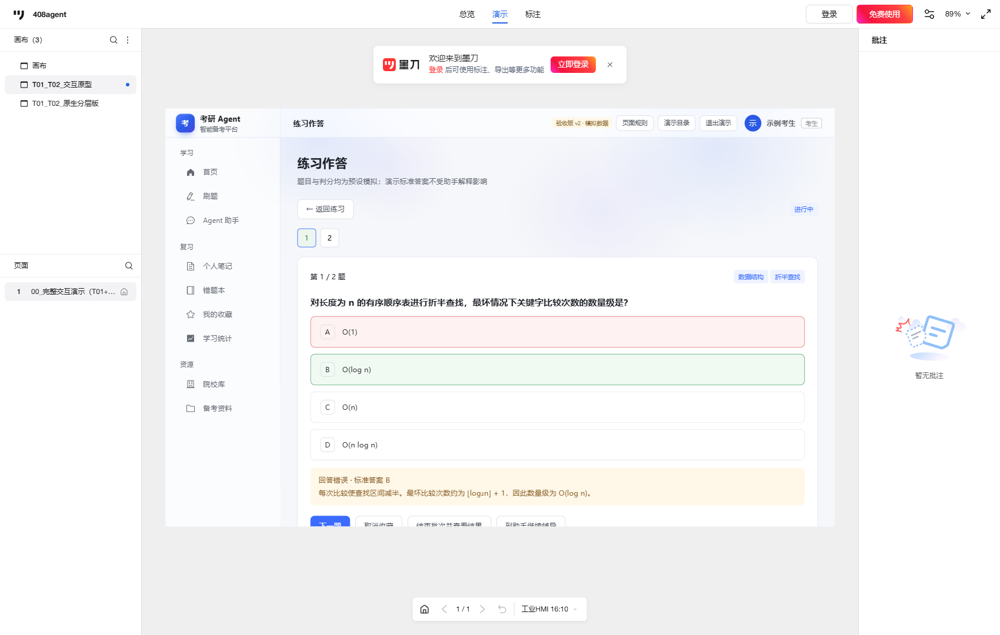

# 原型设计展示链接

## 墨刀入口

- 项目：408agent。
- 新画布：`T01_T02_交互原型`。
- 原生演示画板：`00_完整交互演示（T01+T02）`，尺寸 1280 × 800。
- 画板内当前 HTML 组件：`00_交互验收版_v2`（顶部标识“验收版 v2 · 模拟数据”）；旧 `00_交互演示入口` 隐藏保留。
- [打开墨刀编辑项目](https://modao.cc/proto/design/pb2mw352o5x9pclhs)。编辑能力取决于当前账号的项目权限。
- [打开交互演示（1280 × 800）](https://modao.cc/proto/1tGSwIfito0m4mcLTVKiI2/sharing?view_mode=device&screen=rbpVa4sEZCiOAvssl&canvasId=rcVa4sEZO8ScRh77&device=industrial_hmi_16_10&orientation=portrait)。URL 中的设备预设仅用于匹配 1280 × 800 尺寸，不改变产品业务。

原来的 `画布` 与导入快照保留。本轮在新画布增加一张原生画板，里面的 HTML 交互组件包含 17 个基础逻辑页面及目录、诊断、结果等状态。**这不是 20 张墨刀原生画板**；本地 `html/` 中另有 20 个可独立打开／导入的入口文件。

## 演示方式

1. 打开展示链接，确认左侧选中 `T01_T02_交互原型`。
2. 进入目录中的三条业务路径，或使用内嵌侧栏访问各功能。
3. 管理端从“演示管理员流程”进入预设管理员身份；无需真实账号和密码。
4. 从顶部“演示目录”回到目录。需要重新开始时，点击“重置本次演示”或刷新。
5. 单个 HTML 组件内的状态连续保留；独立打开另一份入口 HTML 会建立新的演示状态。

## 实际验证记录

验证日期：2026-11-05，北京时间。

| 验证项 | 实际结果 |
| --- | --- |
| 本地 20 个独立入口加载 | 通过，未出现脚本运行时异常 |
| 本地完整验收／交互回归 | 27 项验收及 13 项回归通过，见 [完整验收报告](原型验收报告_v2.md) |
| 本地外部网络请求 | 0；不连接业务 API、数据库或模型 |
| 墨刀客户端导入 | 总演示入口 HTML 导入成功，嵌入原生画板 |
| 客户端主路径一 | 已点击验证：开始练习 → 选择 A → 提交后显示错误与标准 B → 错题 → 带上下文辅导 → 本地规则解释 |
| 客户端主路径二 | 已点击验证：学习统计 → 助手分析 → 待确认补强卡片 → 确认创建 → 进入练习 |
| 当前分享权限 | 界面显示“所有人”；本轮没有修改访问权限 |
| 非成员访问 | v2 的 7 项实际分享检查通过。全新隔离 Edge 上下文，不载入账号或 Cookie，覆盖练习、上下文辅导、补强、笔记版本和后台审核 |
| 真实后端／数据库／模型 | 未运行，不属于本轮离线原型验收 |
| T04／T05／T13 人工走查 | 待真实反馈，不标记完成 |

当前非成员检查报告：[public-acceptance-validation.json](public-acceptance-validation.json)；完整五项要求对应表：[原型验收报告 v2](原型验收报告_v2.md)。`public-validation.json` 保留为上一版历史记录。

## 文件与维护

- [T01 学习闭环说明](T01_学习闭环.md)。
- [T02 账号资源与后台说明](T02_账号资源与后台.md)。
- [完整页面映射](page-map.json)。
- [本地总演示入口](html/00_交互演示入口.html)。
- [v2 交付 ZIP 备份](T01_T02_墨刀交互原型_v2.zip)。ZIP 包作为源文件与验收证据备份；实际已验证的导入方式为单独选择 [v2 总入口 HTML](release/00_交互验收版_v2.html)。

组件保留 HTML 动态交互，可通过墨刀提供的 HTML 编辑入口继续调整。2026-11-05 用户确认已删除 `T01_T02_原生分层版`；当前最终交付与演示使用 `T01_T02_交互原型`，本地原生底稿、生成脚本、过期转换说明及旧版 ZIP 已移除。历史验收截图可能仍显示清理前的画布条目。

构建底稿已随仓库提供，重建只需 Python 3 标准库，不再依赖仓库外原始导出目录。详见 [交付说明](README.md)。

所有招生信息、画像和助手输出均为模拟。笔记、判分、授权和审核状态只存于组件内存；刷新后恢复初始状态，不提供正式持久化或真实账号权限保证。
