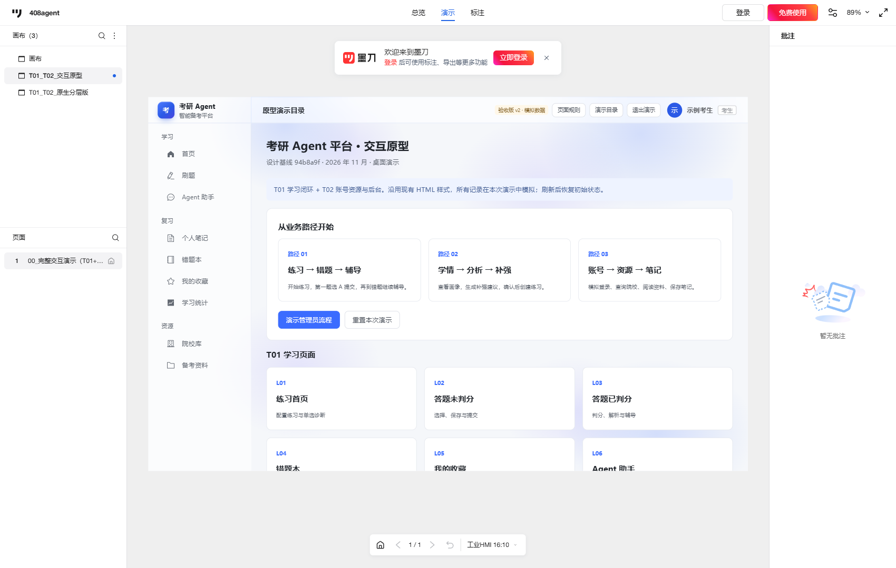
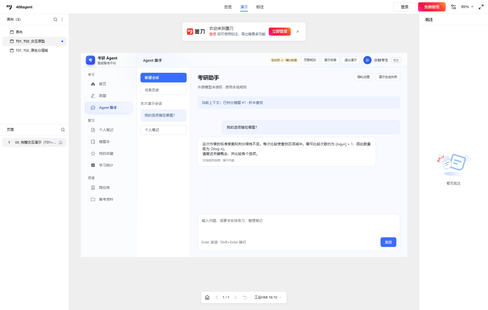
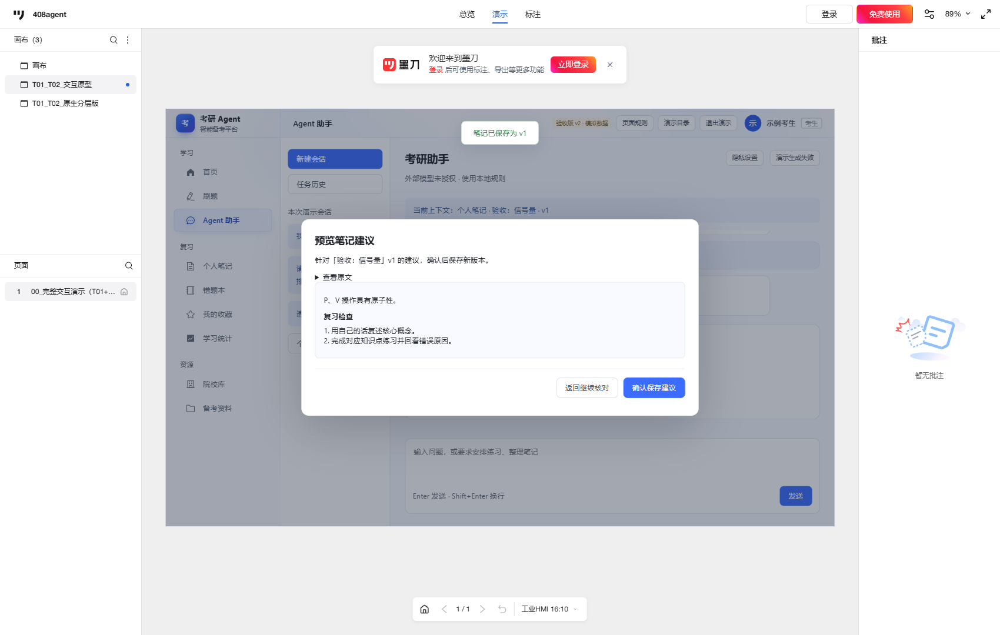
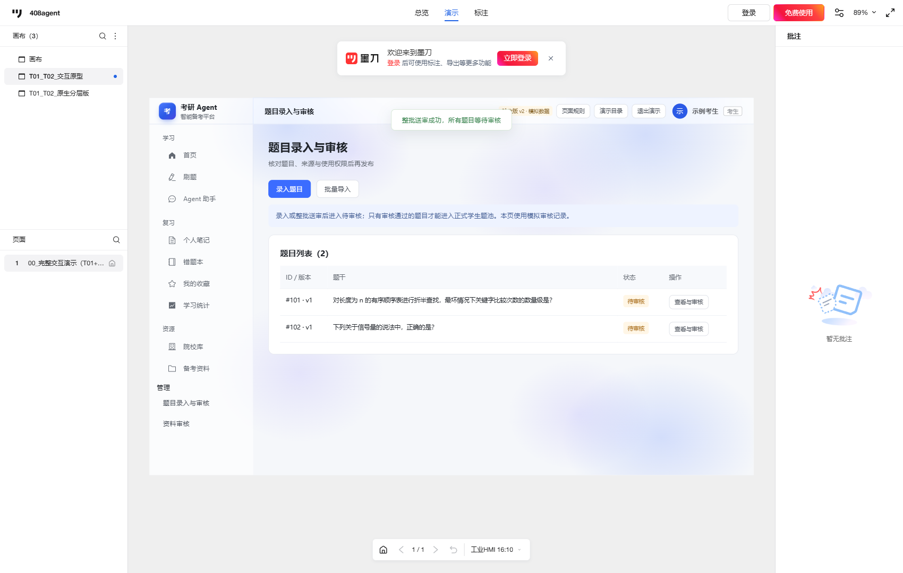
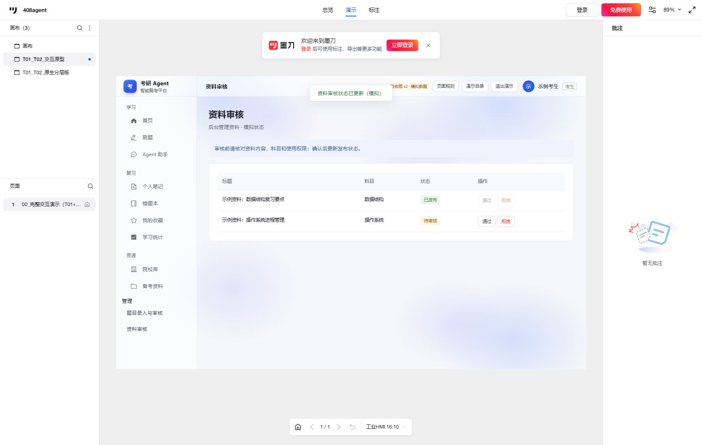

# T01／T02 原型验收报告 v2

验收日期：2026-11-05。版本：`2026-11-05-v2`。对象：墨刀项目 `408agent`，画布 `T01_T02_交互原型`，画板 `00_完整交互演示（T01+T02）`，1280 × 800。

**结论：当前可点击版通过本轮原型自验收，已覆盖题给五项要求的可演示内容。** 这是基于现有要求的自验收；课程最终评分及 T04／T05／T13 同学正式走查仍由相应人员确认。

[打开墨刀 v2 可点击演示](https://modao.cc/proto/1tGSwIfito0m4mcLTVKiI2/sharing?view_mode=device&screen=rbpVa4sEZCiOAvssl&canvasId=rcVa4sEZO8ScRh77&device=industrial_hmi_16_10&orientation=portrait)。顶部应显示“验收版 v2 · 模拟数据”。建议最大化浏览器；较小窗口使用墨刀缩放或全屏，页面内容在组件内部滚动。

## 五项要求对应验收

| 课程要求 | 已交付内容与证据 | 自验收结果 |
| --- | --- | --- |
| 1. 使用专用原型工具 | 已在墨刀内导入 v2 HTML 交互组件，放入 1280 × 800 原生演示画板；实际分享链接可匿名访问 | 通过 |
| 2. 用户端与必要后台 | 用户端包括账号、备考档案、练习、诊断、错题、收藏、统计、Agent、院校、资料与笔记；后台包括题目录入／批量送审／审核、资料审核。共 20 个独立 HTML 入口，墨刀总入口连续导航 | 通过 |
| 3. 必要交互、文本和规则 | 导航、表单校验、判分、空状态、生成中／停止／重试、预览与确认、未保存离开、版本冲突、审核意见、页面规则弹窗；T01／T02 文档给出步骤与业务边界 | 通过 |
| 4. UI 美观 | 统一蓝白配色、中文侧栏、卡片、状态标签与弹窗；检查全部 20 个入口的 1280 像素布局及主要页面 1440 像素布局；已检查长表单、建议预览和实际墨刀分享截图 | 通过本轮视觉走查；审美评分由教师判断 |
| 5. 领域 Agent 结合软件任务 | “练习 → 错题 → 带上下文辅导”、“学情 → 分析 → 确认补强练习”、“已保存笔记 → Agent 建议 → 预览确认 → 同一笔记新版本”；含模型／记录类别模拟授权 | 通过 |

课程提供的五条要求没有明确要求“所有页面均拆成墨刀原生控件”。当前通过验收并最终交付的是墨刀内 HTML 组件可点击版。2026-11-05 用户确认已删除 `T01_T02_原生分层版`，本地对应初稿文件也已清理，不列为交付成果。如果教师另有原生控件要求，应另行执行该要求。

## 本轮完善

- 修复难度筛选无效、进行中批次冒充最终结果、首页与统计计数不一致；诊断结束前隐藏判分，未提交选择不计答题。
- 修复 Agent 生成中离开页面后迟到结果覆盖页面；知识点解释与练习建议匹配上下文，超出资料范围明确说明。
- 选定笔记的建议先预览，确认后保存同一笔记新版本；保留历史，版本冲突不覆盖，未保存离开有提示。
- 补齐真题来源年份／题号校验与修订保留、资料审核二次确认、注册长度限制、规则说明与长表单布局。
- 更新现有墨刀演示入口为 `00_交互验收版_v2`，旧 `00_交互演示入口` 隐藏保留，分享地址继续有效。

## 执行结果与复现

| 检查 | 结果 | 记录 |
| --- | --- | --- |
| 本地完整原型验收 | 27／27 通过；无运行时异常；原型业务外部请求 0 | [acceptance-validation.json](acceptance-validation.json) |
| 原有交互回归 | 13／13 通过；无运行时异常 | [validation.json](validation.json) |
| 墨刀实际分享 | 7／7 通过；全新隔离 Edge 上下文，无账号／Cookie；明确核对 v2 标识 | [public-acceptance-validation.json](public-acceptance-validation.json) |

三套检查有覆盖重叠，不应相加宣传为 47 个独立用例。分享检查覆盖匿名目录、错题辅导、补强练习、笔记新版本、整批送审与审核、资料确认与取消、规则及目录返回；使用原型内控件完成关键操作，测试脚本通过原型导航函数切换部分页面。

复现命令（仓库根目录；构建只需 Python 3 标准库，浏览器测试另需前端 Playwright 和 Microsoft Edge）：

```powershell
python -X utf8 docs/coursework-02/prototype/source/build.py
node docs/coursework-02/prototype/source/acceptance.cjs
node docs/coursework-02/prototype/source/verify.cjs
node docs/coursework-02/prototype/source/verify-public-v2.cjs
```

重建后如修改 HTML，需要重新导入墨刀；本地构建不会自动更新线上组件。构建输入已收录于仓库内 `source/snapshots/`，不再依赖仓库外原始导出目录；交付整理前后已核对 20 个入口、导入文件与页面映射内容一致。备份见 [v2 交付包](T01_T02_墨刀交互原型_v2.zip)，重建与打包方式见 [交付说明](README.md)。

## 建议课堂演示顺序

1. 目录路径 01 → 开始刷题 → 第一题选 A → 提交显示标准 B → 错题本 → 到助手继续辅导 → 追问“我的选项错在哪里？”。
2. 学习统计 → 查看示例画像 → 让学情助手分析 → 确认开始练习 → 进入已创建练习。说明少量演示数据不估计完整 408 成绩。
3. 个人笔记 → 新建并保存 v1 → 请求助手建议 → 预览 → 确认保存 v2 → 回看历史版本。
4. 演示目录 → 演示管理员流程 → 批量导入 → 填入自编题示例 → 校验预览 → 确认整批送审 → 审核；再演示资料审核取消及确认。
5. 打开“页面规则”，说明提示辅助、诊断、授权、保存与审核规则。

## 验收证据

以下为实际墨刀分享页面截图，含外层墨刀界面。截图记录清理前的实际验收过程，可能仍显示后来已删除的原生分层画布，不表示当前仍保留。所有本地入口截图另见 [screenshots/acceptance](screenshots/acceptance)。







## 范围与待真实确认事项

所有账号、招生信息、记录和 Agent 输出均为模拟，当前组件刷新后恢复初始状态；本轮没有验收真实认证、数据库、上传、模型调用或正式服务部署。墨刀“所有人”分享权限沿用已有设置，本轮未修改访问权限。T04／T05 业务核对、T13 人工走查及教师最终认定未冒充完成。
