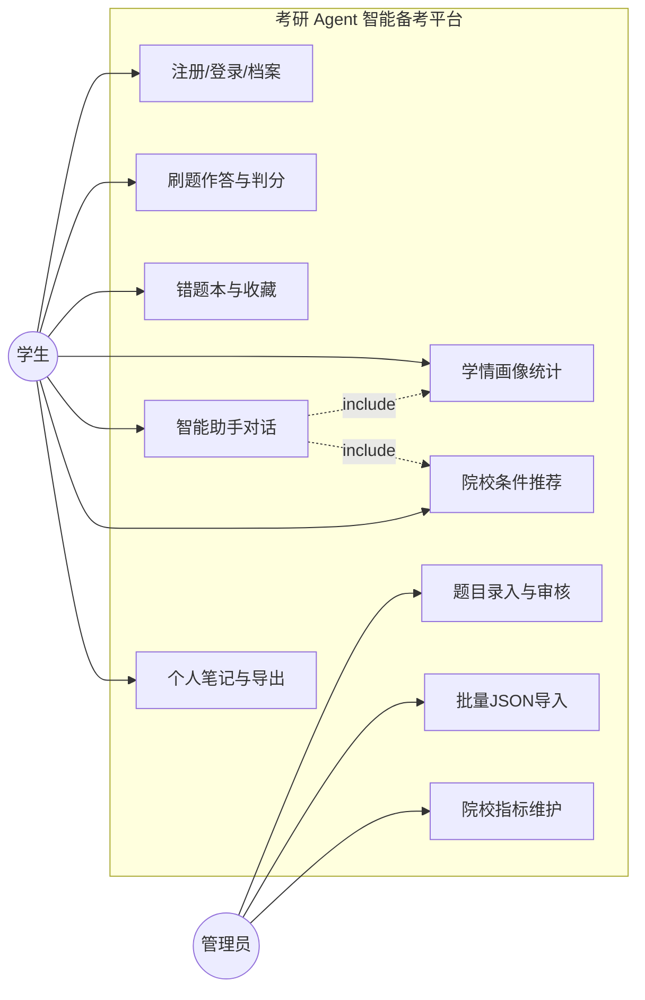
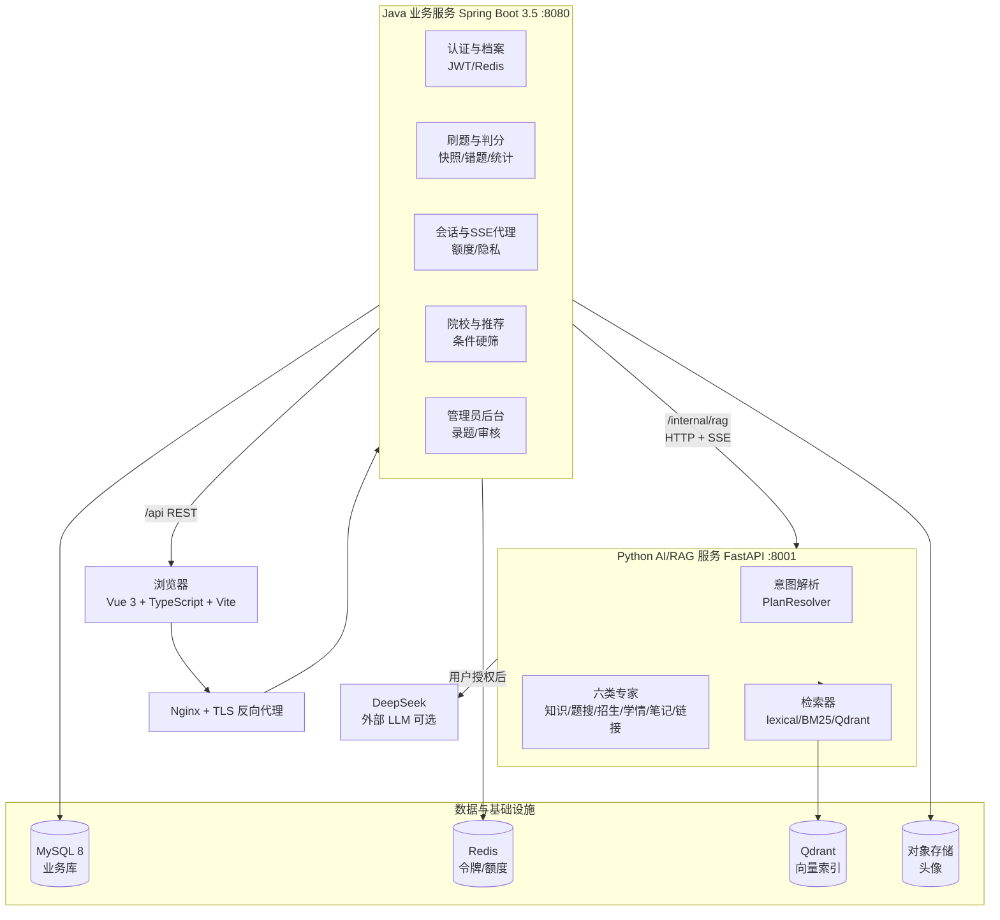
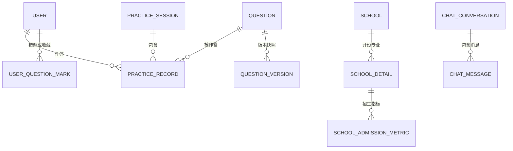
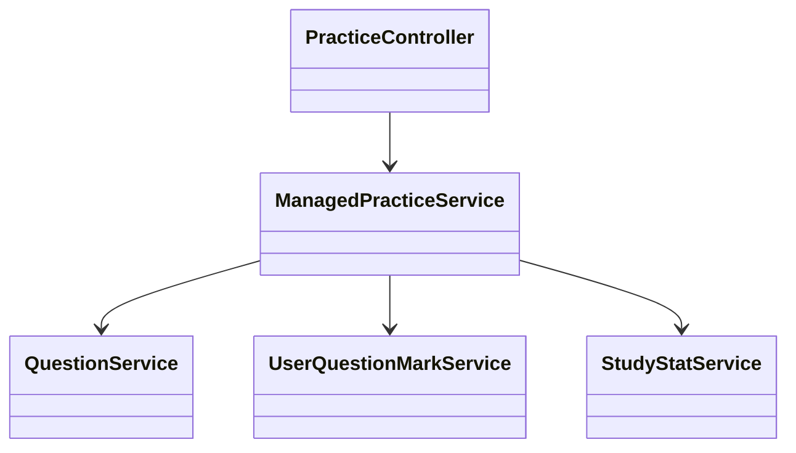
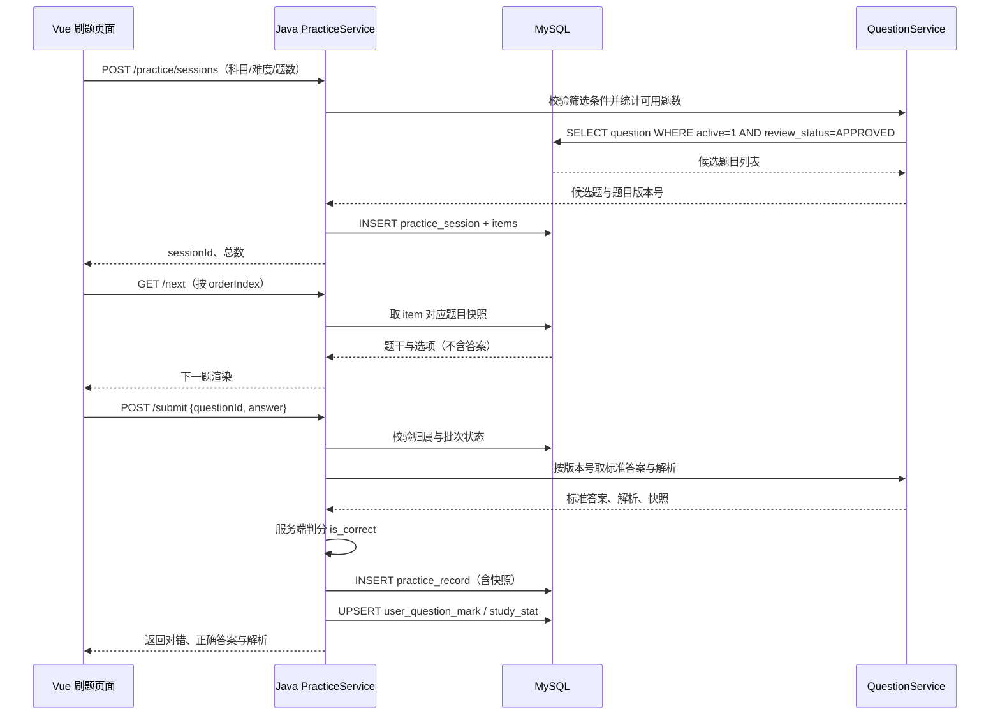
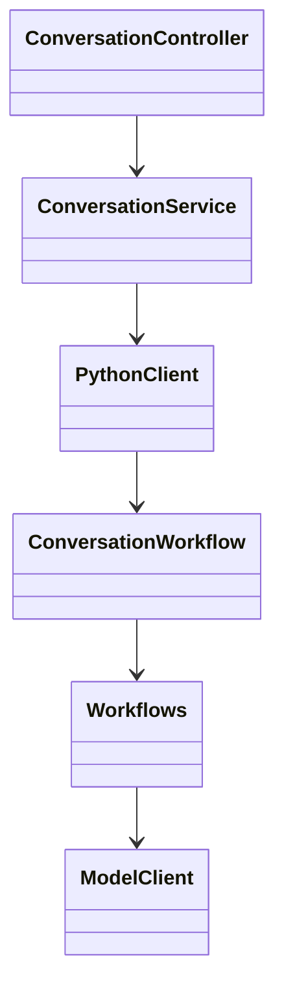
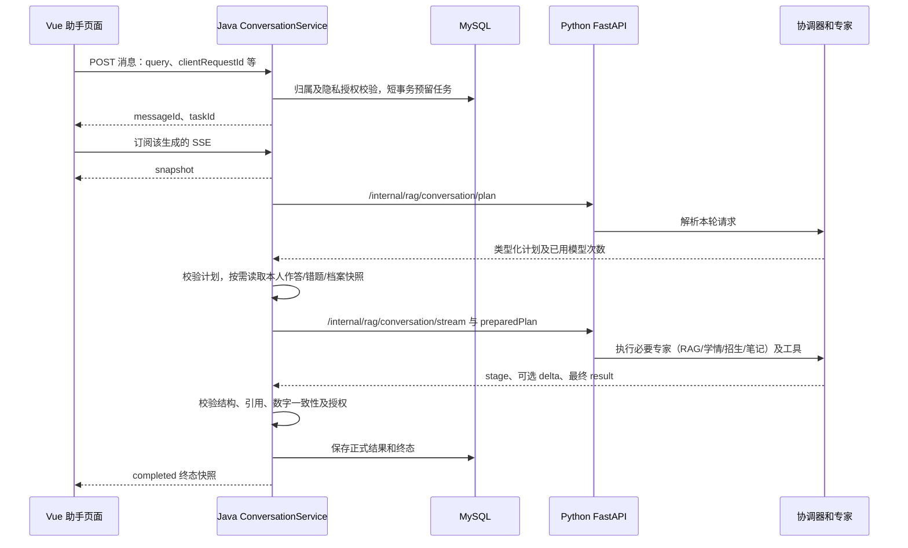
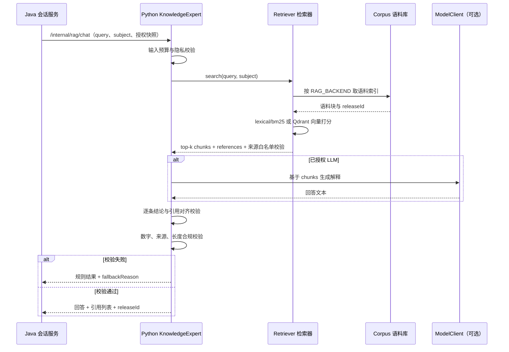
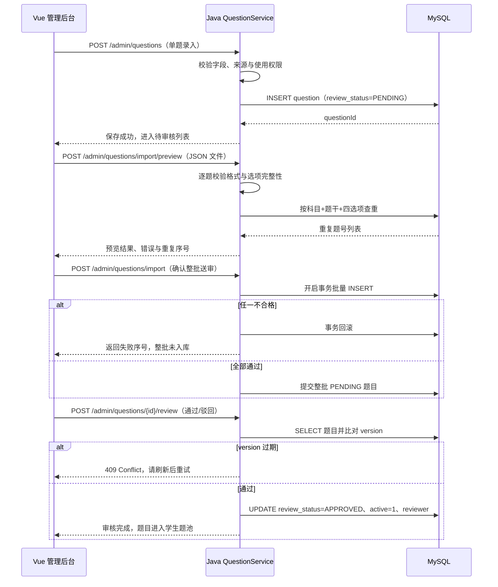

# 考研 Agent 智能备考平台 · 系统说明书

---

## 1 引言

### 1.1 项目背景

考研（尤其是计算机学科 408 统考）备考过程中存在三个长期痛点：

- **题库与学情割裂**：学生在多个刷题 App 上做题，但错题、收藏、知识点掌握程度没有统一沉淀，无法形成"画像 → 诊断 → 推荐练习"的闭环；
- **择校信息分散**：院校招生目录、统考科目、招生计划、复试线散落在 100+ 高校研究生院官网，学生手工比对成本极高；
- **AI 回答不可信**：通用大模型在专业课问题上经常"幻觉"，给出没有出处的解析，学生无法核对。

本项目据此构建一个面向计算机考研学生的全栈智能备考平台：以 Web 应用为入口，学生在平台内完成注册建档、408 四科刷题、错题/收藏管理、学情画像查看；系统内置 RAG 知识库对专业课问题给出带引用的回答，并通过多 Agent 协作完成"自然语言复合请求 → 意图解析 → 专家检索/计算 → 规则择优 → 可选 LLM 解释"的智能助手；管理员则在后台完成题库录入、审核、停用与院校指标维护。

### 1.2 术语与缩略语定义

| 术语/缩略语 | 含义 |
| --- | --- |
| Agent | 本项目中由 HelloAgents 框架驱动的智能体，承担意图解析与多专家编排 |
| RAG | Retrieval-Augmented Generation，检索增强生成：先检索本地语料，再让 LLM 基于引用回答 |
| BM25 | 经典词项检索算法，本系统默认的离线检索后端 |
| Qdrant | 开源向量数据库，用于中文 Embedding 语义检索 |
| FastEmbed / bge-small-zh-v1.5 | 本地中文 Embedding 模型，将题目/语料编码为 512 维向量 |
| MCP | Model Context Protocol，本项目用于把"知识检索""招生官网链接"封装为独立 stdio 子进程工具 |
| SSE | Server-Sent Events，本系统用于 `/tasks` 对话的流式输出 |
| JWT | JSON Web Token，登录态令牌；Redis 用于注销时的令牌撤销 |
| Snapshot | 题目版本快照，作答落库时把题干/选项/答案/解析整体 JSON 化，题目后续修订不影响历史判分 |
| 学情画像 | 由 Java 规则引擎按知识点错误率、样本量计算的结构化学习掌握度，存储于 `learning_profile` |
| HelloAgents | 项目锁定版本 `0.2.8` 的多智能体编排框架，提供对话协调器与六类专家 |

### 1.4 参考资料

1. GB/T 8567-2006《计算机软件文档编制规范》中《系统设计说明书》

---

## 2 部署与运行说明

### 2.1 软硬件环境配置

| 角色 | 最低配置 | 推荐配置 | 软件依赖 |
| --- | --- | --- | --- |
| 开发机（Windows 11） | 8 GB 内存 / 20 GB 磁盘 | 16 GB 内存 / SSD | JDK 17、Python 3.13、Node.js 22（含 npm）、Git |
| 业务数据库 | — | MySQL 8（InnoDB，utf8mb4） | 本机或云数据库 |
| 缓存/令牌撤销 | — | Redis 6+ | `REDIS_HOST`、`REDIS_PORT`、可选 `REDIS_PASSWORD` |
| Python AI/RAG 服务 | 2 核 4 GB（仅 LLM+词项检索） | 4 核 8 GB（含 Qdrant 向量检索） | FastAPI、uvicorn、hello-agents==0.2.8、openai==1.109.1、FastEmbed/Qdrant（可选） |
| 公网服务器（已部署） | Ubuntu 22.04 / 2 核 4 GB | Ubuntu 22.04 / 4 核 8 GB | 上述全部 + Nginx + TLS 证书 |

### 2.2 系统部署配置说明

**① 初始化环境（Windows PowerShell，项目根目录）**

```powershell
py -3.13 -m venv .venv
.\.venv\Scripts\python.exe -m pip install -r kaoyan-agent/requirements-dev.txt
.\.venv\Scripts\python.exe scripts\init-env.py   # 生成随机内部凭证与JWT密钥到 .env
```

在 `.env` 中手工填写 `DB_USER`、`DB_PASSWORD`、`REDIS_HOST/PORT`，可选填写 `LLM_API_KEY`、`LLM_BASE_URL`、`LLM_MODEL_MAIN`。

**② 启动前后端**

```powershell
# 终端 A：Python AI/RAG（8001）
cd kaoyan-agent
..\.venv\Scripts\python.exe -m uvicorn main:create_app --factory --host 127.0.0.1 --port 8001

# 终端 B：Java 业务服务（8080）
.\scripts\start-backend.ps1

# 终端 C：前端（5173）
cd kaoyan-frontend
npm ci; npm run dev
```

关键环境变量：

| 变量 | 默认 | 说明 |
| --- | --- | --- |
| `PORT` | 8080 | Java 端口；与前端 `API_PROXY_TARGET` 配套 |
| `RAG_BACKEND` | lexical | lexical / bm25 / qdrant / hybrid |
| `LLM_ENABLED` | false | 是否调用外部 LLM |
| `KAOYAN_LEARNING_ENABLED` | false | 学情诊断与自动推荐总开关 |

---

## 3 系统用例分析

### 3.1 系统参与者说明

| 参与者 | 描述 |
| --- | --- |
| 学生（Student） | 主要用户，注册/登录后维护个人档案、刷题、查看学情、与智能助手对话、导出笔记/报告 |
| 管理员（Admin） | 在后台录入/审核题目、批量导入题库、维护院校招生指标、查看平台运行状态 |
| Java 业务服务 | 系统内部参与者，面向前端提供 RESTful API，面向 Python 提供内部调用 |
| Python AI/RAG 服务 | 系统内部参与者，承担意图解析、RAG 检索、Qdrant 题目语义检索、SSE 流式编排 |
| 外部 LLM（DeepSeek） | 可选参与者，仅在用户授权后对已检索资料做概念解释 |

### 3.2 系统 UML 用例图（配图）



### 3.3 核心用例说明表

| 用例编号 | 用例名 | 主要参与者 | 前置条件 | 主流程 | 异常分支 |
| --- | --- | --- | --- | --- | --- |
| UC1 | 注册/登录 | 学生 | 注册开关开启 | 提交用户名/密码 → Java BCrypt 落库 → 签发 JWT → Redis 记录白名单 | 用户名冲突 409；注册开关关闭时直接拒绝 |
| UC3 | 刷题作答 | 学生 | 已有审核通过题目 | 创建批次 → 逐题抽取（隐藏答案）→ 提交选项 → Java 落库并判分 → 写快照 | 批次缺题返回实际数量；版本过期 409 |
| UC4 | 错题/收藏 | 学生 | 存在作答记录 | 作答判错自动入错题本；可收藏/移出错题 | 操作先预览确认；越权操作拒绝 |
| UC5 | 学情画像 | 学生 | 近 30 天有有效作答 | Java 按知识点聚合错误率 → 生成 8 个最高错误点 + 样本量 → 前端热力图渲染 | 样本不足时显示提示与独立样本口径 |
| UC6 | 智能助手对话 | 学生 | 已登录，可选 LLM 授权 | 输入自然语言 → Java 转发 Python → Python 输出 plan → SSE 流式返回各阶段结果 → 最后给出可保存动作 | 任一专家失败保留规则结果并附 `fallbackReason` |
| UC8 | 院校条件推荐 | 学生 | 已填档案（学硕/专硕、专业） | Java 按省份/专业代码/学位/年份硬筛 → 规则打分 → 最多 5 个候选，不估录取概率 | 无候选时返回空集并提示缺口 |
| UC12 | 题目审核 | 管理员 | 账号 role=ADMIN | 待审核列表 → 查看详情与来源 → 通过/驳回/停用 | 版本过期返回 409 |
| UC13 | 批量导入 | 管理员 | 1—50 题 JSON 文件 ≤2 MiB | 校验预览 → 逐题查重 → 整批送审 → 失败回滚 | 任一不合格整批不入库 |

---

## 4 总体设计

### 4.1 系统运行环境

浏览器通过 HTTPS 访问 Nginx，Nginx 反代到：

- **前端静态资源**：`kaoyan-frontend` `npm run build` 产物（Vite + Vue 3 + TypeScript）；
- **Java 业务服务**：Spring Boot 3.5（端口 8080），直接读写 MySQL 与 Redis；
- **Python AI/RAG 服务**：FastAPI（端口 8001），**不直连业务数据库**，只接受 Java 传入的已判分、带快照的用户上下文；
- **外部依赖**：DeepSeek API、Qdrant/本地 Embedding、OSS。

### 4.2 系统分层架构设计（架构图 + 文字说明）



**分层说明：**

1. **表现层**：Vue 3 + TypeScript + Vite，使用 Element 风格组件；所有 `/api` 请求经 Vite 代理或 Nginx 转发到 Java；
2. **业务层（Java）**：唯一直接访问 MySQL 的进程，负责鉴权、判分、版本快照、事务、额度、导出文件确定性生成；不直接组织 LLM Prompt；
3. **AI 编排层（Python）**：不连接业务库，所有用户上下文由 Java 以"已授权快照"形式传入；负责意图解析、专家调度、检索、SSE 流式输出；
4. **基础设施层**：MySQL 持久化、Redis 做令牌撤销与任务额度、Qdrant 做中文向量、OSS 存私有头像。

### 4.3 系统功能模块划分

| 模块 | 所属进程 | 职责 |
| --- | --- | --- |
| 认证与档案 | Java | 注册/登录/JWT/Redis 注销、个人档案（含学硕/专硕字段）、OSS 头像 |
| 题库与刷题 | Java | 题目 CRUD、审核流、批次抽题、服务端判分、题目版本快照 |
| 错题与收藏 | Java | 错题本、收藏、错题/收藏练习批次 |
| 学情与画像 | Java + Python | 规则知识点错误率聚合、诊断批次、自动推荐设置 |
| 智能助手 | Python + Java 代理 | 自然语言复合意图、多专家编排、SSE 流式、隐私授权 |
| RAG 知识检索 | Python | 语料加载、BM25/Qdrant、引用来源策略、MCP 子进程 |
| 题目语义检索 | Python | 本地 Qdrant 题目索引，按主题找错题/收藏/全库题 |
| 院校库与推荐 | Java | 院校/专业/招生计划/参考线、条件推荐、招生官网链接 |
| 个人笔记 | Java | Markdown 笔记、版本历史、AI 改笔记预览 |
| 文件导出 | Java | Word/PDF/Markdown 导出，确定性生成，不调用模型 |
| 管理员后台 | Java | 录题、批量导入、审核、启停、指标维护 |

### 4.4 模块之间调用与数据流向

以学生在 `/tasks` 输入"分析我薄弱点，安排 7 天复习并推荐院校"为例：

1. 浏览器 → `POST /api/conversations/{id}/messages`（带 JWT）；
2. Java `ConversationController` 校验登录态、隐私授权、额度，把"本人已判分有效作答 + 错题 + 收藏 + 档案"组装为 `ConversationRequest`；
3. Java → `POST /internal/rag/conversation/plan`（Python），得到结构化 plan（专家列表、条件补丁、预计模型调用次数）；
4. Java → `POST /internal/rag/conversation/stream`（SSE），Python 内部依次调度：知识专家（RAG）、学情专家（读 Java 已传入的统计）、招生专家（返回院校候选）、笔记专家（预览生成待确认笔记）；
5. SSE 事件经 Java 透传给前端；
6. 结果落库到 `chat_message`、`chat_generation`、`assistant_action`；学生在前端确认后，Java 执行对应的"创建练习/保存笔记/收藏院校"等写操作，所有写操作仍由 Java 完成。

---

## 5 接口设计

### 5.1 外部接口设计

#### 5.1.1 前后端交互接口（Java REST，前缀 `/api`）

统一响应包络：`{ code, message, data }`；错误通过 HTTP 状态码 + 业务 `code` 表达。

| 方法 | 路径 | 说明 |
| --- | --- | --- |
| POST | `/api/auth/register` | 注册（受 `REGISTRATION_ENABLED` 控制） |
| POST | `/api/auth/login` | 登录，返回 JWT |
| POST | `/api/auth/logout` | 注销，令牌入 Redis 黑名单 |
| GET | `/api/auth/config` | 匿名接口，仅返回注册开关 |
| GET/PUT | `/api/users/me` | 读取/更新个人档案（含学位类型） |
| POST | `/api/users/avatar` / GET `/api/users/avatar/content` | OSS 头像上传与读取 |
| POST | `/api/practice/sessions` | 创建刷题批次 |
| GET | `/api/practice/sessions/{id}/next` | 取下一题（隐藏答案） |
| POST | `/api/practice/sessions/{id}/items/{qid}/submit` | 提交答案、Java 判分、落快照 |
| GET | `/api/practice/sessions/{id}/review` | 回顾本批次 |
| POST | `/api/questions/{id}/favorite` / `/wrong` | 收藏 / 移出错题 |
| GET | `/api/stats/overview` | 近 30 天 KPI、知识点热力图 |
| GET | `/api/schools?province=&majorCode=&degreeType=` | 院校下拉筛选 |
| GET | `/api/schools/{id}/details` | 院校详情（招生计划/参考线） |
| POST | `/api/recommend/conditions` | 保存自动推荐条件并触发规则推荐 |
| GET | `/api/conversations` / POST `/api/conversations` | 会话列表 / 新建会话 |
| POST | `/api/conversations/{id}/messages` | 发送消息（内部代理 Python SSE） |
| GET | `/api/notes` / POST `/api/notes` / PUT `/api/notes/{id}` | 个人 Markdown 笔记 |
| GET | `/api/exports/{kind}` | 导出 Word/PDF/MD（Redis 存 15 分钟预览） |
| POST | `/api/admin/questions` / PUT `/api/admin/questions/{id}/review` | 管理员录题、审核 |
| POST | `/api/admin/questions/import` | 批量 JSON 导入（1—50 题） |
| POST | `/api/admin/school-metrics` | 维护院校招生指标（V14） |

#### 5.1.2 数据库交互接口

Java 通过 **MyBatis-Plus** 访问 MySQL；所有迁移由 `kaoyan-B/src/main/resources/db/V*.sql` 显式执行，未启用自动迁移。Redis 通过 Spring Data Redis 访问，key 命名：

- `jwt:revoke:{jti}` — 注销令牌；
- `quota:{username}:{yyyyMMdd}` — 每日任务额度；
- `export:preview:{token}` — 导出预览（15 分钟过期）。

#### 5.1.3 AI 大模型与向量库外部接口

| 外部依赖 | 调用方式 | 关键配置 |
| --- | --- | --- |
| DeepSeek | OpenAI 兼容 SDK（`openai==1.109.1`） | `LLM_BASE_URL=https://api.deepseek.com`，模型 `deepseek-flash` |
| Qdrant | 本地嵌入模式（FastEmbed）或服务端 `QDRANT_URL` | 集合与语料/模型绑定，不可变 |
| bge-small-zh-v1.5 | FastEmbed 本地推理，512 维 | 权重缓存于 `kaoyan-agent/.cache/embedding`，服务进程只读 |
| OSS | S3 兼容 SDK | `OSS_KEY_PREFIX=prod/` 隔离线上与本机 |

### 5.2 内部接口设计

#### 5.2.1 Java 业务服务与 FastAPI AI 服务通信接口

所有内部接口要求请求头 `X-Internal-Key: <AGENT_INTERNAL_KEY>`，两端用 `secrets.compare_digest` 比对。

| 方法 | 路径 | 超时 | 说明 |
| --- | --- | --- | --- |
| GET | `/health` | — | 健康检查：releaseId、retrievalBackend、modelEnabled、MCP 状态 |
| POST | `/internal/rag/conversation/plan` | 解析 10s + 兜底 | 输入 `ConversationRequest`，输出 plan（专家列表、条件补丁、模型调用次数） |
| POST | `/internal/rag/chat` | 42s（Java 总保护 48s，浏览器 55s） | 旧式单次任务，返回 `ChatResponse` |
| POST | `/internal/rag/conversation/stream` | 42s | SSE 流式编排，主入口 |
| POST | `/internal/rag/questions/index` | — | Java 把已发布题目副本推给 Python 建索引 |
| GET | `/internal/rag/questions/index/{release_id}` | — | 索引准备状态 |
| POST | `/internal/rag/questions/search` | 12s | 主题语义检索题目 |

请求预算（每次 HTTP 由中间件分配）：模型调用 ≤ 2 次、专家阶段 3 次 / 28s、检索 ≤ 3 次、招生链接 ≤ 1 次；单步 `CONVERSATION_STEP_TIMEOUT=12s`。

#### 5.2.2 SSE 流式输出接口规范

`/internal/rag/conversation/stream` 返回 `text/event-stream`，每帧 `data: {json}\n\n`，事件类型：

| 事件 type | 载荷 | 含义 |
| --- | --- | --- |
| `stage` | `{stage: "正在理解问题与检索资料"}` | 阶段提示 |
| `expert` | `{expert, status, summary, references?}` | 单个专家阶段结果 |
| `action` | `{kind, preview, confirmed?}` | 待学生确认的写操作（建练习、存笔记等） |
| `result` | `{response: ChatResponse}` | 最终结果 |
| `error` | `{message, fallbackReason?}` | 失败或降级（`fallbackReason` 含超时/服务不可用/次数用尽/输入过长/输出格式不符/引用未对齐/数字不一致） |

Java 透传 SSE，浏览器用 `EventSource` 或 `fetch + ReadableStream` 消费；关闭、退出或切换账号会取消前端请求。

---

## 6 数据结构设计

### 6.1 数据库设计原则

1. **业务库与 AI 库物理隔离**：MySQL 只存业务数据，向量/Embedding 索引存放在 `kaoyan-agent/.cache/`，不进 MySQL；
2. **不可变快照**：作答落库时把题目 JSON 化（V7 的 `question_snapshot`、V13 的 `question_version`），题目后续修订不影响历史判分；
3. **软删除**：任务通过 `deleted_at` 隐藏（V8），不物理删除；
4. **版本与乐观锁**：题目、学习画像、推荐设置均带 `revision/version`，过期请求返回 409；
5. **隐私默认关闭**：V12 的 `assistant_privacy.model_allowed` 默认 `FALSE`，外发用户数据必须逐类别授权。

### 6.2 系统 ER 图（配图）



---

## 7 模块详细设计

### 7.1 用户注册登录模块

#### 7.1.1 功能描述

学生注册、登录、注销；管理员登录后进入 `/admin/*`；登录态使用 JWT，注销时把 jti 写入 Redis 黑名单；注册开关关闭时前端隐藏注册入口、后端拒绝注册请求；个人档案支持学硕/专硕（V15）、目标院校、考试年份、考生背景；头像走私有 OSS，通过 Java 鉴权接口读取，不暴露公开 Bucket。

#### 7.1.2 接口设计

- `POST /api/auth/register {username, password}` → `{userId, token}`
- `POST /api/auth/login {username, password}` → `{token, user}`
- `POST /api/auth/logout` → 204
- `GET /api/users/me` / `PUT /api/users/me`
- `POST /api/users/avatar`（multipart，≤5MB，按扩展名校验）

#### 7.1.3 相关类说明

| 类 | 职责 |
| --- | --- |
| `AuthController` | 登录/注册/注销 HTTP 入口 |
| `UserService` + `UserMapper` | 用户 CRUD、BCrypt 加密 |
| `JwtService` | 签发/校验 JWT，与 Redis 黑名单交互 |
| `FileController` / OSS 客户端 | 头像上传与私有读取 |

### 7.2 刷题作答模块

#### 7.2.1 功能描述

学生创建练习批次（普通练习、错题练习、收藏练习、自然语言组题、诊断批次）；系统从已审核且启用的题目中按规则抽题；前端逐题展示并隐藏答案；提交后由 Java 服务端判分，落 `practice_record` 并写入题目快照；错题自动进入 `user_question_mark.is_wrong=1`。

#### 7.2.2 接口设计

- `POST /api/practice/sessions {kind, filters?, questionIds?}` → `{sessionId, total}`
- `GET /api/practice/sessions/{id}/next` → `{questionId, content, options, orderIndex}`（不含 answer）
- `POST /api/practice/sessions/{id}/items/{qid}/submit {answer}` → `{isCorrect, correctAnswer?, analysis?}`
- `POST /api/practice/sessions/{id}/finish` → 触发学情画像重算

#### 7.2.3 类图说明



#### 7.2.4 业务时序图（配图）



### 7.3 学情画像与 Agent 诊断模块

#### 7.3.1 功能描述

学生每完成一个批次，Java 按"近 30 天有效作答"按知识点聚合错误率，取错误率最高的 8 个知识点，其余汇总为一句；数据落 `learning_profile`（带 revision），历史版本进 `learning_profile_history`；样本不足时明确展示"独立样本数"口径，不做过度推断。诊断批次（`kind=DIAGNOSE`）结束后可触发规则版自动推荐，把"薄弱知识点 → 推荐练习题 → 推荐院校条件"推给学生。

#### 7.3.2 接口设计

- `GET /api/stats/overview` → KPI、知识点热力图、证据散点、补强排行
- `POST /api/recommend/conditions {enabled, preferences}` → 保存开关并触发规则推荐
- `GET /api/learning/profile` → 当前画像
- `POST /api/practice/sessions {kind: "DIAGNOSE"}` → 创建诊断批次

#### 7.3.3 核心类图




#### 7.3.4 Agent 诊断业务时序图



### 7.4 RAG 知识库检索模块

#### 7.4.1 功能描述

平台内置四科公开备考资料（语料位于 `kaoyan-agent/knowledge/`）。默认 `lexical` 词项检索；启用 `qdrant` 后用 `bge-small-zh-v1.5` 把语料编码为向量并持久化到本地 Qdrant。每条回答必须带引用来源（来自 `config/reference-hosts.json` 的白名单域名），结论与引用逐条对齐，任一未通过则整段降级为"规则结果 + fallbackReason"。知识检索可选通过 MCP stdio 子进程隔离。

#### 7.4.2 接口设计

- Python 内部：`KnowledgeExpert.query(query, subject?)` → `{chunks, references[]}`
- 健康检查：`GET /health` 返回 `retrievalBackend`、`mcpTools.knowledge.state`
- 索引构建：`python kaoyan-agent/ingest.py`（一次性，离线）

#### 7.4.3 类与调用关系说明

| 类 | 职责 |
| --- | --- |
| `Corpus` | 加载语料、校验来源白名单、提供 release_id |
| `Retriever` | 按 `RAG_BACKEND` 分发 lexical/bm25/qdrant/hybrid |
| `McpKnowledgeClient` / `McpKnowledgeSearchTool` | 以 stdio MCP 协议调用独立子进程 |
| `ModelClient` | 可选 LLM 调用，受配额与超时控制 |

#### 7.4.4 RAG 知识问答时序图（配图）



### 7.5 院校智能推荐模块

#### 7.5.1 功能描述

学生在个人档案填写报考年、目标专业代码、学硕/专硕；Java 按省份、专业代码、学位类型、学习方式、考试科目做硬筛，按规则（层次、匹配度）打分，最多返回 5 个候选；**不估计录取概率**。院校详情页直读 `school_detail` 与 V14 的 `school_admission_metric`，不调用 LLM；明确请求"查官网"时走招生官网链接 MCP，返回登记的入口 URL。

#### 7.5.2 接口设计

- `GET /api/schools?province=&majorCode=&degreeType=` → 下拉选项
- `GET /api/schools/{id}/details` → 详情（15s 超时，失败可重试）
- `POST /api/recommend/conditions` → 保存条件并返回候选

#### 7.5.3 类逻辑说明

`SchoolCatalogService` 负责院校/专业硬筛；`SchoolDetailService` 负责详情聚合（含 V14 指标、状态标签、来源链接）；`RecommendService` 负责规则打分与快照落库到 `recommend_record`；Python 侧 `AdmissionExpert` 只读 Java 传入的候选做可选解释，`AdmissionLinksTool` 封装 MCP 返回官网链接。

### 7.6 管理员后台维护模块

#### 7.6.1 功能描述

管理员登录后可：① 录入单选题、登记来源与使用权限、真题必须填年份和原题号；② 待审核列表逐题通过/驳回；③ 对已审核题目停用/重新启用（保留历史作答）；④ 批量 JSON 导入 1—50 题（≤2 MiB，UTF-8）；⑤ 维护 V14 院校招生指标（招生计划/参考线，带来源 SHA256 与状态标签）。

#### 7.6.2 接口设计

- `POST /api/admin/questions` / `PUT /api/admin/questions/{id}` / `POST /api/admin/questions/{id}/review`
- `POST /api/admin/questions/import/preview` / `POST /api/admin/questions/import`
- `POST /api/admin/school-metrics`

#### 7.6.3 数据维护逻辑说明

所有写操作校验 `version`，过期返回 409；批量导入整批事务化，任一不合格整批回滚；查重按"科目+题干+四选项"完整匹配；题目停用不物理删除，历史快照仍可在回顾页展示；V14 指标按 `(school_detail_id, metric_type)` 主键 upsert，状态机约束在 CHECK 中（`OFFICIAL/UNVERIFIED` 必须有数值，其余必须为 NULL）。

#### 7.6.4 题目审核与时序图（配图）



---

## 8 出错处理设计

### 8.1 通用业务异常处理机制

Java 侧由 `@RestControllerAdvice` 统一捕获：参数校验失败 422、未登录 401、越权 403、资源不存在 404、版本冲突 409、限流 429、内部错误 500；响应体统一 `{code, message, traceId}`。Python 侧 FastAPI 自带 422 处理器，把字段错误翻译为中文"请求字段不符合契约"。

### 8.2 AI 服务超时、检索失败降级策略

- 阶段超时（解析 10s、专家 28s、汇总 4s、总 42s）：保留已完成专家的规则结果，未完成阶段标记 `TIMEOUT`；
- LLM 未授权/调用失败/输入超长/输出格式不符/引用未对齐/数字不一致：返回规则结果并附 `fallbackReason`，前端在提示后展示原因；
- MCP 子进程启动失败：只禁用对应工具（知识或招生链接），不阻塞 Agent 启动；`/health` 中以 `UNAVAILABLE + errorCode` 暴露；
- Qdrant 权重缺失：向量检索不可用，混合模式自动回退 BM25；
- 题目语义索引未就绪：返回"索引准备中"，不生成操作。

### 8.3 用户非法输入容错处理

- 题目导入：整批预览 → 逐题校验（答案必须在 A—D、选项非空、来源必填），失败保留输入并标出错题序号；
- 自然语言输入：超长按 token 预算确定性裁剪，整篇笔记/错题超限时零模型请求直接降级；
- 院校查询：年份依次采用本轮指定 → 个人档案报考年 → 库内最新年；目标年无数据时明确说明缺口，不替换年份；
- 越权：所有 `/api/**` 校验 JWT 与资源归属（错题、收藏、笔记、会话），跨账号访问直接 404/403。

### 8.4 日志与错误编码规范

- Java：SLF4J + MDC 写入 `traceId, userId, taskId`；Python：`log.warning("task=%s failure=%s", ...)`，不记录查询正文与令牌；
- `fallbackReason` 固定枚举：`TIMEOUT`、`SERVICE_UNAVAILABLE`、`QUOTA_EXHAUSTED`、`INPUT_TOO_LONG`、`OUTPUT_FORMAT_INVALID`、`CITATION_MISALIGNED`、`NUMBER_MISMATCH`；
- MCP 错误码：`START_FAILED`、`TIMEOUT`、`PROTOCOL_ERROR`、`RESULT_TOO_LARGE`。

---

## 9 系统特性

### 9.1 技术特点

1. **三端解耦**：Vue3/TS + Spring Boot + FastAPI，Python 不直连业务库，所有用户数据以授权快照形式传入，便于独立升级 AI 能力；
2. **可解释 AI**：RAG 强制引用来源、结论与引用逐条对齐、未对齐整段降级，避免幻觉；
3. **不可变快照**：题目修订不影响历史判分，学情画像基于快照计算，结果可追溯；
4. **预算与配额硬控制**：每次 HTTP 的模型调用、专家次数、检索次数由 ContextVar 限额，避免单次复合请求打爆 LLM 额度；
5. **多后端检索可切换**：lexical/bm25/qdrant/hybrid 通过环境变量切换，无需改代码；
6. **私有 MCP 工具**：知识检索与招生链接可封装为 stdio 子进程，不新增端口、不开放写权限。

### 9.2 安全特性

- **密码**：BCrypt 哈希存储，不存明文；
- **JWT**：签发短期令牌，注销入 Redis 黑名单；Redis 不可用时受保护接口直接失败，不"绕过去"；
- **隐私授权**：默认 `model_allowed=false`，学生在助手"隐私"页按类别逐次授权并可撤回；个人文档还需逐份选择；聊天与上下文 30 天自动清理；
- **OSS 私有**：头像路径含账号编号，通过 Java 鉴权接口读取，不暴露公开 Bucket；
- **内部接口**：Java↔Python 用 `X-Internal-Key` 常量时间比对；
- **注入与越权**：MyBatis-Plus 参数化、资源归属校验、批量导入大小限制、前端 XSS 由 Vue 默认转义；
- **注册开关**：线上 `REGISTRATION_ENABLED=false`，已部署测试账号 `test1—test10` 仅用于演示。

---

## 10 维护设计

### 10.1 系统可扩展性设计

- **新专家接入**：在 Python `Workflows` 中新增一个 `*Expert` 类，实现 `run(context) -> ExpertResult`，在 `PlanResolver` 中登记意图即可，不影响 Java；
- **新题型**：`question.question_type` 字段扩展（当前为 `SINGLE_CHOICE`），配合新的判分器；
- **新科目**：语料目录与 `question.subject` 枚举扩展，无需改表结构；
- **部署扩展**：Python 可独立水平扩容（无状态，除本地 Qdrant 外），MySQL 可迁移至云 RDS。

### 10.2 后续迭代预留设计

1. **移动端原生 App**：当前 API 已按 JSON 设计，可直接复用，仅需补 Token 刷新策略；
2. **更大学科范围**：当前题库覆盖 408 四科（数据结构 144、操作系统 120、计算机网络 100、计算机组成原理 40），后续可扩展数学/英语/政治；
3. **录取预测模型**：当前明确不估录取概率，后续在有历年分数线（V14 已招生计划/参考线）基础上可引入独立评分服务；
4. **协作与组队**：`assistant_action` 表已预留操作类型枚举，可扩展"分享笔记/组队刷题"；
5. **全仓库自动迁移**：当前迁移由开发者显式执行，后续可接入 Flyway/Liquibase 实现启动时自动对账。

