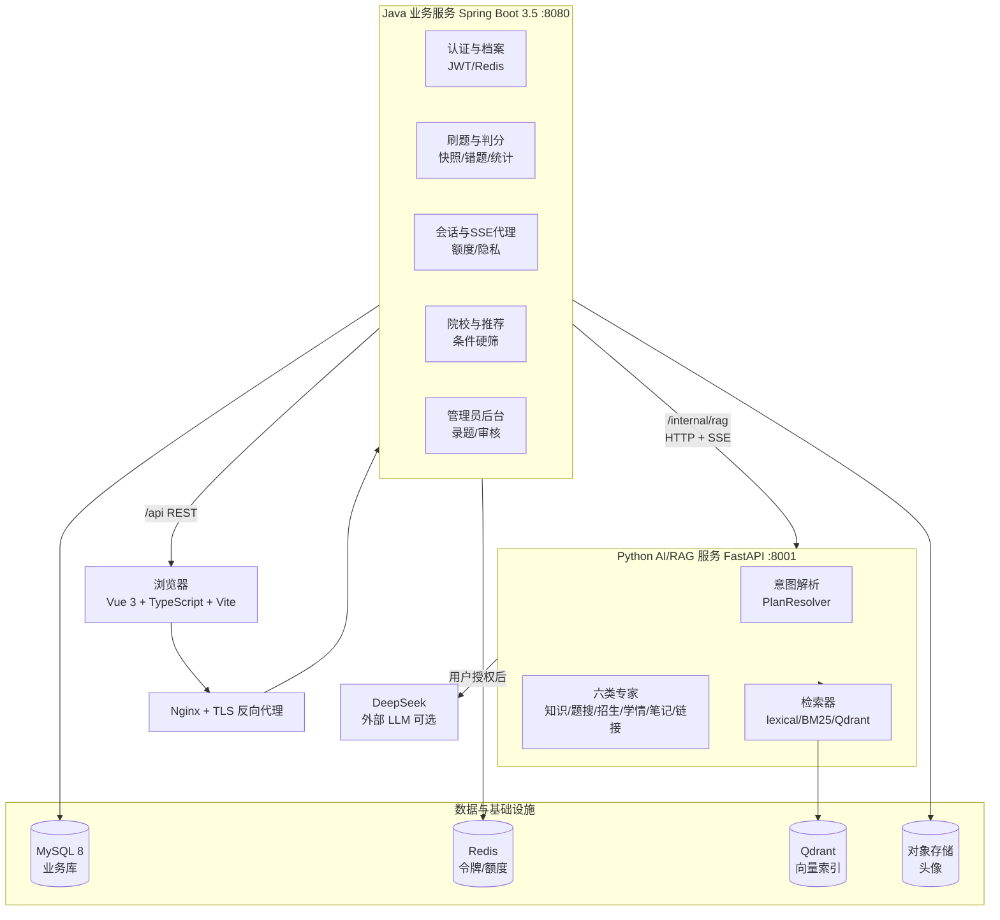
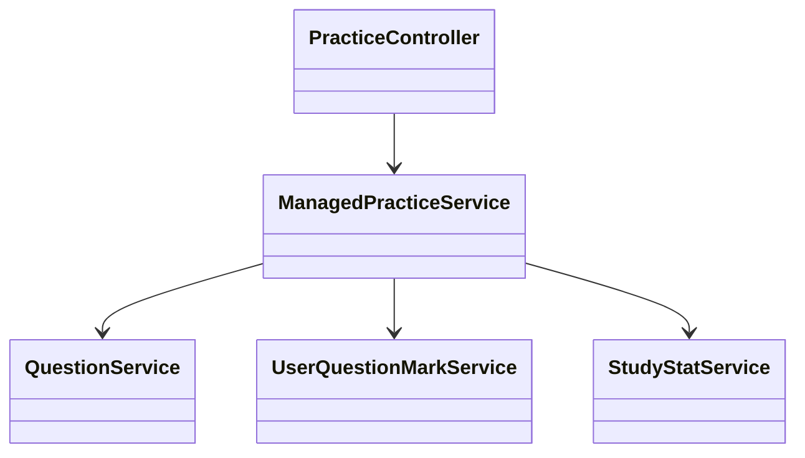
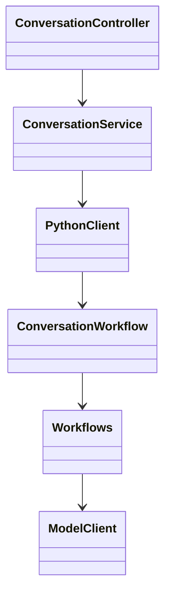

# T03 架构与核心类图

## 1 系统分层架构

### 1.1 架构图

### 1.2 分层说明

1. **表现层**：Vue 3 + TypeScript + Vite，Element 风格组件；`/api` 请求经 Vite 代理或 Nginx 转发到 Java；
2. **业务层（Java）**：唯一直接访问 MySQL 的进程，负责鉴权、判分、版本快照、事务、额度、导出文件确定性生成；不直接组织 LLM Prompt；
3. **AI 编排层（Python）**：不连接业务库，所有用户上下文由 Java 以"已授权快照"形式传入；负责意图解析、专家调度、检索、SSE 流式输出；
4. **基础设施层**：MySQL 持久化、Redis 做令牌撤销与任务额度、Qdrant 做中文向量、OSS 存私有头像。

## 2 功能模块划分

| 模块 | 所属进程 | 职责 |
| --- | --- | --- |
| 认证与档案 | Java | 注册/登录/JWT/Redis 注销、个人档案（含学硕/专硕字段）、OSS 头像 |
| 题库与刷题 | Java | 题目 CRUD、审核流、批次抽题、服务端判分、题目版本快照 |
| 错题与收藏 | Java | 错题本、收藏、错题/收藏练习批次 |
| 学情与画像 | Java + Python | 规则知识点错误率聚合、诊断批次、自动推荐设置 |
| 智能助手 | Python + Java 代理 | 自然语言复合意图、多专家编排、SSE 流式、隐私授权 |
| RAG 知识检索 | Python | 语料加载、BM25/Qdrant、引用来源策略、MCP 子进程 |
| 题目语义检索 | Python | 本地 Qdrant 题目索引，按主题找错题/收藏/全库题 |
| 院校库与推荐 | Java | 院校/专业/招生计划/参考线、条件推荐、招生官网链接 |
| 个人笔记 | Java | Markdown 笔记、版本历史、AI 改笔记预览 |
| 文件导出 | Java | Word/PDF/Markdown 导出，确定性生成，不调用模型 |
| 管理员后台 | Java | 录题、批量导入、审核、启停、指标维护 |

## 3 模块调用与数据流

以学生在 `/tasks` 输入"分析我薄弱点，安排 7 天复习并推荐院校"为例：

1. 浏览器 → `POST /api/conversations/{id}/messages`（带 JWT）；
2. Java `ConversationController` 校验登录态、隐私授权、额度，把"本人已判分有效作答 + 错题 + 收藏 + 档案"组装为 `ConversationRequest`；
3. Java → `POST /internal/rag/conversation/plan`（Python），得到结构化 plan（专家列表、条件补丁、预计模型调用次数）；
4. Java → `POST /internal/rag/conversation/stream`（SSE），Python 内部依次调度：知识专家（RAG）、学情专家（读 Java 已传入的统计）、招生专家（返回院校候选）、笔记专家（预览生成待确认笔记）；
5. SSE 事件经 Java 透传给前端；
6. 结果落库到 `chat_message`、`chat_generation`、`assistant_action`；学生在前端确认后，Java 执行"创建练习/保存笔记/收藏院校"等写操作，所有写操作仍由 Java 完成。

## 4 核心类图

### 4.1 认证与档案模块

| 类 | 职责 |
| --- | --- |
| `AuthController` | 登录/注册/注销 HTTP 入口 |
| `UserService` + `UserMapper` | 用户 CRUD、BCrypt 加密 |
| `JwtService` | 签发/校验 JWT，与 Redis 黑名单交互 |
| `FileController` / OSS 客户端 | 头像上传与私有读取 |

### 4.2 刷题作答模块

- `ManagedPracticeService`：批次生命周期、抽题、判分、错题/收藏标记、学情聚合触发；
- `QuestionService`：按版本号取题干、选项、标准答案与解析，保证历史作答可回放；
- `UserQuestionMarkService`：错题本与收藏状态维护；
- `StudyStatService`：知识点错误率、题量统计的增量聚合。

### 4.3 学情画像与 Agent 诊断模块

- `ConversationController`：HTTP/SSE 入口，负责登录态、隐私授权、额度检查；
- `ConversationService`：会话状态机、用户快照组装、结果落库；
- `PythonClient`：Java 侧调用 Python 的 HTTP/SSE 客户端；
- `ConversationWorkflow` / `Workflows`：Python 侧意图解析、专家编排、预算控制；
- `ModelClient`：LLM 调用封装，含超时与配额。

### 4.4 RAG 知识库检索模块

| 类 | 职责 |
| --- | --- |
| `Corpus` | 加载语料、校验来源白名单、提供 release_id |
| `Retriever` | 按 `RAG_BACKEND` 分发 lexical / bm25 / qdrant / hybrid |
| `McpKnowledgeClient` / `McpKnowledgeSearchTool` | 以 stdio MCP 协议调用独立子进程 |
| `ModelClient` | 可选 LLM 调用，受配额与超时控制 |

### 4.5 院校智能推荐模块

- `SchoolCatalogService`：院校/专业硬筛（省份、专业代码、学位类型、学习方式、考试科目）；
- `SchoolDetailService`：详情聚合，含招生指标、状态标签、来源链接；
- `RecommendService`：规则打分与快照落库到 `recommend_record`，不估计录取概率；
- Python 侧 `AdmissionExpert` 只读 Java 传入的候选做可选解释，`AdmissionLinksTool` 封装 MCP 返回招生官网链接。

### 4.6 管理员后台模块

- 所有写操作校验 `version`，过期返回 409；
- 批量导入整批事务化，任一不合格整批回滚；
- 查重按"科目 + 题干 + 四选项"完整匹配；
- 题目停用不物理删除，历史快照仍可在回顾页展示；
- 招生指标按 `(school_detail_id, metric_type)` 主键 upsert，状态机约束在 CHECK 中。
