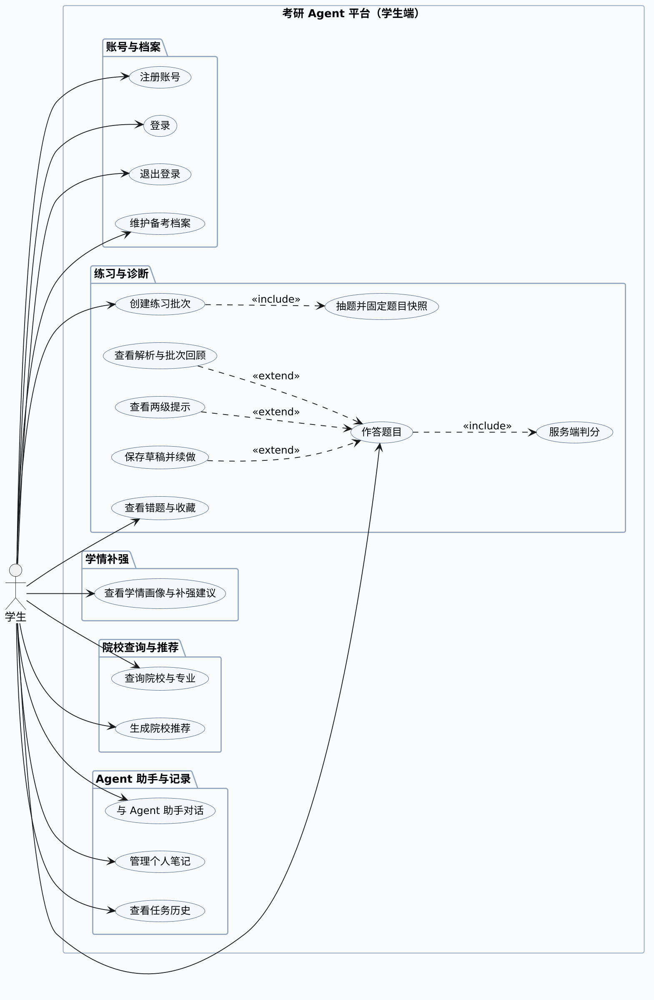
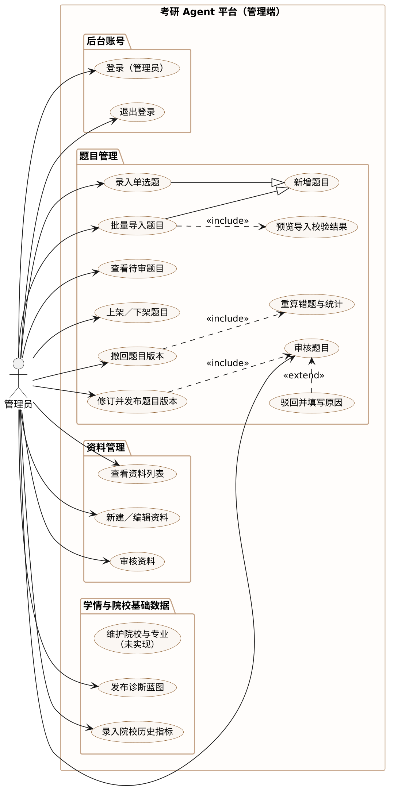
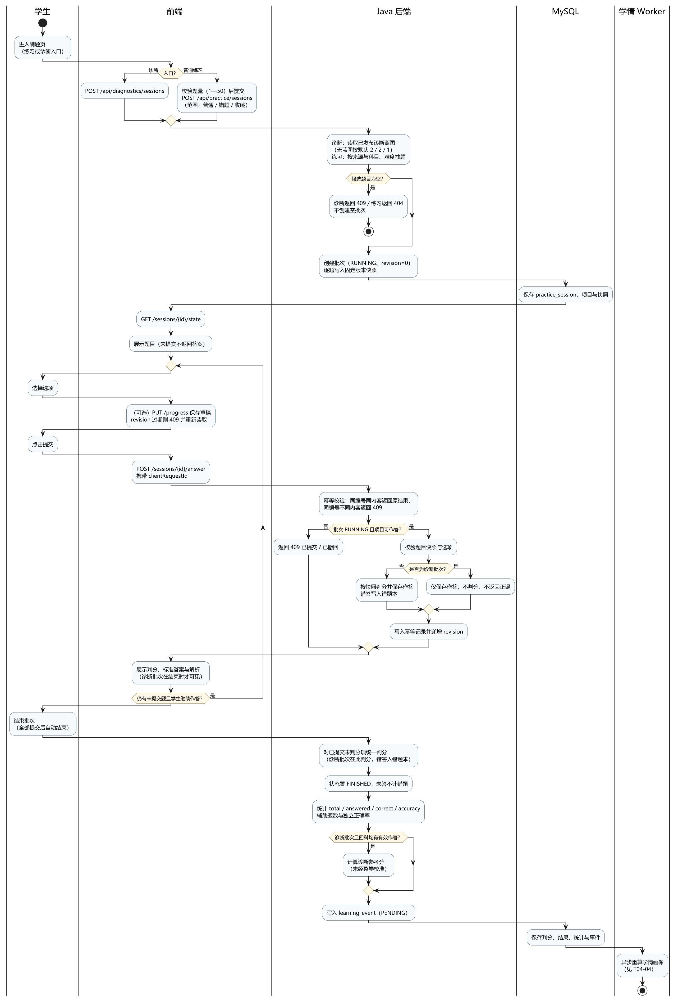
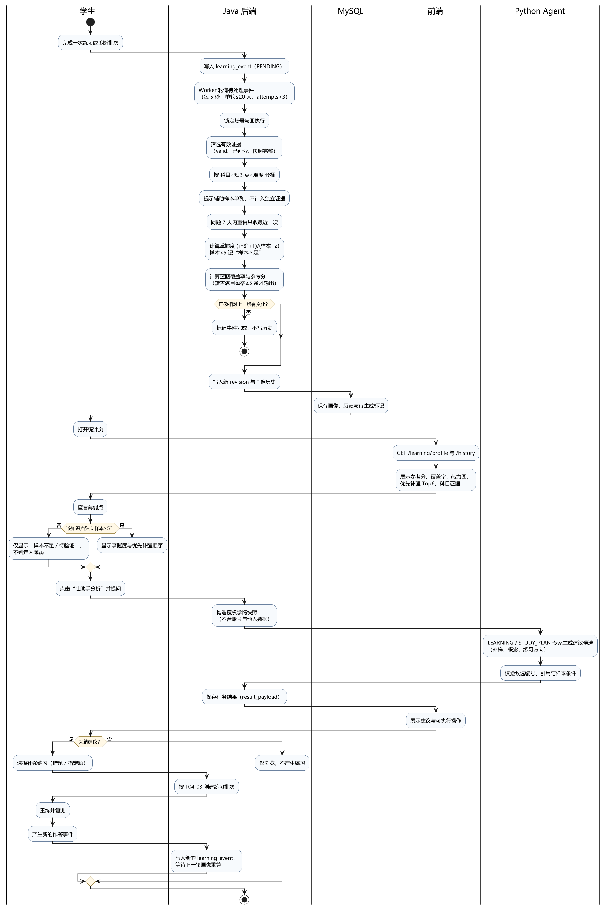
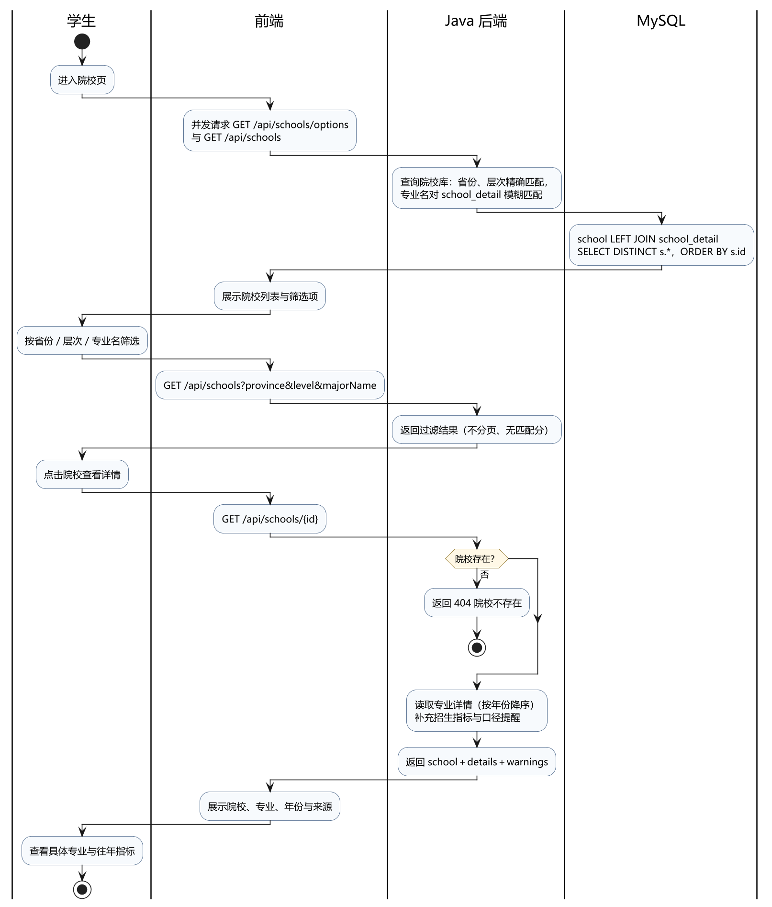
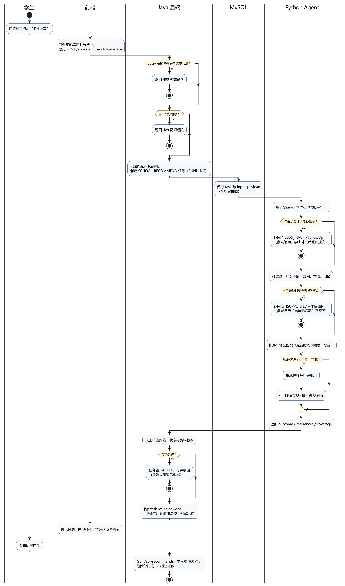

# T04 用例与业务活动图

> 课程：软件工程 · 第二次团队作业（408 小组）
>
> 任务：Issue [#21 T04（核心／UML）用例、业务活动与需求对应](https://github.com/fzu-404-team/kaoyan-agent-platform/issues/21)
>
> 负责人：C4 朱铮睿（学号 102401625，GitHub `Ruiii1124`）
>
> 代码基线：`main` @ `94b8a9f`（2026-11-03，仓库 `fzu-404-team/kaoyan-agent-platform`）
>
> 文档状态：初稿（2026-11-05）；待与 T01、T02 核对主要流程后交 T03
>
> 交付位置：`docs/coursework-02/system/`

## 0. 阅读说明

- 本文的“已实现”只以 `main` 分支代码为判据，不以搭建文档的目标设计为准；凡文档写了而代码没有的，统一进第 9 节“未实现与后续事项”。
- 图中出现的 `kaoyan.learning.enabled` 是学情模块的总开关（`LearningConfiguration`）。**默认未开启**时，诊断、草稿、提示、正式结束与学情画像接口返回 503，前端只走旧刷题链路；本文按“开启后”的完整链路描述，并在规则表中单独标注开关影响。
- 图示为 PlantUML 源文件（`uml/*.puml`），导出的 PNG／SVG 在 `uml/export/`，复现方法见第 10 节。
- 与 T05 的边界：本文只画用例与活动（业务视角），不画对象生命周期、消息顺序与类结构；时序与协作图见 T05，类图与架构见 T03，ER 见 T06。

## 1. 目的与范围

| 项 | 内容 |
| --- | --- |
| 目的 | 把“第一次需求 + 现有代码”提炼成可核对的学生／管理员用例与三组业务流程，并给出需求、用例、原型页面的对应关系，供 T03 整合、原型组核对、T11 写博客引用 |
| 覆盖 | 账号与档案、练习与诊断、学情补强、院校查询与推荐、题目与资料后台、任务与笔记 |
| 不覆盖 | 类图、时序图、数据库设计、部署与接口全量索引（分别由 T03、T05、T06、T09 负责） |
| 判据 | 用例关系（include／extend／泛化）成立；泳道职责与实际调用方一致；分支条件能在代码中找到；未实现项单列 |

本任务的三项交付物与本文的对应关系：

1. 学生、管理员用例图与核心用例说明 —— 第 4、5 节（图 T04-01、T04-02）。
2. 练习／诊断、学情补强、院校查询／推荐三组活动图 —— 第 6 节（图 T04-03 至 T04-06，其中院校查询与推荐拆为两张）。
3. “需求—用例—原型页面”简表 —— 第 7 节。

## 2. 依据、角色与术语

### 2.1 需求依据

| 来源 | 用途 |
| --- | --- |
| `考研Agent平台搭建文档.md` §3.1 使用人群、§3.3 用户故事 US-01～US-08 | 需求条目与成功标准 |
| 同文档 §4.1 能力与优先级、§4.2 页面与路由、§4.3 三条目标流程 | 页面范围与流程骨架 |
| 同文档 §4.4 刷题中心完整建设规则 | 抽题、草稿、提示、判分、结束、统计口径 |
| Issue #21 任务说明 | 交付物与验收标准 |
| `docs/learning-profile-visualization-verification-2026-10-31.md`、`docs/learning-suggestions-verification-2026-11-03.md` | 学情画像与补强建议的已实现范围与限制 |
| [软工实践团队作业（一）](https://www.cnblogs.com/junglllin/p/23427501)（408 小组，2026-10-24） | 第一次作业的需求分析 F-01～F-10、目标用户与选题 |
| [第一次作业要求](https://edu.cnblogs.com/campus/fzu/2026-01SoftwareEngineeringandSoftwareEngineeringPractice/homework/16759)（课程平台，需登录） | 作业目标与交付要求 |
| [团队需求分析文档（飞书，在线维护）](https://my.feishu.cn/wiki/URa5wCuVfiKcEPkzmYHcEMfmn3g?from=from_copylink) | 需求原文与迭代记录 |

说明：第一次作业已经给出需求分析，功能编号为 F-01～F-10。本文的 R01～R20 是在这套需求上按“本次实现粒度”做的细化编号，逐条对应与方案变化见 2.5；两套编号并存，R 编号用于第 7、8 节，F 编号只用于追溯第一次作业。

### 2.2 代码依据

后端 `kaoyan-B/`（Spring Boot 单模块）共 16 个 Controller，与本任务直接相关的是：

| 关注点 | 入口 | 主要服务 |
| --- | --- | --- |
| 账号与档案 | `AuthController`、`UserController` | `UserServiceImpl`、`JwtService`、`JwtAuthenticationFilter` |
| 刷题（旧链路） | `PracticeController` | `PracticeServiceImpl` |
| 刷题（学习闭环链路） | `PracticeController`、`LearningController` | `ManagedPracticeService`、`LearningProfiles` |
| 题目 | `QuestionController` | `QuestionServiceImpl`、`QuestionMapper` |
| 学情 | `LearningController` | `LearningProfileEngine`、`LearningWorker`、`LearningRecommendations` |
| 院校 | `SchoolController` | `SchoolServiceImpl`、`SchoolDetailServiceImpl`、`SchoolCatalogService` |
| 推荐 | `RecommendController` | `RecommendServiceImpl` → `TaskService` → Python `SchoolAgent` |
| 任务与统计 | `TaskController`、`StatController` | `TaskServiceImpl`、`StudyStatServiceImpl` |
| 资料与笔记 | `DocumentController`、`PersonalDocumentController` | `DocumentServiceImpl`、`PersonalDocumentService` |

前端 `kaoyan-frontend/` 的 17 条叶子路由见 `src/router/index.ts`，本文第 7 节按路由列页面。

### 2.3 参与者

| 参与者 | 说明 | 权限边界 |
| --- | --- | --- |
| 访客 | 未登录用户 | 仅注册、登录页 |
| 学生（STUDENT） | 注册后默认角色，使用全部前台功能 | 只能读写本人数据；跨账号资源返回 404 |
| 管理员（ADMIN） | 由种子 SQL／受控方式授予，不能自助注册 | 拥有学生全部前台用例 + `/api/*/admin/**`；`SecurityConfig:61` 统一 `hasRole('ADMIN')` |
| Python Agent 服务 | 系统参与者，非人类 | 只接收 Java 传入的授权快照，不直连业务库 |
| 审核资料库／院校库 | 系统参与者（数据） | 题目与院校事实须审核后才可进入学生题池或推荐 |

管理员继承学生用例（ADMIN 同样通过 `authenticated` 访问前台），因此管理员用例图只画“后台新增”的部分，继承关系在 4.3 说明。

### 2.4 术语

| 术语 | 含义 | 代码位置 |
| --- | --- | --- |
| 批次（session） | 一次练习／诊断的容器，创建时固定题目集合与顺序 | `practice_session`、`PracticeRecord.sessionId` |
| 题目快照 | 创建批次时冻结的题干、选项、答案、解析、版本 | `PracticeRecord.questionSnapshot`，`PracticeServiceImpl:84-86` |
| 草稿 revision | 批次进度版本号，客户端带着旧版本保存会被拒绝 | `LearningContracts.Progress`，`ManagedPracticeService:145` |
| 有效作答 | `gradingStatus=valid` 且已判分；撤回、未答、未提交都不计入 | `ManagedPracticeService.result` |
| 辅助作答 | 使用过提示的作答，不计入独立正确率与掌握度 | `hintLevel>0`，`LearningProfileEngine:30` |
| 样本不足 | 某知识点×难度独立样本少于 5 条，不判定薄弱 | `LearningProfileEngine:43` |
| 画像参考分 | 蓝图覆盖完整（覆盖率≥0.999999）即输出的实验性分数；每格≥5 条只决定“证据是否充分”（`sufficient`），不是输出条件；未经整卷校准 | `LearningProfileEngine:47-56` |
| 诊断参考分 | 诊断批次结束、且四科均有有效作答时按正确率折算，与画像参考分不是同一口径 | `ManagedPracticeService:215-218` |
| 任务（task） | 一次 Agent 调用的持久记录，状态 RUNNING／SUCCESS／FAILED／CANCELLED | `task` 表，`TaskServiceImpl` |

### 2.5 第一次作业需求的承接与变化

第一次作业（2026-10-24）已经完成需求分析，功能编号 F-01～F-10。第二次作业沿用这套需求，但实现方案有调整；逐条对应如下，避免说明书前后两版对不上。

| 第一次作业 | 需求 | 本次对应 | 变化／说明 |
| --- | --- | --- | --- |
| F-01 | 题库维护与查询 | R15、R16 | 已实现：录题、批量导入、审核、上下架；学生侧只查已审核且启用的题 |
| F-02 | 在线答题练习 | R06、R09 | 已实现：普通／错题／收藏三种来源；无章节树 |
| F-03 | 参考答案查看 | R09 | 已实现：提交后才返回答案与解析，未提交不泄露 |
| F-04 | 作答记录与错题复盘 | R10、R11 | 已实现：错题本、批次回顾、历史快照；自动掌握状态未实现 |
| F-05 | 学习统计 | R11 | 部分实现：今日／区间／总览；题目覆盖率与 90 天日历未做 |
| F-06 | 错因分析 | R03（错题辅导） | 已实现为 `WRONG_QUESTION_TUTOR` 任务，与助手对话共用知识专家 |
| F-07 | 薄弱考点归纳 | R12 | 已实现为规则画像的“优先补强”排序，不是模型自由归纳 |
| F-08 | 学情画像 | R12 | 已实现：可复算的规则引擎（Laplace 平滑＋覆盖加权），不调用模型生成画像 |
| F-09 | 院校推荐 | R05 | 已实现：确定性筛选与排序＋可选模型解释；资格核验未做 |
| F-10 | 补强练习 | R06、R10 | 部分实现：错题／收藏重练、指定题重练；未按薄弱点自动组卷 |

方案层面的变化（不影响需求承接，但写进说明书时要与第一次作业区分）：

- **架构**：第一次作业写“Vue＋网关＋Spring＋FastAPI”。当前没有独立网关，前端直连 Spring，Spring 用 Feign 调 Python 内部接口，鉴权在 Spring Security 过滤器完成。
- **Agent**：第一次作业写“学情分析＋院校推荐双 Agent”。当前是 HelloAgents 协调器＋六类专家（LEARNING／SCHOOL／KNOWLEDGE／PRACTICE／NOTE／STUDY_PLAN），学情与院校仍是两条主链路。
- **知识库**：第一次作业写“专业课库＋院校考情库”双库。当前是版本化资料＋独立 Qdrant 检索，院校招生数据走结构化表与筛选工具。
- **自动生成新练习题**：第一次作业已注明“调研选项、不作核心承诺”，本次也未实现。
- **画像算法**：第一次作业未限定算法；当前用规则引擎，结果可复算，模型不参与画像计算。

## 3. 需求编号

需求编号用于第 7、8 节对齐；来源列给出搭建文档的用户故事或章节；与第一次作业 F-01～F-10 的逐条对应见 2.5。

| 编号 | 需求摘要 | 来源 | 主要用例 | 状态 |
| --- | --- | --- | --- | --- |
| R01 | 注册、登录、退出与令牌校验 | US-01、§4.2 | UC01～UC03 | 已实现（refresh 未闭环） |
| R02 | 维护备考档案（目标院校／专业／年份／学位类型等） | US-01、§4.1 | UC04 | 已实现（仅学位类型有格式校验） |
| R03 | 知识问答与引用、缺口说明 | US-02、§4.3-1 | UC16 | 已实现（资料覆盖有限） |
| R04 | 按省份／层次／专业查询院校与详情 | US-03、§4.2 | UC14 | 已实现 |
| R05 | 按档案与偏好生成院校推荐、查看来源与待确认项 | US-03、§4.3-2 | UC15 | 已实现（资格核验未做） |
| R06 | 练习方式与抽题、题量 1—50 | US-04、§4.4 | UC05、UC06 | 部分实现（普通练习只有普通／错题／收藏，无章节树、不随机；诊断候选打乱） |
| R07 | 保存未提交选择并续做，刷新不丢 | US-05、§4.4 | UC09 | 已实现（学习开关开启时） |
| R08 | 两级审核提示，不泄露答案 | US-06、§4.4 | UC10 | 已实现（提示内容需管理端录入） |
| R09 | 服务端判分、隐藏未答答案、解析与回顾 | US-04、§4.4 | UC07、UC08、UC11 | 已实现 |
| R10 | 错题归集、收藏与重练 | US-06、§4.4 | UC12 | 部分实现（自动掌握状态未实现） |
| R11 | 批次结束、结果与统计口径 | US-07、§4.4 | 见 5.3 | 部分实现（未答／撤回口径已区分；蓝图覆盖率已有，题目覆盖率与 90 天日历未做） |
| R12 | 学情画像、薄弱点与补强建议 | US-07、§4.1 | UC13 | 已实现（实验性，样本门槛明确） |
| R13 | 任务历史与 AI 总结记录 | US-07、§4.2 | UC18 | 已实现 |
| R14 | 个人笔记的创建、编辑、版本与导出 | US-02、§4.2 | UC17 | 已实现（导入与共享未做） |
| R15 | 管理员录入题目、登记来源 | US-08、§4.1 | AQ01、AQ02 | 已实现 |
| R16 | 题目审核、上下架，未审不进题池 | US-08、§4.4 | AQ04、AQ05、AQ07 | 已实现 |
| R17 | 题目版本修订与撤回，保留历史依据 | US-08、§4.4 | AQ08、AQ09、AQ11 | 部分实现（需学习开关，前端无入口） |
| R18 | 审核资料的后台管理与审核 | §4.1、§4.2 | AD01～AD03 | 部分实现（后端有 CRUD，页面仅列表＋审核） |
| R19 | 诊断蓝图与院校历史指标的发布 | §4.4、§6.6 | AL01、AL02 | 已实现（无独立管理页面） |
| R20 | 院校与专业基础数据维护 | §4.1 | AL03 | 未实现（仅 Service，无接口无页面） |

## 4. 用例图

### 4.1 学生用例图（T04-01）



图源：[`uml/T04-01_学生用例图.puml`](uml/T04-01_学生用例图.puml)

| 编号 | 用例 | 参与者 | 一句话说明 | 关系 |
| --- | --- | --- | --- | --- |
| UC01 | 注册账号 | 访客 | 用户名＋密码注册，角色固定 STUDENT | — |
| UC02 | 登录 | 学生 | 账密登录换取访问令牌 | — |
| UC03 | 退出登录 | 学生 | 令牌加入撤销名单 | — |
| UC04 | 维护备考档案 | 学生 | 修改目标院校、专业、年份、学位类型等 | — |
| UC05 | 创建练习批次 | 学生 | 选范围、科目、难度、题量后建批次 | include UC06 |
| UC06 | 抽题并固定题目快照 | 系统 | 从已审核且启用的单选题中抽取并冻结版本 | 被 UC05 包含 |
| UC07 | 作答题目（练习） | 学生 | 逐题选择、提交并获取反馈 | include UC08 |
| UC08 | 提交即判分 | 系统 | 练习批次提交时按快照判分，返回答案与解析 | 被 UC07 包含；诊断批次不在此判分 |
| UC09 | 保存草稿并续做 | 学生 | 未提交选择与题号持久化 | extend UC07（未提交时） |
| UC10 | 查看两级提示 | 学生 | 概念提示→解题方向，顺序使用 | extend UC07（练习模式） |
| UC11 | 查看解析与批次回顾 | 学生 | 已提交项回看答案、解析与本人选择 | extend UC07（已提交后） |
| UC12 | 查看错题与收藏 | 学生 | 本人错题本、收藏列表与重练入口 | — |
| UC13 | 查看学情画像与补强建议 | 学生 | 参考分、覆盖率、薄弱点与建议 | — |
| UC14 | 查询院校与专业 | 学生 | 条件筛选院校、查看详情与指标 | — |
| UC15 | 生成院校推荐 | 学生 | 提交推荐任务并查看候选、来源 | — |
| UC16 | 与 Agent 助手对话 | 学生 | 问答、择校、错题解释、笔记建议 | — |
| UC17 | 管理个人笔记 | 学生 | 创建、编辑、版本、导出 | — |
| UC18 | 查看任务历史 | 学生 | 只读查看历史任务与结果 | — |

说明：诊断批次不单独建用例。它复用“作答”流程，但提交时不判分，判分推迟到结束批次统一执行（`ManagedPracticeService:183`、`:199-203`），具体分支在 T04-03 活动图中展开；若在用例图上再画一条“作答→判分”的 include，会与“提交即判分”矛盾。

### 4.2 管理员用例图（T04-02）



图源：[`uml/T04-02_管理员用例图.puml`](uml/T04-02_管理员用例图.puml)

| 编号 | 用例 | 说明 | 状态 |
| --- | --- | --- | --- |
| AC01／AC02 | 登录（管理员）／退出 | 与前台同一套 JWT，仅角色不同 | 已实现 |
| AQ00 | 新增题目（抽象） | 录入与批量导入的共同父用例 | 已实现 |
| AQ01 | 录入单选题 | 白名单字段＋六项来源登记，落库即待审 | 已实现 |
| AQ02 | 批量导入题目 | 每批 1—50 条，库内／批内查重 | 已实现 |
| AQ03 | 预览导入校验结果 | 导入前整体校验，错误行反馈 | 已实现（被 AQ02 包含） |
| AQ04 | 查看待审题目 | 仅 `PENDING_REVIEW` 分页 | 已实现 |
| AQ05 | 审核题目 | 通过／驳回，带版本号防并发 | 已实现 |
| AQ06 | 驳回并填写原因 | 驳回必填原因，长度受限 | 已实现（extend AQ05） |
| AQ07 | 上架／下架题目 | 仅已审核题可切换，影响学生题池 | 已实现 |
| AQ08 | 修订并发布题目版本 | 旧版归档为新版本，修订后重新审核 | 部分实现（需开关，无页面） |
| AQ09 | 撤回题目版本 | 撤回后不可作答，重算错题 | 部分实现（需开关，无页面） |
| AQ11 | 重算错题与统计 | 撤回时按剩余有效记录重算 | 已实现（被 AQ09 包含） |
| AD01～AD03 | 查看／新建编辑／审核资料 | 资料从草稿到发布 | 部分实现（页面不全） |
| AL01 | 发布诊断蓝图 | 四科覆盖、权重和为 1、题数上限 | 已实现（仅接口） |
| AL02 | 录入院校历史指标 | 逐条录入并校验来源 | 已实现（仅接口） |
| AL03 | 维护院校与专业 | 院校与专业增删改 | 未实现（仅 Service） |

### 4.3 用例关系怎么判定的

| 关系 | 判定规则 | 本文用法 |
| --- | --- | --- |
| include | 每次执行基用例都必然执行被包含用例，且被包含用例可独立描述 | UC05→UC06（建批次必抽题并冻结）、UC07→UC08（练习提交即判分；诊断的判分在结束批次，故不画该 include）、AQ02→AQ03（导入必先整体校验）、AQ08→AQ05（修订发布必经审核）、AQ09→AQ11（撤回必重算） |
| extend | 只在特定条件下发生，且基用例不依赖它也能完成 | UC09／UC10／UC11 对 UC07 的扩展；AQ06 对 AQ05 的扩展（仅驳回时需要原因） |
| 泛化 | 子用例是父用例的特化，可替换父用例出现 | AQ01、AQ02 泛化为 AQ00“新增题目”；管理员继承学生用例 |
| 不建模 | 纯界面跳转、日志、内部方法调用 | 页面切换、刷新列表、写审计日志 |

两点需要下游注意：

1. **登录不是各业务用例的 include**。登录是访问控制的前置条件（`SecurityConfig` 统一拦截，前端路由守卫只做交互），把它画成每个用例的 include 会造成“每个用例都重复登录流程”的错误语义，因此单独建模。
2. **“查看解析”是 extend 而非 include**。判分返回的答案与解析只在提交成功后可见，未提交时基用例仍然完成（`ManagedPracticeService.state` 的 `graded` 条件）。

## 5. 核心用例说明

以下 8 个用例覆盖了本任务的三组主流程与后台关键操作。字段说明：**参与**、**前置**、**触发**、**主成功场景**、**扩展／异常**、**后置**、**规则依据**、**实现状态**。

### 5.1 UC05 创建练习批次（诊断走独立入口）

| 项 | 内容 |
| --- | --- |
| 参与 | 学生（主）、系统（抽题） |
| 前置 | 已登录；题库中存在 `active=1 AND review_status='APPROVED'` 的单选题 |
| 触发 | 学生在刷题页选择范围、科目、难度、题量后点击开始 |
| 主成功场景 | ① 前端校验题量为 1—50；② `POST /api/practice/sessions`；③ 服务端校验来源枚举与题量；④ 按范围抽题（普通／错题／收藏）；⑤ 逐题写入批次与固定快照；⑥ 返回 `sessionId`，前端跳转答题页 |
| 扩展／异常 | 题量越界→400；来源非法→400；错题／收藏集合外的题目→404；候选题为空→404“没有符合条件的题目”。**诊断不走本用例**：由 `POST /api/diagnostics/sessions` 独立创建，读蓝图（无蓝图用默认 2／2／1），无候选时返回 **409** |
| 后置 | `practice_session` 状态 RUNNING，`revision=0`；每题一条 `practice_record` 且带快照 |
| 规则依据 | 题量 1—50 与来源枚举 `PracticeServiceImpl:54-56`；错题／收藏白名单 `:59-70`；空题池 `:72-74`；快照写入 `:84-86`；诊断入口 `LearningController:22`、抽题与 409 `ManagedPracticeService:83-96`、`:99-106` |
| 实现状态 | ✅ 普通／错题／收藏；◐ 诊断（需学习开关，候选打乱）；○ 章节树未实现；普通练习不随机（按 `stable_order` 取题） |

### 5.2 UC07 作答题目（含 UC08 判分、UC09 草稿、UC10 提示、UC11 解析）

| 项 | 内容 |
| --- | --- |
| 参与 | 学生（主）、系统（判分） |
| 前置 | 批次 RUNNING；该项目未提交、未撤回 |
| 触发 | 学生选择选项并提交 |
| 主成功场景 | ① 选择选项；②（可选）保存草稿并携带 `revision`；③ 提交时带 `clientRequestId`；④ 服务端做幂等校验；⑤ 校验批次状态、项目有效性、快照完整性、选项合法性；⑥（练习批次）按快照判分并保存；⑦ 错答写入错题本；⑧ 写幂等记录并递增 `revision`；⑨ 返回判分结果，前端展示正误、答案与解析 |
| 扩展／异常 | 同 `clientRequestId` 同内容→返回首次结果（幂等）；同编号不同内容→409；重复提交→409；草稿 `revision` 过期→409 并提示重新读取；选项非法→400；快照缺失或不完整→409；**诊断批次提交时只记录、不判分**，正误与解析在结束批次后可见，也不提供提示 |
| 后置 | 作答与判分持久化；错题集合更新；统计累加；全部提交后自动结束批次 |
| 规则依据 | 选项白名单 `PracticeServiceImpl:96-97`；重复提交 `:108-110`；快照判分 `:111-128`；并发只计一次 `:130-132`；错题与统计 `:134-137`；幂等与自动结束 `ManagedPracticeService:159-192`；草稿 `:143-157`；两级提示顺序 `:224-234` |
| 实现状态 | ✅ 判分、解析、草稿、提示；○ 提示内容的审核工作流未做（提示由管理员修订版本时录入） |

### 5.3 结束批次与结果（R11）

| 项 | 内容 |
| --- | --- |
| 参与 | 学生（主）、系统 |
| 前置 | 批次 RUNNING |
| 触发 | 全部项目提交后自动结束，或学生主动结束 |
| 主成功场景 | ① 对已提交未判分项统一判分（诊断批次在此判分，错答入错题本）；② 状态置 FINISHED；③ 统计总题数、有效已答、正确、错误、未答、撤回；④ 计算正确率、辅助题数、独立正确率；⑤ 诊断批次在四科均有有效作答时给出**诊断参考分**；⑥ 写入学情事件；⑦ 前端展示结果与回顾入口 |
| 扩展／异常 | 重复结束→返回原结果（幂等）；已结束批次不接受新作答与草稿；未答不计错题；诊断进行中不展示正误（`state` 的 `graded` 条件） |
| 规则依据 | `ManagedPracticeService:199-204`（finish 统一判分）、`:205-222`（result 口径）、`:215-218`（诊断参考分与提示语） |
| 实现状态 | ◐ 结果口径已实现；题目覆盖率、90 天日历、提示辅助率展示未实现（见第 9 节）；蓝图覆盖率已有 |

### 5.4 UC13 查看学情画像与补强建议

| 项 | 内容 |
| --- | --- |
| 参与 | 学生（主）、系统（画像重算）、Python Agent（建议） |
| 前置 | 已登录；学习模块开启；有至少一次有效作答（否则展示未诊断） |
| 触发 | 学生打开统计页，或作答后 Worker 异步重算 |
| 主成功场景 | ① Worker 轮询事件并重算画像；② 按科目×知识点×难度分桶统计；③ 计算掌握度、覆盖率、参考分；④ 有变化则写新 revision 与历史；⑤ 前端展示 KPI、热力图、优先补强 Top6、科目证据、历史；⑥ 学生请求助手分析，得到补样／概念／练习建议；⑦ 采纳后按 T04-03 创建练习 |
| 扩展／异常 | 样本<5 只显示“样本不足／待验证”；蓝图缺失只展示分知识点表现、不给参考分；模型关闭或预算不足→规则建议；冷却期（30 分钟）内不重复生成；画像未变则不写历史 |
| 规则依据 | 证据筛选与 7 天去重 `LearningProfileEngine:22-35`；掌握度 `:39`；样本状态 `:43`；覆盖率与充分性 `:45-48`；参考分 `:55-56`；Worker `LearningWorker:23-38`；触发与冷却 `LearningRecommendations:71-135`；建议校验 `docs/learning-suggestions-verification-2026-11-03.md` |
| 实现状态 | ✅ 画像与可视化（含蓝图覆盖率）；◐ 自动建议（复用 `SCHOOL_RECOMMEND` 任务类型，语义与院校推荐重叠，见第 9 节）；○ 题目覆盖率与 90 天日历未做 |

### 5.5 UC14 查询院校与专业

| 项 | 内容 |
| --- | --- |
| 参与 | 学生 |
| 前置 | 已登录 |
| 主成功场景 | ① 进入院校页，加载筛选项与列表；② 按省份、层次、专业名筛选；③ 打开院校详情；④ 展示院校、专业（按年份降序）、指标与口径提醒 |
| 扩展／异常 | 省份／层次为空则不加条件；专业名为模糊匹配；院校不存在→404；指标缺失→返回 `warnings` 而不编造 |
| 规则依据 | 筛选项 `SchoolMapper.xml:6-17`；搜索 `:20-36`；详情 `SchoolServiceImpl:47-59`；专业排序 `SchoolDetailServiceImpl:20-25` |
| 实现状态 | ✅ 查询与详情；○ 分页、按匹配度排序未做 |

### 5.6 UC15 生成院校推荐

| 项 | 内容 |
| --- | --- |
| 参与 | 学生（主）、Java（任务）、Python Agent（筛选与解释） |
| 前置 | 已登录；档案中至少有专业或年份之一，否则走 NEEDS_INPUT |
| 触发 | 学生在院校页点击“条件推荐” |
| 主成功场景 | ① 用档案预填条件并提交；② Java 校验 query 长度与偏好白名单；③ 校验配额并创建 `SCHOOL_RECOMMEND` 任务；④ Python 补全专业码、学位、年份；⑤ 硬过滤后排序取前 5；⑥ 可选模型解释并核验引用；⑦ Java 校验响应契约后保存结果；⑧ 前端展示候选、匹配条件、待确认项与来源 |
| 扩展／异常 | 缺年份／专业／学位→`NEEDS_INPUT`＋追问；当年无项目或全被排除→`UNSUPPORTED`＋原因；配额超限→429；响应不合契约或版本不符→任务 FAILED；模型关闭→规则解释 |
| 规则依据 | `RecommendController:29-33`、`RecommendServiceImpl:16-19`、`TaskServiceImpl.submit`；Python `agents/school.py`、`tools/schools.py`（筛选与排序）；学情对比 `LearningRecommendations:137-154` |
| 实现状态 | ✅ 硬过滤、稳定排序、引用校验、历史与软删；○ 资格核验、按分数排序、`recommend_record` 落库未实现 |

### 5.7 AQ01／AQ02 题目录入与批量导入

| 项 | 内容 |
| --- | --- |
| 参与 | 管理员 |
| 前置 | ADMIN 角色；题目字段与来源信息齐全 |
| 主成功场景 | ① 填写科目、知识点、难度、题干、A—D、答案、解析；② 登记来源类别、名称、定位、年份、原题号、使用权限；③ 提交后落库为 `PENDING_REVIEW`、`version=1`、`active=1`；④ 批量导入先预览校验，再整体入库 |
| 扩展／异常 | 缺字段／枚举非法→400；重复题（批内或库内）→409；导入超过 50 条→400；真题缺年份或原题号→400 |
| 规则依据 | `QuestionServiceImpl:57-65`（创建）、`:67-104`（导入）、`:205-214`（校验）；`QuestionController:73-90` |
| 实现状态 | ✅ 录入与导入；○ 批量导入的失败回滚提示粒度、重复题检测规则仍可细化 |

### 5.8 AQ05／AQ07 审核与上下架

| 项 | 内容 |
| --- | --- |
| 参与 | 管理员 |
| 前置 | 题目处于 `PENDING_REVIEW`（审核）或 `APPROVED`（上下架） |
| 主成功场景 | ① 待审列表分页查看；② 查看完整题目与来源；③ 通过或驳回（驳回填原因）；④ 通过后可按需上架／下架 |
| 扩展／异常 | 版本不一致→409；状态不符→409；驳回未填原因→400；未审核题不可上架；学生侧永远看不到未审题 |
| 规则依据 | 待审 `QuestionServiceImpl:230-238`；审核 `:144-160`；上下架 `:164-185`；抽题过滤 `QuestionMapper:30` |
| 实现状态 | ✅ 审核与上下架 |

## 6. 业务活动图

三组活动图共四张（院校的查询与推荐拆开，避免一张图过高影响排版）。泳道按“谁执行动作”划分，而不是按部署单元划分：`学生`、`前端`、`Java 后端`、`MySQL`、`Python Agent`、`学情 Worker`。

### 6.1 练习／诊断（T04-03）



图源：[`uml/T04-03_练习与诊断活动图.puml`](uml/T04-03_练习与诊断活动图.puml)

泳道职责：

| 泳道 | 负责 |
| --- | --- |
| 学生 | 选择条件、作答、结束批次、查看结果 |
| 前端 | 参数校验、调用接口、展示题目与判分（不自行判分） |
| Java 后端 | 抽题、建批次、快照、幂等、判分、统计、事件 |
| MySQL | 批次、项目、快照、作答、错题、统计、事件 |
| 学情 Worker | 异步重算画像 |

关键分支：

| 判断 | 条件 | 结果 |
| --- | --- | --- |
| 入口 | 诊断／普通练习 | 诊断走 `POST /api/diagnostics/sessions`；练习走 `POST /api/practice/sessions`，题量 1—50、来源枚举校验 |
| 是否诊断 | 诊断入口 | 读已发布蓝图抽题；无蓝图用默认 2／2／1；不提供提示 |
| 候选是否为空 | 过滤后无题 | **诊断 409**、**练习 404**，均不创建空批次 |
| 项目是否可作答 | 已提交／已撤回／批次已结束 | 409，前端重新读取 |
| 是否诊断批次 | 项目属于 DIAGNOSTIC | 仅保存作答，不判分、不返回正误 |
| 是否还有未提交题 | 提交后仍有 pending | 继续循环；否则自动结束 |
| 结束批次 | 存在已提交未判分项（诊断） | finish 统一判分后再统计 |
| 诊断是否四科齐全 | 四科均有有效作答 | 输出诊断参考分；否则不输出 |

与旧链路的差异（学习开关关闭时）：没有 `state／progress／hint／finish`，只有 `start／answer／summary`，判分由 `PracticeServiceImpl.answer` 直接完成，草稿与提示不可用。这一点已在上表与第 8 节标注。

### 6.2 学情补强（T04-04）



图源：[`uml/T04-04_学情补强活动图.puml`](uml/T04-04_学情补强活动图.puml)

流程要点：

1. 作答或结束批次写入 `learning_event`，Worker 每 5 秒轮询，单轮最多 20 人，失败重试 3 次（`LearningWorker:23-38`）。
2. 证据只取 `valid`、已判分、快照完整的记录；提示辅助样本单列。同题按作答时间升序，**7 天内只保留首条**，其后的重复作答跳过；超过 7 天的再次作答可重新计入（`LearningProfileEngine:22-35`）。
3. 掌握度 `(正确+1)/(样本+2)`，样本<5 记“样本不足”。**画像参考分在蓝图覆盖完整（覆盖率≥0.999999）时输出**；每格≥5 条只决定 `sufficient`（证据是否充分），不与参考分绑定（`:39-56`）。诊断参考分是另一套口径，见 5.3。
4. 画像变化才写新 revision 与历史；未变化直接完成事件。
5. 自动建议受“是否开启、冷却期、配额、模型可用”四重约束（`LearningRecommendations:71-135`）。
6. 学生采纳建议后回到 T04-03 创建补强练习，形成“作答→画像→建议→再练”的闭环。

### 6.3 院校查询（T04-05）与推荐（T04-06）



图源：[`uml/T04-05_院校查询活动图.puml`](uml/T04-05_院校查询活动图.puml)



图源：[`uml/T04-06_院校推荐活动图.puml`](uml/T04-06_院校推荐活动图.puml)

查询分支只走 SQL，不经 Agent；推荐分支才创建任务并调用 Python。两条分支的边界正是“查询是确定性检索，推荐是受约束的生成”。

关键分支：

| 判断 | 条件 | 结果 |
| --- | --- | --- |
| 院校是否存在 | 详情接口查不到 | 404 |
| 参数是否合法 | query 超长或偏好不在白名单 | 400 |
| 配额是否足够 | 当日任务超限 | 429 |
| 条件是否齐全 | 缺年份／专业／学位 | NEEDS_INPUT＋追问，不猜年份 |
| 当年是否有项目 | 硬过滤后为空 | UNSUPPORTED＋排除原因，不换年份凑数 |
| 是否允许模型解释 | 开关关闭或模型不可用 | 规则解释 |
| 引用是否通过 | 解释中的来源无法核验 | 回退规则解释 |
| 领域结果回传 | `NEEDS_INPUT`／`UNSUPPORTED`／`RECOMMEND` | 三种都是正常结果，统一回 Java 校验契约后写入 `task.result_payload`，前端按 outcome 展示追问／原因／候选 |
| 响应是否合契约 | 状态或资料版本不符 | 任务 FAILED |

## 7. 需求—用例—原型页面简表

原型：T01／T02 已完成可点击原型，只读分享地址为
<https://modao.cc/proto/1tGSwIfito0m4mcLTVKiI2/sharing?view_mode=read_only&screen=rbpVa4sEZCiOAvssl>（墨刀，2026-11-05）。
下表“原型页面”按功能页命名，与原型中的页面一一对应；若原型改过页名，以原型目录为准并在 11.3 记录。状态含义：✅已实现、◐部分实现、○未实现。

| 需求 | 需求摘要 | 用例 | 路由／页面（现状） | 原型页面（墨刀） | 后端入口 | 状态 |
| --- | --- | --- | --- | --- | --- | --- |
| R01 | 注册／登录／退出 | UC01～UC03 | `/login`、`/register` | 登录、注册 | `POST /api/auth/*` | ✅ |
| R02 | 备考档案 | UC04 | `/profile` | 档案 | `GET /api/users/me`、`PUT /api/users/profile` | ✅ |
| R03 | 知识问答与引用 | UC16 | `/tasks`（Agent 助手） | 助手对话 | `POST /api/conversations/*` | ✅ |
| R04 | 院校查询与详情 | UC14 | `/schools`、`/schools/:id` | 院校列表、院校详情 | `GET /api/schools`、`/api/schools/{id}` | ✅ |
| R05 | 院校推荐 | UC15 | `/schools`（条件推荐弹窗） | 推荐条件、推荐结果 | `POST /api/recommends/generate` | ✅ |
| R06 | 练习方式与抽题 | UC05、UC06 | `/practice` | 刷题首页 | `POST /api/practice/sessions` | ◐ |
| R07 | 草稿续做 | UC09 | `/practice/session/:sessionId` | 答题页 | `PUT /api/practice/sessions/{id}/progress` | ✅ |
| R08 | 两级提示 | UC10 | 同上（答题页提示区） | 提示弹层 | `POST …/items/{itemId}/hints` | ✅ |
| R09 | 判分与解析 | UC07、UC08、UC11 | 同上＋批次回顾 | 判分反馈、回顾 | `POST …/answer`、`GET …/state` | ✅ |
| R10 | 错题与收藏 | UC12 | `/wrong`、`/favorite` | 错题本、收藏 | `GET /api/marks/wrong`、`/favorite` | ◐ |
| R11 | 批次结果与统计 | 5.3 | `/stat`、批次结果 | 结果页、统计 | `GET /api/practice/sessions/{id}/result`、`/api/stats/*` | ◐ |
| R12 | 学情画像与补强 | UC13 | `/stat`（学情面板） | 学情画像 | `GET /api/learning/profile` | ✅ |
| R13 | 任务历史 | UC18 | `/tasks/history` | 任务历史 | `GET /api/tasks` | ✅ |
| R14 | 个人笔记 | UC17 | `/notes` | 笔记列表、编辑器 | `/api/personal-documents/*` | ✅ |
| R15 | 题目录入与导入 | AQ01、AQ02 | `/admin/questions` | 录题、导入 | `POST /api/questions/admin`、`/admin/import` | ✅ |
| R16 | 题目审核与上下架 | AQ04、AQ05、AQ07 | `/admin/questions` | 待审列表、审核 | `/api/questions/admin/pending`、`/{id}/review`、`/{id}/active` | ✅ |
| R17 | 题目版本修订与撤回 | AQ08、AQ09 | 无页面 | 版本管理（若有） | `POST /api/questions/admin/{id}/versions` | ◐ |
| R18 | 资料管理与审核 | AD01～AD03 | `/admin/documents` | 资料后台 | `/api/documents/admin/*` | ◐ |
| R19 | 诊断蓝图与历史指标 | AL01、AL02 | 无页面 | 基础数据后台 | `POST /api/learning/admin/blueprints` 等 | ✅ |
| R20 | 院校与专业维护 | AL03 | 无页面 | 原型未覆盖（代码亦无页面） | 无接口 | ○ |

“无页面”的三项（R17、R19、R20）说明：接口存在但前端没有入口，属于第 9 节的后续事项；T08 的页面覆盖清单与此一致。

## 8. 规则与代码对照

本表用于验收“规则符合代码”。同一规则有多处实现时，只列主入口。

| 规则 | 取值／条件 | 代码位置 | 状态 |
| --- | --- | --- | --- |
| 题量范围 | 1—50 | `PracticeServiceImpl:54` | ✅ |
| 练习来源 | 仅 NORMAL／WRONG／FAVORITE | `PracticeServiceImpl:56` | ✅ |
| 错题／收藏范围 | 只允许本人集合内的题目 | `PracticeServiceImpl:59-63` | ✅ |
| 空题池 | 练习不创建空批次返回 404；诊断无候选返回 409 | `PracticeServiceImpl:72-74`；`ManagedPracticeService:87` | ✅ |
| 快照固定 | 建批次时冻结题干、选项、答案、版本 | `PracticeServiceImpl:84-86`；`ManagedPracticeService:45-64` | ✅ |
| 未审不入池 | `active=1 AND review_status='APPROVED'` | `QuestionMapper:30` | ✅ |
| 未提交不泄答案 | `state` 在未判分时不返回 answer／analysis | `ManagedPracticeService:132-137` | ✅ |
| 草稿版本 | 旧 revision 保存→409 | `ManagedPracticeService:145` | ✅ |
| 提示顺序 | 两级，第二级须先看第一级 | `ManagedPracticeService:229` | ✅ |
| 提示不泄答案 | 只返回 hintConcept／hintDirection | `ManagedPracticeService:230-233` | ✅ |
| 幂等提交 | 同 `clientRequestId` 同内容返回原结果；不同内容 409 | `ManagedPracticeService:162-172` | ✅ |
| 重复作答 | 已提交项目再次提交→409 | `ManagedPracticeService:176` | ✅ |
| 并发不双计 | 条件更新 `is_correct IS NULL` | `PracticeServiceImpl:130-132` | ✅ |
| 未答不计错题 | 错题只在 `isCorrect=0` 时写入 | `ManagedPracticeService:195` | ✅ |
| 自动结束 | 无剩余未提交项时 finish | `ManagedPracticeService:189-190` | ✅ |
| 结果口径 | 有效已答为分母；辅助题单列 | `ManagedPracticeService:207-214` | ✅ |
| 诊断参考分 | 诊断批次且四科均有有效作答>0 才给；未整卷校准 | `ManagedPracticeService:215-218` | ✅ |
| 画像参考分 | 蓝图覆盖完整即输出；每格≥5 只决定 `sufficient` | `LearningProfileEngine:47-56` | ✅ |
| 判分时机 | 练习提交即判分；诊断提交只记录，finish 时统一判分 | `ManagedPracticeService:183`、`:199-203` | ✅ |
| 答题卡与跳题 | 新学习批次页有答题卡，点击切换题并保存 `currentIndex` | `ManagedPracticeSession.vue:10-12`、`:76` | ✅ |
| 掌握度 | (正确+1)/(样本+2) | `LearningProfileEngine:39` | ✅ |
| 样本门槛 | <5 为 INSUFFICIENT，不判薄弱 | `LearningProfileEngine:43` | ✅ |
| 蓝图覆盖率 | 有样本的蓝图格权重之和 | `LearningProfileEngine:45-48` | ✅ |
| 同题去重 | 按时间升序，7 天内只保留首条，其后重复作答跳过 | `LearningProfileEngine:31-33` | ✅ |
| 画像触发 | 初次／能力变化≥5 分／样本充分性变化／资料或蓝图变更 | `LearningProfiles:83-96` | ✅ |
| 建议冷却 | 能力变化后 30 分钟 | `LearningProfiles:94` | ✅ |
| 建议配额 | 任务超限 429 | `LearningRecommendations:96-98`；`TaskStore` | ✅ |
| 院校筛选 | 省份、层次精确；专业名对 `school_detail` 模糊；DISTINCT；按 id 排序 | `SchoolMapper.xml:20-36` | ✅ |
| 院校详情 | 专业按年份降序；指标缺失给 warnings | `SchoolServiceImpl:47-59`；`SchoolDetailServiceImpl:20-25` | ✅ |
| 推荐硬过滤 | 年份等值、方向、学位、地区 | `tools/schools.py`（`filter_programs`） | ✅ |
| 推荐排序 | 地区匹配→更新时间→编号，取前 5 | `tools/schools.py`（`rank_programs`） | ✅ |
| 推荐历史 | 本人前 100 条；删除仅隐藏 | `RecommendServiceImpl:20-25` | ✅ |
| 管理员权限 | `/api/*/admin/**` 需 ADMIN | `SecurityConfig:61` | ✅ |
| 题目审核状态机 | PENDING_REVIEW→APPROVED／REJECTED；版本+1 | `QuestionServiceImpl:144-160` | ✅ |
| 上下架 | 仅 APPROVED 可切换；版本+1 | `QuestionServiceImpl:164-185` | ✅ |
| 注册角色 | 公开注册只能 STUDENT | `UserServiceImpl:29-48` | ✅ |
| 令牌撤销 | jti 入 Redis 黑名单，TTL=剩余有效期 | `UserServiceImpl:77-89` | ✅ |

## 9. 未实现与后续事项

以下各项在代码中**没有**对应实现，或只有接口没有可用入口；已按“影响面”排序，供 T03 写入“后续工作”，也供原型组避免画出不存在的页面。

| 编号 | 事项 | 现状 | 建议归属 |
| --- | --- | --- | --- |
| F01 | 章节树／按知识点练习 | 只有科目＋难度＋题量；无章节接口 | 后续迭代（T01 原型可先不放） |
| F02 | 普通练习的随机抽样 | 普通练习按 `stable_order` 取题；只有诊断候选会 `shuffle` | 后续迭代 |
| F03 | 新旧批次页能力不一致 | 新学习批次页有答题卡、草稿、提示；旧批次页没有，两个页面能力不同 | 前端统一入口 |
| F04 | 提示内容的审核工作流 | 提示随题目版本由管理员录入，无独立审核 | 与 R08 一起补 |
| F05 | 自动掌握状态（连续两次独立答对→mastered） | 文档有规则，代码未实现 | 后续迭代 |
| F06 | 题目覆盖率与 90 天练习日历 | 蓝图覆盖率已有（画像面板展示）；题目覆盖率与日历视图未做 | 后续迭代 |
| F07 | 题目版本修订／撤回的前端入口 | 有接口，默认关闭，无页面 | 管理端补齐 |
| F08 | 资料新建／编辑／删除页面与入参校验 | 后端可绕过审核直接置 PUBLISHED，页面缺失 | 与 R18 一起修 |
| F09 | 管理员授权与账号禁用 | 仅种子 SQL；无 API 无页面 | 运维手册说明 |
| F10 | refresh token 闭环 | 登录不下发 refreshToken，前端读空 | 账号模块修复 |
| F11 | 院校资格核验 | 只有固定 `pendingChecks` 文案，不读本科背景 | 推荐迭代 |
| F12 | 按分数／年份排序 | 年份仅等值过滤，分数不参与排序 | 推荐迭代 |
| F13 | `recommend_record` 落库 | 建表未使用，结果只在 `task.result_payload` | 数据组确认是否保留 |
| F14 | 自动建议复用 `SCHOOL_RECOMMEND` | 学情自动建议创建的是院校推荐任务，语义重叠 | 建议拆分任务类型 |
| F15 | 诊断参考分的整卷校准 | 明确标注“未校准”，仅 4 科齐全时输出 | 后续实验 |
| F16 | 学习模块默认关闭 | `kaoyan.learning.enabled` 未配置时诊断／草稿／提示／画像不可用 | 部署时显式开启并记录 |

## 10. 图源与复现

| 文件 | 说明 |
| --- | --- |
| `uml/T04-01_学生用例图.puml` | 学生用例图（需 Graphviz 或用在线服务器渲染） |
| `uml/T04-02_管理员用例图.puml` | 管理员用例图（同上） |
| `uml/T04-03_练习与诊断活动图.puml` | 练习／诊断活动图（活动图不依赖 Graphviz） |
| `uml/T04-04_学情补强活动图.puml` | 学情补强活动图 |
| `uml/T04-05_院校查询活动图.puml` | 院校查询活动图 |
| `uml/T04-06_院校推荐活动图.puml` | 院校推荐活动图 |
| `uml/export/*.png`、`*.svg` | 已导出图，可直接插入 Word（T12） |

复现命令（在 `docs/coursework-02/system/uml/` 下）：

```bash
# 活动图：本地渲染，无需 Graphviz
java -Dfile.encoding=UTF-8 -DPLANTUML_LIMIT_SIZE=16384 \
  -jar plantuml.jar -charset UTF-8 -tpng -tsvg -o export T04-03_练习与诊断活动图.puml

# 用例图：有 dot 时同样本地渲染；没有 Graphviz 时用 PlantUML 在线服务器
# （把源文件内容 POST 到 https://www.plantuml.com/plantuml/png 或使用其编码 URL）
```

排版约定：正文 12pt、图题在下、图宽不超过版心；用例图为纵向长图，Word 中按整页竖排；活动图为纵向长图，建议整页或跨页放置。T12 排版时如遇缩放导致文字过小，优先拆图而不是继续缩小。

## 11. 评审与交接

### 11.1 与 T01、T02 的核对清单

- [ ] 刷题首页的练习方式：代码只有普通／错题／收藏三种，没有“章节”；原型若画了章节或随机，需标注“规划中”。
- [ ] 答题页是否展示答题卡、草稿状态、提示入口：新学习批次页三样都有（答题卡见 `ManagedPracticeSession.vue:10-12`），原型应保留；旧批次页没有，需说明入口差异。
- [ ] 批次结果页字段：总数、已答、正确、未答、撤回、辅助题数、独立正确率；诊断参考分仅在诊断且四科齐全时出现，画像参考分在学情页。
- [ ] 学情页是否展示“样本不足”灰态、蓝图覆盖率与“优先补强 Top6”：代码已支持，原型需保留这些状态。
- [ ] 院校页的筛选条件是否只有省份／层次／专业名：代码没有分数、年份筛选（年份只在推荐内使用）。
- [ ] 推荐结果是否展示“待确认项”和“来源”：代码返回 `pendingChecks`、`references`，但资格核验未实现；追问与“当年无匹配”也应有对应状态页。
- [ ] 管理端是否有题目版本管理、资料新建／编辑入口：代码有接口、无页面，原型未覆盖即可，不要画成已完成。

### 11.2 交 T03 的说明

- 第 4、5 节可直接作为“用例建模”章节；第 6 节作为“业务流程”章节；第 7 节可作为“需求追踪矩阵”的初版。
- 第 8 节的规则表建议保留，T03 写“业务规则”时可直接引用，避免与代码不一致。
- 第 9 节建议原样进入“后续工作”，不要删减；这是验收标准“未实现需求列为后续事项”的直接证据。

### 11.3 变更记录

| 日期 | 版本 | 变更 | 作者 |
| --- | --- | --- | --- |
| 2026-11-05 | v0.1 | 初稿：两张用例图、四张活动图、需求对照表、规则表、后续事项 | C4 朱铮睿 |
| 2026-11-05 | v0.2 | 按代码复核意见修订：补答题卡与诊断入口、拆分画像参考分与诊断参考分、修正 7 天去重与判分时机、推荐 outcome 统一回 Java 保存、填入墨刀原型链接 | C4 朱铮睿 |
| 2026-11-05 | v0.3 | 补第一次作业需求来源（博客、作业要求、飞书需求文档），新增 2.5 节 F-01～F-10 与 R 编号的逐条对应及架构、Agent、知识库、画像算法变化说明 | C4 朱铮睿 |
