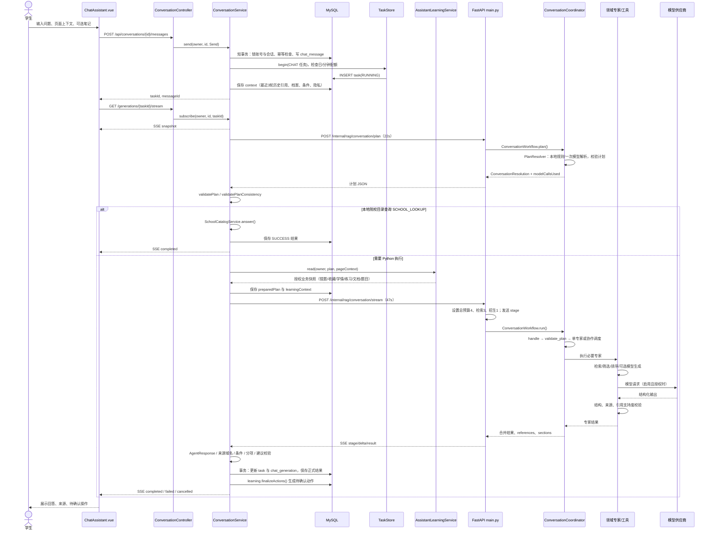
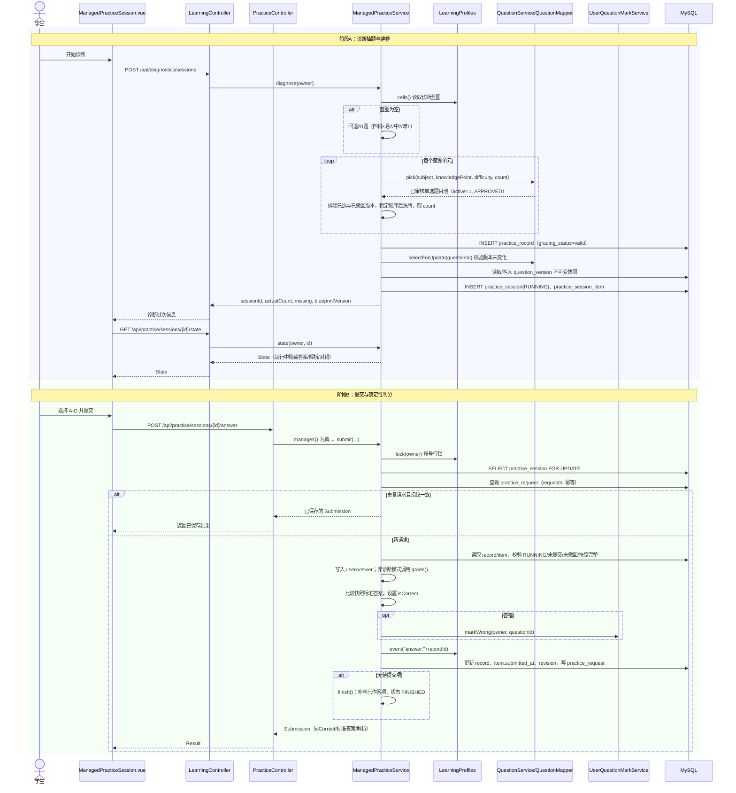
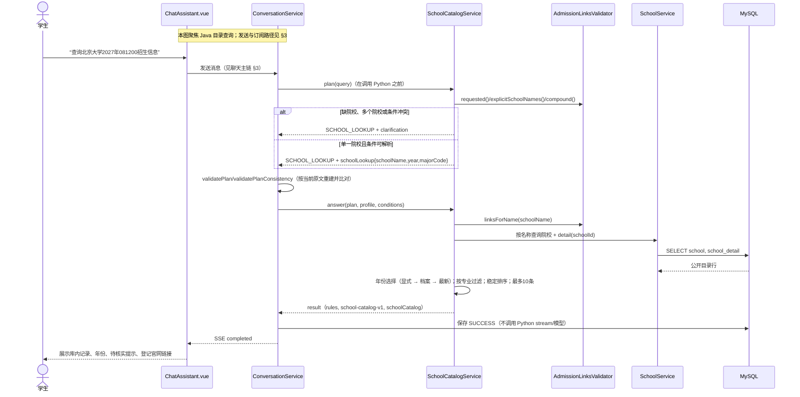
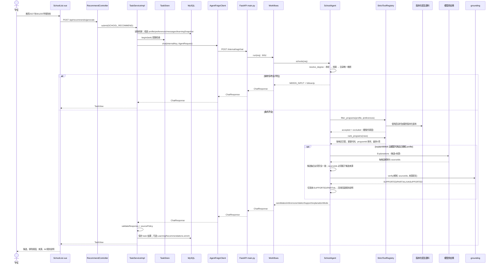
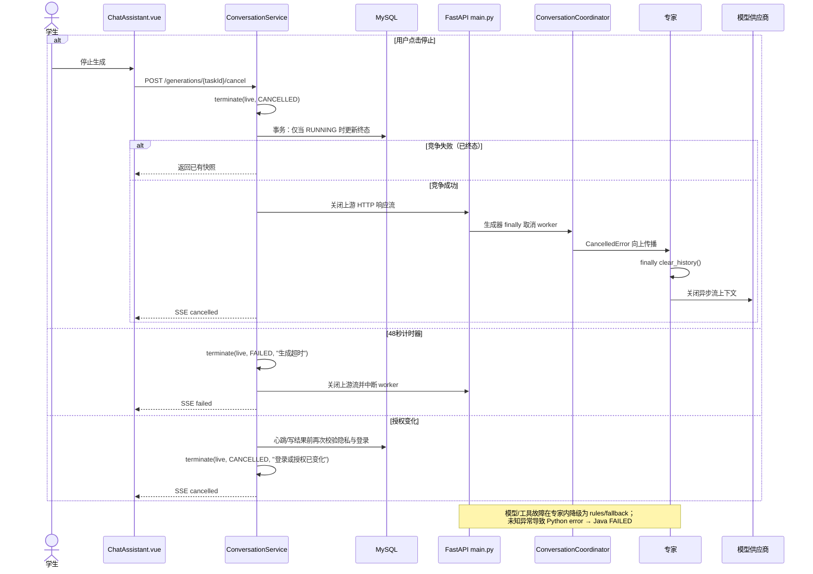
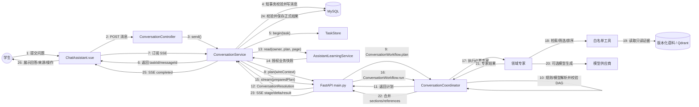

# T05 Agent 时序、关键算法交互与协作图

| 项目 | 内容 |
| --- | --- |
| 文档编号 | T05 |
| 文档名称 | Agent 时序、关键算法交互与协作图 |
| 编写 | C5（ren3717） |
| 版本 | v0.2（初稿，基线对齐） |
| 编写日期 | 2026-11-05 |
| 代码基线 | `fzu-404-team/kaoyan-agent-platform`，`94b8a9f`（2026-11-03，团队统一设计基线）；T05 相关代码与 `db1c040a`/`ffb6b49c` 一致 |
| 所属作业 | 第二次团队作业：原型设计与概要设计 |
| 交付位置 | `docs/coursework-02/system/T05_Agent与调用设计.md` |
| 关联任务 | T03 总体架构、T04 用例与活动图；T01、T11 为下游使用者 |
| 需求依据 | 《408-Agent 智能备考平台需求分析文档》v2.1（2026-10-22，飞书） |

**修订记录**

| 版本 | 日期 | 修改内容 | 作者 |
| --- | --- | --- | --- |
| v0.1 | 2026-11-05 | 依据当前代码核对聊天、练习诊断判分、院校目录查询、院校推荐及取消降级链路，形成初稿 | C5 |
| v0.2 | 2026-11-05 | 按团队统一设计基线 `94b8a9f` 复核；补充需求条目映射、两类 Agent 与六类专家口径、墨刀原型核对项 | C5 |

> 本章节是 T05 的独立交付稿，可直接并入 T03 的系统设计说明书。文中的对象、消息、字段和约束均以当前仓库实现为准；目标设计、尚未实现的能力和未执行的验证单独标注，不把设计意图写成现有行为。

---

## 1. 章节定位与结论

本章回答四个问题：

1. 一次助手请求从 Vue 页面到 Java、Python、模型和数据库，实际经过哪些对象，消息顺序是什么。
2. 练习诊断的抽题、提交、判分、结束分别由谁执行，关键算法和数据快照边界在哪里。
3. “院校目录查询”和“院校推荐”为什么是两条不同的链路，各自何时使用模型。
4. 取消、超时、模型失败、工具失败和校验失败时，系统怎样收敛到确定终态。

先给出三条结论，后文用图和代码映射展开：

- **Java 是业务主控。** 认证、授权、任务配额、隐私范围、业务数据读取、正式结果校验与持久化都在 Java；Python 是无业务数据库连接、按请求创建、结束即清理的内部专家服务。
- **聊天是两段式调用。** Java 先让 Python 只产出“需要哪些数据”的类型化计划，再由 Java 读取本人授权快照，最后把计划与快照一起交给 Python 流式执行。这样 Python 不需要、也不能自行访问业务库。
- **院校相关请求分流。** 单所院校的招生目录事实查询走 Java `SchoolCatalogService` 的确定性路径，不调用模型；跨院校的筛选、排序和可选解释走 Python `SchoolAgent`，规则候选由工具产生，模型只能解释已有候选。

### 1.1 与 T03、T04 的边界

- 本章只负责**运行时时序、对象通信、关键算法交互**，不重复 T03 的分层架构、部署拓扑和核心类图，也不重复 T04 的用例图、活动图与需求—用例映射。总体分层与 `docs/agents框架讲解.md` 的聊天主链说明一致；本章补充该文未展开的练习诊断判分、院校目录/推荐分流和取消降级链路。
- 本章使用的参与者名称、服务名和数据边界，供 T03 在系统说明书中统一术语；T03 整合时如调整章节编号，只改引用，不改本稿的消息事实。
- 已按 T04 PR #29 的 UC01—UC18 核对：本章 §3—§6 对应 UC16（助手对话）、UC07—UC11（作答／判分／草稿／提示／解析）、UC13（学情画像与补强）、UC14（院校查询）、UC15（院校推荐）。T04 与本章均使用 `docs/coursework-02/system/` 作为交付目录，T03 可直接合并。
- 需求文档按“学情分析 Agent / 院校推荐 Agent”两类描述；本章按当前实现展开为协调器 + 六类专家。两者不是两套系统：六类专家是内部职责拆分，需求层仍归并为学情分析与院校推荐两类，映射见 §6.3，需求条目对应见 §10.3。

---

## 2. 参与对象、职责与数据边界

### 2.1 运行对象

| 对象 | 当前实现 | 主要职责 | 关键入口 |
| --- | --- | --- | --- |
| 学生 | 浏览器使用者 | 输入问题、作答、确认或忽略建议操作 | — |
| 助手页面 | `kaoyan-frontend/src/views/ChatAssistant.vue` | 发送消息、订阅 SSE、展示阶段/正文/来源/操作 | `sendMessage`、`subscribe` |
| 练习页面 | `ManagedPracticeSession.vue`、`PracticeSessionEntry.vue` | 开始诊断、保存草稿、提交、查看结果 | `startDiagnostic`、`submitManaged` |
| 推荐页面 | `SchoolList.vue` | 提交推荐条件、展示候选与来源 | `generateRecommend` |
| 会话接口 | `ConversationController` | 创建会话、发消息、重试、订阅、取消、应用笔记建议 | `/api/conversations/**` |
| 会话服务 | `ConversationService` | 归属校验、短事务预留、计划校验、快照读取、结果校验与保存、取消 | `send`、`generate`、`terminate`、`cancel` |
| 任务存储 | `TaskStore` | 账号行锁、日/分钟配额、任务开始与结束 | `begin`、`finish` |
| 学习读取 | `AssistantLearningService` | 按计划读取本人错题、收藏、学情、练习、文档、题目快照；生成待确认动作 | `read`、`finalizeActions` |
| 学情画像 | `LearningProfiles`（Java） | 计算、保存个人画像与学习事件；向 Agent 提供授权快照 | `cells`、`snapshot`、`event` |
| 隐私服务 | `AssistantPrivacyService` | 模型开关、类别范围、供应商端点、授权版本校验 | `settings`、`check`、`wire` |
| 院校目录 | `SchoolCatalogService` | 单校招生目录事实查询，确定性、无模型 | `plan`、`validatePlan`、`answer` |
| 练习服务 | `ManagedPracticeService` | 诊断抽题、批次、草稿、提交、判分、提示、结束、撤回 | `diagnose`、`submit`、`grade`、`finish`、`result` |
| Python 入口 | `kaoyan-agent/main.py` | 内部鉴权、计划与流式接口、预算设置、SSE 输出 | `conversation_plan`、`conversation_stream` |
| 会话门面 | `kaoyan-agent/conversation.py` | `ConversationWorkflow` 每次创建请求级协调器，保留旧调用入口 | `plan`、`run`、`resolve` |
| 对话协调器 | `ConversationCoordinator` | 解析/校验计划、单专家分派、多专家依赖调度、结果合并 | `plan`、`handle`、`collaborate` |
| 计划解析器 | `PlanResolver` | 本地规则优先，必要时一次模型解析，失败回退 | `resolve`、`fallback` |
| 领域专家 | `KnowledgeAgent`、`SchoolAgent`、`LearningAgent`、`PracticeAgent`、`NoteAgent`、`StudyPlannerAgent` | 各自领域内的规则、检索、生成与校验 | `handle` |
| 白名单工具 | `retrieve_knowledge`、`filter_programs`、`rank_programs`、`read_document`、`propose_document` | 受参数校验的只读能力或待确认建议 | `StrictToolRegistry` |
| 版本化语料 | `Corpus` + `Retriever` + 独立 Qdrant | 知识检索走 Retriever/Qdrant；招生推荐直接读 Corpus 中的结构化招生记录；`releaseId` 标识版本 | `search` |
| 正式存储 | MySQL | 会话、消息、生成、任务、练习、用户、文档等 | Java Mapper/JdbcTemplate |
| 模型供应商 | 外部 LLM | 在授权范围内生成结构化内容 | `ModelClient.generate` |

### 2.2 数据边界

| 数据 | 所有者/产生方 | Java | Python | 前端 |
| --- | --- | --- | --- | --- |
| 账号、档案、会话条件 | MySQL，Java 写入 | 读写，按认证上下文取 `owner` | 只接收 Java 投影后的 `profile`/`conditions` 快照 | 只提交本轮输入，不提交可信 `userId` |
| 会话、消息、生成任务 | MySQL，Java 独占 | 短事务写入、终态竞争、结果保存 | 不持久化；每轮从 Java 快照恢复 | 通过 Java 读写 |
| 练习批次、作答、判分 | MySQL，Java 独占 | `ManagedPracticeService` 确定性判分 | 不连接业务库；仅在 `PRACTICE_SUMMARY` 时接收已判分题目快照 | 通过 Java 读写 |
| 学情画像 | MySQL，Java `LearningProfiles` 生成/保存 | 计算、保存、按授权投影 | 只读投影快照，不重算权重 | 通过 Java 查看 |
| 题目标准答案 | MySQL，Java 管理 | 提交前不向前端/模型泄露；判分用不可变版本快照 | 只在授权错题快照或已判分总结中接收必要字段 | 服务端返回后才展示 |
| 知识/招生资料 | 版本化语料副本 + 独立 Qdrant | 不直接检索；校验引用 URL 与结果结构 | 知识检索走版本化语料/Qdrant；招生推荐读版本化结构化记录；引用必须来自本轮证据 | 只展示 Java 保存后的来源 |
| 模型密钥 | Python 环境配置 | 不知道 | 仅 `ModelClient` 使用 | 不持有 |
| 个人笔记建议 | Python 生成候选，Java 校验 | `validateProposal` 后等待用户确认再保存 | 只产生 `documentProposal`，不写库 | 预览并确认 |
| 业务操作（收藏、建卷、错题移除等） | Java | 生成 `actions`、用户确认后执行 | 只能给建议，不能执行 | 展示待确认操作 |

**边界规则：**

1. Python 不连接业务 MySQL；它会收到 Java 传入的 `userId` 用于请求上下文，但该值不构成数据库权限；Java 只传本人、已授权、已投影的数据，也不接受前端直传的归属标识。
2. Python 的检索证据来自版本化语料副本和独立 Qdrant，不来自业务题表或用户表。
3. 前端不直接请求 Python，不持有模型密钥，不以 localStorage 承担正式记录或权限判断。
4. Java 保存的 `result` 才是正式结果；Python 的流式正文、草稿和建议都不等于已保存事实。

### 2.3 图形约定

- 实线箭头：同步调用或发送消息；虚线箭头：返回、响应或 SSE 事件。
- `alt`/`opt`/`loop`：分支、可选步骤、重复步骤。
- 时序图按时间自上而下，不显示消息编号；§8 通信图使用编号消息，编号与 §8.2 的表一致。各节消息表的序号只用于文字引用，不对应时序图箭头计数。
- 图中对象名与 §2.1 的实现名一致，便于从图直接定位代码。

---

## 3. 时序图一：助手聊天主链（两段式 plan / stream）

<!-- diagram-source: uml/T05-01_聊天主链时序.mmd -->

### 3.1 消息说明

| 序号 | 发送方 → 接收方 | 实现/方法 | 数据与约束 |
| --- | --- | --- | --- |
| 1 | 学生 → 助手页面 | `ChatAssistant.vue` 输入 | 问题 1—8000 字符；可带页面上下文、笔记编号与版本 |
| 2 | 助手页面 → 会话接口 | `POST /api/conversations/{id}/messages` | `query`、`clientRequestId`、`pageContext`、可选 `documentId/documentVersion` |
| 3 | 会话接口 → 会话服务 | `ConversationService.send` | `owner` 来自认证上下文，不接受客户端传入 |
| 4 | 会话服务 → MySQL | `transactions.execute` | 锁 `user` 行与会话行；`client_request_id` 幂等；会话忙时 409 |
| 5 | 会话服务 → MySQL | 写 `chat_message`、更新标题与序号 | 与归属校验同一事务；返回前不调用模型 |
| 6 | 会话服务 → 任务存储/MySQL | `TaskStore.begin` + 插入 `chat_generation` | 账号行锁；日/分钟配额；任务置 `RUNNING` |
| 7 | 会话服务 → 助手页面 | HTTP 响应 | `taskId`、`messageId`，先返回再后台生成 |
| 8 | 助手页面 → 会话接口 | `GET /api/conversations/{id}/generations/{taskId}/stream` | 订阅已有生成；重连不创建新任务 |
| 9 | 会话服务 → 助手页面 | `subscribe` + SSE `snapshot` | 65 秒 emitter；10 秒心跳；断线可重连 |
| 10 | 会话服务 → Python | `POST /internal/rag/conversation/plan` | 22 秒超时；`wireContext` 只含白名单字段 |
| 11 | Python → 协调器 | `ConversationWorkflow.plan` → `PlanResolver.resolve` | 本地规则优先；最多一次模型解析；10 秒解析 + 2 秒回退 |
| 12 | 协调器 → 协调器 | `local_orchestration` / `IntentResolver` / `validate_plan` | 类型化计划；专家步骤最多 6 个；依赖必须是已出现的专家 |
| 13 | Python → 会话服务 | 计划 JSON | `action`、`planVersion`、`steps`、`reads`、`operation`、`modelCallsUsed` |
| 14 | 会话服务 → 会话服务 | `validatePlan`、`validatePlanConsistency` | 动作白名单、DAG、reads/operation 一致性、目录/招生链路独立复核 |
| 15 | 会话服务 → 学习读取 | `AssistantLearningService.read` | 只读取计划声明的类别；归属、页面成员、快照版本再次校验 |
| 16 | 会话服务 → Python | `POST /internal/rag/conversation/stream` | 47 秒超时；携带 `preparedPlan` 与投影后的 `learningContext` |
| 17 | Python → Python | `main.py` 预算设置 | 复合计划总预算 4、v1 计划为 2（均含解析已用）、检索 3、招生 1；阶段事件先发 |
| 18 | Python → 协调器 | `ConversationWorkflow.run` → `handle` | 已带 `preparedPlan` 时先 `validate_plan`，不重复解析 |
| 19 | 协调器 → 专家/工具 | `collaborate` 或单专家 `execute` | 单专家与多专家分支；多专家按依赖就绪调度 |
| 20 | 专家 → 模型 | `ModelClient.generate` | 仅启用、授权、预算与阶段时间均满足时发起；SDK 不自动重试 |
| 21 | Python → 会话服务 | SSE `stage` / `delta` / `result` | `delta` 只允许 `answer/content/summary/candidate.N`；偏移按 Unicode 码点 |
| 22 | 会话服务 → MySQL | `terminate` 事务 | 只允许 `RUNNING → SUCCESS/FAILED/CANCELLED`；胜负竞争只成功一次 |
| 23 | 会话服务 → 助手页面 | SSE `completed` / `failed` / `cancelled` | 完成后清理草稿、关闭上游、移除监听器 |

### 3.2 关键设计说明

**（1）为什么分两段调用 Python。** 第一段只解析“本轮需要什么”，不读取业务库；Java 只投影计划所需的本人档案、会话条件、页面上下文和所选笔记快照。Java 拿到计划后，再按 `reads` 精确读取本人数据，避免 Python 获得业务库权限。第二段才执行专家。这样既能让计划影响数据读取范围，也能把私人数据读取留在 Java 的认证与事务边界内。

**（2）短事务与网络调用分离。** `send` 的数据库事务只做归属、幂等、消息插入、会话序号和任务预留；模型与 Python 调用在事务外执行。`terminate` 再用一个短事务竞争终态。等待模型时不会长期占用数据库锁。

**（3）草稿与正式结果分开。** Python 的 `delta` 只投影到 `chat_generation.draft_json`，用于刷新恢复和流式展示；只有完整 `result` 通过 Java 的结构、条件、来源、权限、分项、招生链接、笔记建议等校验后，才写入 `result_json` 和 `task.result_payload`。

**（4）多专家不混写正文。** `_execute_step` 为每个专家关闭 `stream_sink`，多专家阶段只发 `stage`；单专家路径和可选最终汇总才允许正文 `delta`。这样不会把多个专家的增量拼进同一个正文槽。

**（5）结果保存包含业务动作。** `terminate` 在保存结果后调用 `learning.finalizeActions`，由 Java 根据已验证计划、页面上下文和学习快照生成收藏、建卷、错题移除等待确认操作；Python 返回的 `actions` 会被移除，不能直接执行业务操作。

### 3.3 时间预算

| 阶段 | 配置 | 说明 |
| --- | --- | --- |
| Java 解析等待 | 22 秒 | Python 解析阶段上限 10 秒，另留 2 秒本地回退预算 |
| Java 流式等待 | 47 秒 | 小于 Java 后台 48 秒总保护 |
| Java 总保护 | 48 秒 | `dispatch` 定时器触发 `FAILED`，关闭上游并中断 worker |
| Python 全流程 | 42 秒 | 解析 10 + 专家 28 + 汇总 4 的阶段上限 |
| 专家阶段 | 28 秒 | 剩余不足 8 秒不再发起模型请求 |
| 单专家步骤 | 12 秒 | 单步超时只降级该分项 |
| 汇总 | 4 秒 | 可选；失败保留各专家结果 |
| 模型尝试 | 解析 1 + 专家 3 + 汇总 1 | 复合计划 v2 与流式共用总预算 4；v1 计划为 2；`modelCallsUsed` 跨检查点携带 |

> 以上是配置上限，不是实测耗时；本章未启动服务、未调用真实模型，不能把配置值写成性能承诺。

---

## 4. 时序图二：练习诊断抽题与确定性判分

<!-- diagram-source: uml/T05-02_练习诊断判分时序.mmd -->

### 4.1 消息说明

| 序号 | 发送方 → 接收方 | 实现/方法 | 数据与约束 |
| --- | --- | --- | --- |
| 1 | 学生 → 练习页面 | 开始诊断 | 可跳过的诊断入口 |
| 2 | 练习页面 → 学习接口 | `POST /api/diagnostics/sessions` | 无请求体；登录态取 `owner` |
| 3 | 学习接口 → 练习服务 | `ManagedPracticeService.diagnose` | 只对当前用户建卷 |
| 4 | 练习服务 → 学情画像 | `LearningProfiles.cells` | 有蓝图按蓝图；无蓝图回退四科 20 题 |
| 5 | 练习服务 → 题目数据 | `QuestionMapper` 查询 + `pick` | `active=1`、`APPROVED`、`SINGLE_CHOICE`；按 `stableOrder,id` 后洗牌 |
| 6 | 练习服务 → MySQL | `practice_record`、`practice_session`、`practice_session_item` | 记录版本号；`question_version` 保存不可变快照 |
| 7 | 练习服务 → 学习接口 → 练习页面 | `sessionId`、`actualCount`、`missing`、`blueprintVersion` | 缺题如实返回，不伪造数量 |
| 8 | 练习页面 → 学习接口 | `GET /api/practice/sessions/{id}/state` | 运行中的诊断不返回答案、解析、对错 |
| 9 | 学生 → 练习页面 | 选择 A-D 并提交 | 只允许 A-D；客户端生成 `clientRequestId` |
| 10 | 练习页面 → 刷题接口 | `POST /api/practice/sessions/{id}/answer` | `questionId`、`itemId`、`answer`、`clientRequestId` |
| 11 | 刷题接口 → 练习服务 | `manages(owner,id)` 为真后 `submit` | 管理批次走新服务；旧批次走兼容 `PracticeService.answer` |
| 12 | 练习服务 → 学情画像 | `profiles.lock(owner)` | 账号行锁串行化同一账号的请求编号 |
| 13 | 练习服务 → MySQL | 会话 `FOR UPDATE`、`practice_request` 查询 | 同请求同指纹返回旧结果；不同内容 409 |
| 14 | 练习服务 → 练习服务 | `grade(record)` | 只用记录中的快照答案比较，不读现行题答案 |
| 15 | 练习服务 → 错题标记 | `UserQuestionMarkService.markWrong` | 答错才标记；撤回时重算 |
| 16 | 练习服务 → 学情画像 | `profiles.event` | 触发异步画像事件，不阻塞判分 |
| 17 | 练习服务 → MySQL | 更新 record/item、`revision`、`practice_request` | 已提交项不能重复提交；草稿清空 |
| 18 | 练习服务 → 练习服务 | `finish` | 最后一项提交后自动结束；也可由用户主动结束 |
| 19 | 练习服务 → 刷题接口 → 练习页面 | `Submission` | 诊断模式在结束前不展示对错 |

### 4.2 诊断抽题算法

1. **蓝图来源**：`LearningProfiles.cells()` 给出 `(subject, knowledgePoint, difficulty, count)` 单元；为空时回退为四科 × 易 2 / 中 2 / 难 1，共 20 题，蓝图编号 `diagnostic-prototype-v1`，并标记 `approved=false`。
2. **候选池**：按 `subject`、`knowledgePoint`、`difficulty` 查询 `active=1`、`reviewStatus=APPROVED`、`questionType=SINGLE_CHOICE` 的题目；按 `stableOrder,id` 稳定排序后洗牌，避免同一知识点固定顺序。
3. **排除规则**：跳过本轮已选题目；跳过 `question_version` 中该版本 `withdrawn=1` 的题目；候选不足时把缺口写入 `missing`，不跨条件凑题。
4. **快照固化**：`register` 对每道题 `selectForUpdate`，若抽题期间题目版本变化则拒绝建卷；`fixed(q)` 读取或写入 `question_version.snapshot_json`，批次只依赖该不可变快照。
5. **运行中保密**：`state` 在 `DIAGNOSTIC + RUNNING` 时把 `isCorrect/answer/analysis` 置空；结束或非诊断批次才展示。
6. **提交幂等**：`clientRequestId` 与 `fingerprint = hash(sessionId:questionId:itemId:answer)` 写入 `practice_request`；重复请求同指纹返回原响应，不同指纹 409。
7. **判分**：`grade` 只比较 `question_snapshot.answer` 与规范化后的 `userAnswer`；答错调用 `markWrong`；`profiles.event` 发事件。诊断模式在提交时不判分，`finish` 时对已作答且 `isCorrect=null` 的有效记录补判。
8. **统计口径**：`answered/correct` 只统计已提交且未撤回的作答；未答不计错题；辅助作答（`hintLevelUsed>0`）与独立作答分开统计；撤回题目单列 `withdrawn`，不计入 `answered/correct/未答` 和参考分分母，但 `total` 仍是批次条目总数。
9. **诊断参考分**：仅当批次为 `DIAGNOSTIC`、已结束、四科均有已提交作答且非撤回项数 `valid>0` 时输出 `Math.round(1500.0 * correct / valid) / 10.0`（即 150 分制、保留一位小数），并附“未经完整 408 试卷校准”的提示；局部诊断不输出参考分。

### 4.3 状态与边界

| 对象 | 状态/字段 | 迁移条件 |
| --- | --- | --- |
| `practice_session.state` | `RUNNING → FINISHED` | 全部有效项提交，或用户主动结束 |
| `practice_record.grading_status` | `valid → withdrawn` | 管理员撤回题目版本 |
| `practice_record.is_correct` | `null → 0/1` | 非诊断提交时立即判分；诊断结束时补判 |
| `practice_session_item.submitted_at` | `null → 时间戳` | 该题首次成功提交 |
| `practice_session_item.draft_answer` | `A-D/空` | 草稿保存；提交后清空 |
| `practice_request` | 新行 | 首次成功提交；重复请求不新增 |

**与 AI 总结的边界：** `POST /api/practice/sessions/{id}/ai-summary` 是另一条异步任务链（`TaskService.submit("PRACTICE_SUMMARY")` → Python `SummaryAgent`），只在批次完成、有效作答存在、快照完整时允许；它读取的是 Java 已判分的题目快照，不改变判分，也不属于 `ManagedPracticeService` 的确定性判分逻辑。

---

## 5. 时序图三：院校目录查询（Java 本地确定性）

<!-- diagram-source: uml/T05-03_院校目录查询时序.mmd -->

### 5.1 消息说明

| 序号 | 发送方 → 接收方 | 实现/方法 | 数据与约束 |
| --- | --- | --- | --- |
| 1 | 学生 → 助手页面 | 招生目录问题 | 需明确院校全名；年份/专业可省略 |
| 2 | 助手页面 → 会话服务 | 见聊天主链 | 与普通聊天共用入口 |
| 3 | 会话服务 → 院校目录 | `SchoolCatalogService.plan(query)` | 在 Python 计划之前执行；只处理非链接类招生查询 |
| 4 | 院校目录 → 招生链接校验 | `AdmissionLinksValidator.requested` 等 | 识别院校名、年份、六位专业代码；复合请求拆分 |
| 5 | 院校目录 → 会话服务 | `SCHOOL_LOOKUP` 计划或澄清 | `reads=[]`、`steps=[]`、`operation=NONE` |
| 6 | 会话服务 → 会话服务 | `validatePlan`、`SchoolCatalogService.validatePlan` | 按当前原文重新生成期望计划并逐字段比对，防止模型/上游篡改 |
| 7 | 会话服务 → 院校目录 | `answer(plan, profile, conditions)` | 只读公开目录；不写业务数据 |
| 8 | 院校目录 → 招生链接校验 | `linksForName` | 只返回登记过的官网确认链接；未登记则给提示 |
| 9 | 院校目录 → 院校服务 | `lambdaQuery().eq(name)` + `detail(schoolId)` | 同名多条返回 `NEEDS_INPUT`；未收录返回 `UNSUPPORTED` |
| 10 | 院校服务 → MySQL | `school`、`school_detail` | 只取公开字段 |
| 11 | 院校目录 → 院校目录 | 年份/专业过滤、排序、截断 | 显式年份 > 档案 `examYear` > 最新年份；不替换为其他年份 |
| 12 | 院校目录 → 会话服务 | `schoolCatalog` 结果 | `resolvedTaskType=CHAT`、`releaseId=school-catalog-v1`、`explanationMode=rules`、`references=[]` |
| 13 | 会话服务 → MySQL | `terminate(SUCCESS)` | 跳过 Python 流式调用；仍走统一终态保存 |
| 14 | 会话服务 → 助手页面 | SSE `completed` | 页面展示库内记录、年份、警告和官网链接 |

### 5.2 目录查询算法

1. **意图判定**：只有 `AdmissionLinksValidator.requested(query)` 为真，且请求不包含“官网/网址/链接/核对/核验”时，才进入本地目录查询；纯链接查询走 `ADMISSION_LINKS`/MCP，不在此路径。
2. **条件抽取**：从原文抽取院校全名、年份（2000—2100）、六位专业代码；同一轮出现多个院校、多个年份或多个专业代码时返回澄清，不擅自选择。
3. **计划复核**：`SchoolCatalogService.validatePlan` 重新调用 `plan(query)`，要求 `schoolLookup`、`clarification`、`operation`、`reads`、`steps` 与期望完全一致；任何不一致都拒绝。
4. **年份选择**：显式年份优先；否则使用本人档案 `examYear`（并把 `profile` 加入 `dataScopes`）；再否则取库内最新年份。
5. **过滤与排序**：按年份和专业代码过滤；排序键为年份降序、专业代码升序、记录编号升序；最多返回 10 条，`total` 保留真实匹配数。
6. **公开字段**：`publicDetail` 只输出 `schoolId`、专业名/代码、年份、备注、招生人数、分数线、招生指标；警告只保留与可见记录相关的项。
7. **结果语义**：找到记录 → `COMPLETED`；院校未收录 → `UNSUPPORTED`；同名多条 → `NEEDS_INPUT`；院校存在但年份/专业无匹配 → `COMPLETED` 且说明“未替换为其他年份”。

### 5.3 与“院校推荐”的区别

| 维度 | 院校目录查询 | 院校推荐 |
| --- | --- | --- |
| 触发 | 单所院校的招生信息/目录查询 | 多所院校比较、择校、推荐 |
| 执行方 | Java `SchoolCatalogService` | Python `SchoolAgent` |
| 数据 | MySQL 院校/招生明细 | 版本化招生语料中的结构化招生记录（筛选/排序工具直接读取） |
| 模型 | 不调用 | 可选，仅解释规则候选 |
| 结果 | 单校记录、年份、官网链接 | 最多 5 个候选、排除原因、来源、可选解释 |
| 失败/缺口 | 未收录、同名、无匹配年份 | 缺条件追问；无候选说明原因；模型失败回退规则 |

---

## 6. 时序图四：院校推荐（Agent SCHOOL 专家）

<!-- diagram-source: uml/T05-04_院校推荐时序.mmd -->

### 6.1 消息说明

| 序号 | 发送方 → 接收方 | 实现/方法 | 数据与约束 |
| --- | --- | --- | --- |
| 1 | 学生 → 推荐页面 | 输入择校条件 | 年份、专业代码、学位类型、地区、学习方式、考试科目、是否 AI 解释 |
| 2 | 推荐页面 → 推荐接口 | `POST /api/recommends/generate` | `query` + `preferences`；未传则用默认查询 |
| 3 | 推荐接口 → 任务服务 | `TaskServiceImpl.submit("SCHOOL_RECOMMEND")` | 同步任务；任务类型在固定白名单 |
| 4 | 任务服务 → MySQL | `buildRequest` | `profile` 取本人档案；`learningSnapshot` 可选；`messages` 最多 6 条 |
| 5 | 任务服务 → 任务存储 | `TaskStore.begin` | 账号行锁、日/分钟配额 |
| 6 | 任务服务 → Agent 客户端 | `AgentFeignClient.chat` | `X-Internal-Key`；请求 DTO 白名单 |
| 7 | Agent 客户端 → Python | `POST /internal/rag/chat` | Python 任务上限 42 秒；返回 `ChatResponse` |
| 8 | Python → 工作流 | `Workflows.run` | `SCHOOL_RECOMMEND` 分派到 `SchoolAgent` |
| 9 | 工作流 → 院校专家 | `SchoolAgent.execute` → `arun` → `handle` | 请求级专家；`finally clear_history` |
| 10 | 院校专家 → 院校专家 | `resolve_degree` | 本轮偏好 > 档案 > 目录中目标专业唯一学位类型 |
| 11 | 院校专家 → 工作流 → Python/FastAPI → 任务服务 | `NEEDS_INPUT + followUp` | 缺报考年份、专业代码、学位类型时追问，不猜测 |
| 12 | 院校专家 → 工具注册表 | `filter_programs` | 硬条件：年份、专业、学位、学习方式、考试科目子集、地区必选 |
| 13 | 工具注册表 → 语料 | 遍历版本化招生记录 | 只读副本；每条记录带来源文档 |
| 14 | 院校专家 → 工具注册表 | `rank_programs` | 地区匹配优先、`updatedAt` 降序、`programId` 升序，最多 5 项 |
| 15 | 院校专家 → 模型 | `Explanations` | 仅 `explainWithAi`、模型可用、已授权 `profile` 时 |
| 16 | 院校专家 → 院校专家 | 候选集合与来源校验 | `programId` 集合必须与规则候选完全相同；`sourceIds` 必须是候选来源子集 |
| 17 | 院校专家 → 引用校验 | `grounding.verify` | 逐候选核对解释与来源原文的词项支持度 |
| 18 | 院校专家 → 工作流 | 结果 | `candidates`、`references`、`citationSupport`、`explanationMode`、`notice` |
| 19 | 工作流 → Python/FastAPI → Agent 客户端 → 任务服务 | `ChatResponse` | `status`、`releaseId=rag-v1-*`、`result`、`references` |
| 20 | 任务服务 → 任务服务 | `validateResponse` + `ReferenceSourcePolicy` | 任务编号/状态/终态/字段/候选来源/引用 URL 全部校验 |
| 21 | 任务服务 → MySQL | 保存 `task.result_payload` | 可选的 `LearningRecommendations.enrich` 只在有学习快照时执行 |
| 22 | 任务服务 → 推荐页面 | `TaskView` | 候选、排除原因、来源、提示 |

### 6.2 推荐算法

1. **条件闭合**：先确定 `examYear`、`majorCodes`、`degreeType`。学位类型按“本轮显式 > 个人档案 > 目录中目标专业唯一值”推断；仍缺则 `NEEDS_INPUT`，不生成候选。
2. **硬筛选**：`filter_programs` 逐条比较：
   - `p.year == profile.examYear`；
   - `p.majorCode ∈ preferences.majorCodes`（未给专业代码时，用档案 `targetMajor` 反查代码）；
   - `p.degreeType == preferences.degreeType`；
   - 学习方式、考试科目子集、地区必选条件（仅 `regionConstraint=required`）。
   不匹配项写入 `excluded`，并保留具体原因；模型不能新增候选或放宽条件。
3. **稳定排序**：`rank_programs` 依次按地区匹配（有地区偏好且命中）、`updatedAt` 降序、`programId` 升序排序，截取前 5；排序是确定性的，不依赖模型。
4. **来源绑定**：每个候选携带 `sourceIds`，来自对应招生记录的版本化文档；`references` 只包含入选候选的来源。
5. **可选解释**：模型输出 `Explanations`，每个候选一段解释和 `sourceIds`；校验 `programId` 集合与规则候选完全一致、`sourceIds` 属于候选来源，再逐条 `grounding.verify`。只有 `SUPPORTED` 或 `PARTIAL` 的解释才替换规则说明；全部不通过时 `explanationMode=fallback`，保留规则候选。学习快照不参与硬筛选，只作为可选解释上下文；与需求文档“推荐读取画像”的口径差异见 §11。
6. **失败降级**：模型超时/不可用/输出非法 → `fallbackReason`（`TIMEOUT`、`UNAVAILABLE`、`BUDGET_EXHAUSTED`、`INVALID_OUTPUT`、`EVIDENCE_MISMATCH` 等）+ 保留规则候选；工具或语料故障按分项 `UNSUPPORTED` 处理，不伪造候选。
7. **结果语义**：`candidates` 非空为 `COMPLETED`；无候选为 `UNSUPPORTED` 并解释排除原因；缺条件为 `NEEDS_INPUT`。推荐结果明确“不代表录取概率”。

### 6.3 专家分工

| 专家 | 输入 | 主要工作 | 输出与边界 |
| --- | --- | --- | --- |
| `LEARNING` | Java 授权的统计、错题、收藏、练习快照 | 归纳薄弱点、给学习建议 | 不重算正式判分或画像权重 |
| `SCHOOL` | 版本化招生副本、档案、偏好 | 硬筛选、稳定排序、可选解释 | 最多 5 个候选；模型不能加候选 |
| `KNOWLEDGE` | 问题、检索工具、可选错题快照 | 检索、来源摘要、解释、引用核对 | 不改标准答案；证据不足明确说明 |
| `PRACTICE` | Java 已审核题目候选、页面上下文 | 规则建议、练习操作反馈 | 不生成正式题目；建卷由 Java 确认后执行 |
| `NOTE` | 选中笔记及版本、授权资料或上游 `studyPlan` | 生成 `documentProposal` | 只建议；保存由 Java 确认 |
| `STUDY_PLAN` | 画像/记录中的知识点、天数 | 生成 `studyPlan.days` 与依据 | 默认 7 天、最多 30 天；不虚构可用小时 |

**需求层 Agent 与实现层专家的对应**

| 需求文档 Agent | 实现层专家/服务 | 说明 |
| --- | --- | --- |
| 学情分析 Agent（含补强） | `LEARNING`、`KNOWLEDGE`、`PRACTICE`、`STUDY_PLAN`、`NOTE` | 错题解释、薄弱点/学情建议、练习建议、复习安排、笔记建议由协调器按计划选择；画像本身由 Java `LearningProfiles` 生成与保存 |
| 院校推荐 Agent | `SCHOOL` | 规则筛选/排序 + 可选 AI 解释；读取 Java 传入的档案、偏好和学习快照 |
| 会话协调 | `ConversationCoordinator` | 不是需求层新增 Agent；负责解析、依赖调度、合并与降级 |

> `SummaryAgent` 保留 `PRACTICE_SUMMARY` 兼容入口，不属于六类协作专家；`WRONG_QUESTION_TUTOR` 复用 `KNOWLEDGE`，不是第七类专家。错题辅导只读取 Java 核验的 `attempt` 快照与原题解析，不额外发起知识检索；与需求文档“结合专业课资料”的口径差异见 §11。
> `NOTE`、`STUDY_PLAN` 属于当前实现的扩展能力，未在需求文档 F-01—F-10 中单列；本章保留其交互说明，验收以需求文档和实际系统为准。

---

## 7. 时序图五：取消、超时与降级

<!-- diagram-source: uml/T05-05_取消降级时序.mmd -->

### 7.1 消息说明

| 序号 | 发送方 → 接收方 | 实现/方法 | 结果 |
| --- | --- | --- | --- |
| 1 | 学生 → 助手页面 | 点击停止 | 只停止当前生成 |
| 2 | 助手页面 → 会话服务 | `cancel(owner,id,taskId)` | 校验会话与任务归属 |
| 3 | 会话服务 → 会话服务 | `terminate(live,"CANCELLED",...)` | 同一 `Live` 只允许一个终态 |
| 4 | 会话服务 → MySQL | 条件更新 `status='RUNNING'` | 0 行表示已终态，直接返回快照 |
| 5 | 会话服务 → Python | `closeUpstream` | 关闭 `InputStream`，取消 worker future |
| 6 | Python → 协调器 | `StreamingResponse` 生成器 `finally` | `worker.cancel()` + `gather` |
| 7 | 协调器 → 专家 | `CancelledError` 传播 | `schedule_steps` 重新抛出，不吞取消 |
| 8 | 专家 → 专家 | `StructuredAgent.arun` 的 `finally` | `clear_history()` 释放本轮消息 |
| 9 | 专家 → 模型 | 异步流上下文关闭 | 尽量终止底层响应；不承诺供应商已停止计费 |
| 10 | 会话服务 → 助手页面 | SSE `cancelled` | 草稿清空，监听器完成 |

### 7.2 降级矩阵

| 故障点 | 处理 | 终态/表现 |
| --- | --- | --- |
| 计划解析模型失败 | `PlanResolver` 本地回退 | 仍可生成计划；无法解析则澄清 |
| 专家模型超时/不可用 | 专家捕获 `MODEL_FAILURES`，保留规则结果 | `explanationMode=fallback` + `fallbackReason` + `notice` |
| 单个专家超时/工具故障 | `schedule_steps` 将该分项置 `UNSUPPORTED` | 多专家时其他分项保留且 `partial=true`；单专家时按该分项终态返回 |
| 依赖专家未完成 | 下游步骤 `UNSUPPORTED`“依赖尚未完成” | 不执行依赖步骤 |
| 汇总失败 | 保留各专家结果 | 附加“综合解释不可用”提示 |
| Python 未知异常 | 发送 `error` 事件 | Java `FAILED`，不保存半成品 |
| Java 结果校验失败 | `terminate(FAILED)` | 不保存未通过校验的结果 |
| Java 48 秒超时 | 定时器 `FAILED` | 关闭上游，保存失败终态 |
| 登录/授权变化 | 心跳或写结果前校验失败 | `CANCELLED`“登录或授权已变化” |
| 服务重启 | `ApplicationReadyEvent.recover` | 遗留 `RUNNING` 任务置 `FAILED`“服务重启，生成已中断” |

**取消的真实边界：** Java 的取消是“终态竞争 + 关闭上游 + 中断本地 worker”；Python 会清理本轮消息、取消 worker、关闭异步流上下文。但已经发往供应商的请求是否立即停止、是否计费，取决于供应商和网络，不在本项目控制内，不能写成“已终止供应商请求”。

---

## 8. 助手主流程通信图（编号消息）

### 8.1 可渲染版本（Mermaid）

> Mermaid 没有专用 UML 通信图语法，下图用“对象—编号消息”图等价表达；编号与 §8.2 的表一致。规范 UML 源见 `uml/T05-06_助手主流程通信图.puml`。为突出业务对象，图中把 `ConversationController` 的同步转发合并到相邻消息；实际 HTTP 入出口均经过该控制器（消息 2、3、6、7、25）。

<!-- diagram-source: uml/T05-06_助手主流程通信图.mmd -->

### 8.2 编号消息表

| 编号 | 消息 | 发送方 → 接收方 | 说明 |
| --- | --- | --- | --- |
| 1 | 提交问题 | 学生 → `ChatAssistant.vue` | 问题、页面上下文、可选笔记 |
| 2 | `POST /api/conversations/{id}/messages` | `ChatAssistant.vue` → `ConversationController` | 携带 `clientRequestId` |
| 3 | `send(owner, id, Send)` | `ConversationController` → `ConversationService` | `owner` 来自认证上下文 |
| 4 | 短事务校验并写消息 | `ConversationService` → MySQL | 锁账号/会话、幂等、写 `chat_message` |
| 5 | `begin(task)` | `ConversationService` → `TaskStore` | 配额检查，插入 `task(RUNNING)` |
| 6 | 返回 `taskId/messageId` | `ConversationService` → `ConversationController` → `ChatAssistant.vue` | HTTP 先返回，生成在后台 |
| 7 | 订阅 SSE | `ChatAssistant.vue` → `ConversationController` → `ConversationService` | `GET /generations/{taskId}/stream` |
| 8 | `plan(wireContext)` | `ConversationService` → Python | 只传白名单上下文 |
| 9 | `ConversationWorkflow.plan` | Python → `ConversationCoordinator` | 创建请求级协调器 |
| 10 | 规则/模型解析并校验 DAG | `ConversationCoordinator` → 自身 | 本地优先，最多一次模型解析 |
| 11 | 返回计划 | `ConversationCoordinator` → Python | `ConversationResolution` |
| 12 | `ConversationResolution` | Python → `ConversationService` | 含 `planVersion`、`steps`、`modelCallsUsed` |
| 13 | `read(owner, plan, page)` | `ConversationService` → `AssistantLearningService` | 按计划读取本人数据 |
| 14 | 授权业务快照 | `AssistantLearningService` → `ConversationService` | 错题/收藏/学情/练习/文档/题目 |
| 15 | `stream(preparedPlan)` | `ConversationService` → Python | 携带已保存计划与投影快照 |
| 16 | `ConversationWorkflow.run` | Python → `ConversationCoordinator` | 请求级执行 |
| 17 | 执行必要专家 | `ConversationCoordinator` → 领域专家 | 单专家或按依赖调度 |
| 18 | 检索/筛选/排序 | 领域专家 → 白名单工具 | `retrieve_knowledge`/`filter_programs`/`rank_programs` |
| 19 | 读取只读证据 | 白名单工具 → 版本化语料/Qdrant | 不可写业务库 |
| 20 | 可选模型生成 | 领域专家 → 模型供应商 | 启用、授权、预算、阶段时间均满足 |
| 21 | 专家结果 | 领域专家 → `ConversationCoordinator` | 带来源、模式、提示 |
| 22 | 合并 `sections/references` | `ConversationCoordinator` → Python | 冲突引用拒绝，最多 20 条 |
| 23 | SSE `stage/delta/result` | Python → `ConversationService` | 多专家不混写正文 |
| 24 | 校验并保存正式结果 | `ConversationService` → MySQL | 结构/来源/条件/权限/分项 |
| 25 | SSE `completed` | `ConversationService` → `ConversationController` → `ChatAssistant.vue` | 终态快照 |
| 26 | 展示回答/来源/操作 | `ChatAssistant.vue` → 学生 | 待确认操作不自动执行 |

### 8.3 通信图对象与代码对应

| 图中的对象 | 代码位置 | 关键方法 |
| --- | --- | --- |
| `ChatAssistant.vue` | `kaoyan-frontend/src/views/ChatAssistant.vue` | `sendMessage`、SSE 订阅与重连 |
| `ConversationController` | `kaoyan-B/src/main/java/com/kaoyan/controller/ConversationController.java` | `send`、`stream`、`cancel` |
| `ConversationService` | `kaoyan-B/src/main/java/com/kaoyan/service/ConversationService.java` | `send`、`generate`、`wireContext`、`terminate`、`cancel` |
| `TaskStore` | `kaoyan-B/src/main/java/com/kaoyan/service/impl/TaskStore.java` | `begin`、`finish` |
| `AssistantLearningService` | `kaoyan-B/src/main/java/com/kaoyan/service/AssistantLearningService.java` | `read`、`finalizeActions` |
| `FastAPI main.py` | `kaoyan-agent/main.py` | `conversation_plan`、`conversation_stream` |
| `ConversationCoordinator` | `kaoyan-agent/agents/coordinator.py` | `plan`、`handle`、`collaborate` |
| `领域专家` | `kaoyan-agent/agents/*.py` | `KnowledgeAgent`、`SchoolAgent` 等 `handle` |
| `白名单工具` | `kaoyan-agent/tools/*.py` | `retrieve_knowledge`、`filter_programs`、`rank_programs` |
| `版本化语料 / Qdrant` | `kaoyan-agent/retrieval.py` | `Corpus`、`Retriever.search` |
| 模型供应商 | `kaoyan-agent/core/model.py` | `ModelClient.generate` |

---

## 9. 关键算法与校验汇总

### 9.1 检索与知识回答

1. `Corpus` 读取版本化语料，校验来源域名，按内容 SHA256 生成 `releaseId=rag-v1-<16位>`；切块保留标题、来源、定位、版本。
2. `Retriever.search` 支持 `lexical`、`bm25`、`qdrant`、`hybrid`；`hybrid` 用 RRF（`1/(60+rank+1)`）融合 BM25 与向量结果，向量不可用时回退 BM25。
3. `KnowledgeAgent` 通过 `retrieve_knowledge` 取前 5 条；按主题词锚点过滤“只共享弱词”的片段；无结果返回 `UNSUPPORTED`，不凭记忆编造。
4. 模型输出 `Answer`（正文 + `sourceIds` + `claims`）；`sourceIds` 与逐条 claim 的来源必须属于本轮检索文档。
5. `grounding.verify` 按句子/结论计算词项重叠：`MIN_RATIO=0.34`、`SUPPORTED_RATIO=0.8`、`PARTIAL_RATIO=0.5`；知识回答要求 `fully_supported`（每个被检查单元都支持）才采用 AI 正文，否则回退来源摘要。
6. 词项支持度是基线，不能识别否定、逻辑矛盾或全部事实错误；本章不把它写成“事实正确性证明”。

### 9.2 院校筛选与排序

| 步骤 | 规则 | 失败处理 |
| --- | --- | --- |
| 条件闭合 | 年份、专业代码、学位类型必须齐全 | `NEEDS_INPUT` + `followUp` |
| 学位推断 | 本轮 > 档案 > 目标专业目录唯一值 | 多值则不推断，追问 |
| 硬筛选 | 年份、专业、学位、学习方式、考试科目子集、地区必选 | 写入 `excluded` 原因 |
| 排序 | 地区匹配降序 → `updatedAt` 降序 → `programId` 升序 | 稳定、可复现 |
| 截断 | 最多 5 个候选 | 其余不展示 |
| 解释 | 模型只能解释已有候选；来源必须属于候选 | 不通过则回退规则说明 |

### 9.3 引用与结果校验

| 层 | 校验 | 失败结果 |
| --- | --- | --- |
| 知识专家 | 来源编号子集、逐句/逐 claim 支持度 | `fallback` + 来源摘要 |
| 院校专家 | 候选集合完全一致、来源子集、逐候选支持度 | 保留规则候选 |
| 协调器汇总 | 来源子集、正文对专家答案与证据的支持度、数字可追溯 | 保留分项结果 + 提示 |
| Java 结果 | `taskId`、`status`、`releaseId`、`outcome`、`explanationMode`、`answer` 长度、引用 HTTPS/唯一/完整、候选来源子集 | `FAILED`，不保存 |
| Java 来源策略 | 引用 URL 主机必须在允许清单 | 拒绝结果 |
| Java 专项 | 条件枚举/长度、学习计划天数/任务、笔记建议目标版本、招生链接、错题快照 | 拒绝结果 |

### 9.4 专家调度与预算

- 计划最多 6 个专家步骤；每个专家只出现一次；`dependsOn` 只能指向已出现的专家，形成 DAG。
- `schedule_steps` 先执行依赖就绪的纯规则步骤，再按 `LEARNING → SCHOOL → KNOWLEDGE → STUDY_PLAN → NOTE → PRACTICE` 的模型优先级推进候选；模型请求串行。
- 依赖未 `COMPLETED` 时，下游步骤直接 `UNSUPPORTED`，不执行。
- 预算：解析 1、专家合计 3、可选汇总 1；复合计划 v2 与流式共用总上限 4（v1 为 2）；`modelCallsUsed` 携带解析已用次数。
- 阶段时间：专家阶段 28 秒，单步 12 秒；剩余不足 8 秒不再发起模型请求；汇总 4 秒；Python 全流程 42 秒；Java 48 秒保护。

### 9.5 幂等、并发与数据边界

- **聊天幂等**：按 `(conversation_id, client_request_id)` 查询 `chat_generation` 并比对 `request_hash`；同请求同哈希返回原 `taskId/messageId`，不同内容 409。
- **练习幂等**：`practice_request(user_id, request_id)` + `fingerprint`；重复提交返回已保存结果；已提交项不能再次提交。
- **并发锁**：账号行锁串行化任务/请求编号；练习会话 `FOR UPDATE` 保护批次状态；`terminate` 用条件更新 `status='RUNNING'` 竞争终态，只有一个调用能保存。
- **网络在锁外**：等待模型/上游时不持有数据库事务；`terminate` 只在短事务内写终态。
- **数据边界**：Python 不写业务库；Java 只传本人、授权、必要字段；前端不直接访问 Python；模型密钥只在 Python。

---

## 10. 验收对照与实现映射

### 10.1 验收标准对照

| Issue 验收标准 | 本章节证据 |
| --- | --- |
| 对象和消息对应真实实现 | §2.1 对象表、§3—§7 消息表、§8.3 代码映射 |
| 关键算法步骤清楚 | §4.2 诊断抽题与判分、§5.2 目录查询、§6.2 推荐筛选排序、§9 检索/引用/预算 |
| 协作图使用编号消息 | §8.1 图、§8.2 编号消息表（1—26） |
| 数据边界正确 | §2.2 数据边界表、§9.5 幂等/并发/边界 |
| 至少三组时序及一张通信图源 | §3—§7 共 5 组时序，§8 通信图；源文件见 §12 |

### 10.2 关键代码索引

| 主题 | 代码入口 |
| --- | --- |
| 聊天发送/订阅/取消 | `ConversationController`、`ConversationService.send/generate/cancel/subscribe` |
| 计划校验 | `ConversationService.validatePlan/validatePlanConsistency/validateExpertSteps` |
| 结果保存 | `ConversationService.terminate`、`AssistantLearningService.finalizeActions` |
| 练习诊断/判分 | `LearningController`、`PracticeController`、`ManagedPracticeService.diagnose/submit/grade/finish/result` |
| 院校目录 | `SchoolCatalogService.plan/validatePlan/answer`、`AdmissionLinksValidator` |
| 院校推荐 | `RecommendController`、`TaskServiceImpl.submit/buildRequest/validateResponse`、`SchoolAgent.handle`、`tools/schools.py` |
| 知识检索 | `tools/knowledge.py`、`retrieval.py`、`KnowledgeAgent.handle` |
| 引用校验 | `grounding.py`、`ReferenceSourcePolicy`、`TaskServiceImpl.validateResponse` |
| 专家调度/预算 | `agents/coordinator.py`、`core/scheduling.py`、`core/runtime.py` |
| Python 入口/预算 | `main.py` 的 `conversation_plan`、`conversation_stream`；`conversation.py` 的 `ConversationWorkflow` |

### 10.3 需求条目对应

| 需求编号 | 需求 | 本章对应 | T04 用例/需求 |
| --- | --- | --- | --- |
| F-01 | 题库维护与查询 | 不在本章时序；练习抽题消费已审核题库，见 §4.2 | —（T04 题库后台用例） |
| F-02 | 在线答题练习 | §4 | UC05、UC07 |
| F-03 | 参考答案查看 | §4；提交后由服务端返回，诊断结束前隐藏 | UC07、UC08、UC11 |
| F-04 | 作答记录与错题复盘 | §4；错题解释由 `KnowledgeAgent` 处理（§6.3） | UC11、UC12 |
| F-05 | 学习统计 | Java 统计与学习快照读取（§3 消息 15）；统计接口本身不在本章展开 | R11（结果统计，见 T04 §5.3） |
| F-06 | 错因分析 | `KnowledgeAgent.tutor`（`WRONG_QUESTION_TUTOR`），§6.3 | UC16 |
| F-07 | 薄弱考点归纳 | Java `LearningProfiles` 归纳；`LEARNING` 专家读取快照解释，§3、§6.3 | UC13 |
| F-08 | 学情画像 | Java `LearningProfiles` 生成与保存；`LEARNING` 只读快照，§6.3 | UC13 |
| F-09 | 院校推荐 | §6 | UC15 |
| F-10 | 补强练习 | `PRACTICE` 专家 + Java `finalizeActions`，§3、§6.3 | UC13、UC05 |

> F-01—F-10 取自需求文档 v2.1；UC01—UC18 与 R01—R20 取自 T04 PR #29。T04 的 F→R→UC 细化见其 §2.5、§3、§4。

---

## 11. 与 T03、T04 的核对项

截至本稿，T04 已有 PR #29（分支 `docs/t04-use-cases-activity`），本章已按该分支的 UC01—UC18、F-01—F-10/R01—R20 核对；T03 尚未产出可核对的 `system/` 文档。以下保留待核对清单：

| 核对对象 | 核对内容 | 本章当前处理 |
| --- | --- | --- |
| T03 总体架构 | 分层名称、参与者术语、部署图/核心类图是否与本稿一致 | 使用 Java 业务后端、Python Agent、Vue 前端、MySQL/Redis/Qdrant 的现有命名；待 T03 初稿复核 |
| T03 系统说明书 | 章节编号、图表编号、引用方式 | 本章可独立成章，图表按 `图 T05-1`…`图 T05-6` 编号；待 T03 整合 |
| T04 用例（已核对 PR #29） | UC16 助手对话、UC07—UC11 作答/判分/草稿/提示/解析、UC13 学情与补强、UC14 院校查询、UC15 院校推荐 | 已按 T04 PR #29 的 UC 编号和 F→R→UC 映射核对；术语与边界一致 |
| T04 活动图（已核对 PR #29） | T04-03 练习/诊断、T04-04 学情补强、T04-05 院校查询、T04-06 院校推荐 | 本章只画对象交互，不重复活动图；分支语义以 §4、§6 文字为准 |
| T04 交付目录 | T04 使用 `docs/coursework-02/system/` 与 `uml/` | 本章已迁入同一目录，图源放在 `uml/`，便于 T03 直接合并 |
| 需求口径：Agent 与画像 | 需求文档写“学情分析/院校推荐两个 Agent”“画像由 Agent 生成并保存”“推荐读取画像” | 当前实现是协调器 + 六类专家；画像由 Java `LearningProfiles` 生成/保存，Python 只读快照；院校硬筛选使用报考条件，学习快照只进入可选解释与 `enrich`，不改变候选集合。需 T03/T04 在系统说明书中统一口径 |
| 需求口径：错因分析 | 需求文档写“结合题目、用户作答和专业课资料分析错误原因” | 当前 `WRONG_QUESTION_TUTOR` 复用 `KNOWLEDGE`，只读 Java 核验的 `attempt` 快照与原题解析，不额外调用知识检索；差异见 §6.3 |
| 需求口径：网关、会话与知识库 | 需求文档写“网关统一分发”“FastAPI 负责会话管理”“知识与招生分别存储” | 当前仓库未发现独立网关模块，前端直接请求 Java、Java 再调 Python；正式会话/消息由 Java 持久化，Python 只维护请求级临时上下文；知识与招生在同一版本化语料的 `domain` 中区分，知识检索走独立 Qdrant，招生推荐直接读结构化招生记录。需 T03 在部署/存储图中按实际标注 |
| 飞书需求分析 | 角色、用例编号、术语、验收标准 | 已按用户提供的 v2.1 文本核对；F-01—F-10 映射见 §10.3。飞书链接本身需登录，文档中的图片、思维导图、类图未能核对 |
| 墨刀原型 | 助手、诊断练习、院校查询/推荐的页面编号与入口名称 | 本章使用代码中的组件名；待 T01 按墨刀原型核对 |
| T01/T11 下游 | 原型页面名称、博客引用 | 使用 `ChatAssistant.vue`、`ManagedPracticeSession.vue`、`SchoolList.vue` 现有名称 |

> T04 仍处于 PR #29 初稿（待 T01、T02 核对）；如 UC 编号或活动分支调整，本章 §10.3 与 §11 同步更新。

核对后如发现术语或编号差异，优先修改本章的引用和图表编号，不改变已核实的方法、状态和字段。

---

## 12. 图源清单

| 图 | 文件 | 说明 |
| --- | --- | --- |
| 图 T05-1 聊天主链 | [`uml/T05-01_聊天主链时序.mmd`](uml/T05-01_聊天主链时序.mmd) | Mermaid 时序图源 |
| 图 T05-2 练习诊断与判分 | [`uml/T05-02_练习诊断判分时序.mmd`](uml/T05-02_练习诊断判分时序.mmd) | Mermaid 时序图源 |
| 图 T05-3 院校目录查询 | [`uml/T05-03_院校目录查询时序.mmd`](uml/T05-03_院校目录查询时序.mmd) | Mermaid 时序图源 |
| 图 T05-4 院校推荐 | [`uml/T05-04_院校推荐时序.mmd`](uml/T05-04_院校推荐时序.mmd) | Mermaid 时序图源 |
| 图 T05-5 取消与降级 | [`uml/T05-05_取消降级时序.mmd`](uml/T05-05_取消降级时序.mmd) | Mermaid 时序图源 |
| 图 T05-6 助手主流程通信图 | [`uml/T05-06_助手主流程通信图.mmd`](uml/T05-06_助手主流程通信图.mmd) | Mermaid 可渲染版（编号消息） |
| 图 T05-6 规范 UML 源 | [`uml/T05-06_助手主流程通信图.puml`](uml/T05-06_助手主流程通信图.puml) | PlantUML 对象—编号消息图 |

> 渲染说明：Mermaid 可在 GitHub、Typora、支持 Mermaid 的 Markdown 预览中直接显示；PlantUML 源需 PlantUML 工具或插件渲染。两种版本的编号和对象一致。目录与 T04 一致（`docs/coursework-02/system/`，图源在 `uml/`），T03 合并时可直接引用。

---

## 13. 未执行验证与已知限制

- 本章按团队统一设计基线 `94b8a9f` 核对 T05 相关源码；`94b8a9f→db1c040a` 仅新增 `docs/coursework-02/README.md`，`db1c040a→ffb6b49c` 的新增提交集中在注册开关、OSS、登录/首页/刷题页面样式，`ConversationService`、`ManagedPracticeService`、`SchoolCatalogService`、Python `agents/tools/retrieval` 等 T05 相关文件未变。**未启动 Java/Python 服务，未运行集成测试，未调用真实模型，未查询日常数据库**。
- 本章已按用户提供的需求分析文档 v2.1 文本核对 F-01—F-10 与术语；飞书链接本身需要登录，文档中的图片、思维导图、类图未能核对，如与最新飞书版不一致，以飞书最新版为准并回改本章。
- 需求文档 v2.1 的“两类 Agent”“画像由 Agent 生成并保存”“推荐读取画像”“网关统一分发”“FastAPI 负责会话管理”“知识与招生分别存储”等表述与当前实现存在口径差异，已在 §11 列出。本章按实际代码绘制，不把目标口径写成现有行为。
- 时序图中的 22/47/48/42/28/12/4/8 秒均为配置上限，不是实测耗时；未做压力测试。
- 取消只能保证 Java 终态、上游连接关闭和本地 worker 清理；不能保证供应商已停止处理或计费。
- 引用支持度是词项基线，不能证明逻辑蕴含、否定或全部事实正确；“编号合法”不等于“内容正确”。
- 诊断参考分未按完整 408 试卷校准；局部诊断不输出参考分。
- 院校目录覆盖范围取决于当前 MySQL 收录；推荐覆盖范围取决于版本化语料，二者都不等于全国全专业覆盖。
- Python 每日模型预算是单进程内存计数，重启会重置，不是账单硬限额；GSSC 适配器没有精确总 token 硬上限。
- T04 已按 PR #29（`docs/t04-use-cases-activity`）核对 UC/F/R 编号、术语和活动图边界；其 §2.5 同样记录“无独立网关、协调器+六类专家、版本化资料+Qdrant”，与本章 §11 一致。T03 尚未产出可核对的 `system/` 文档，§11 的 T03 核对项待其初稿后完成。
