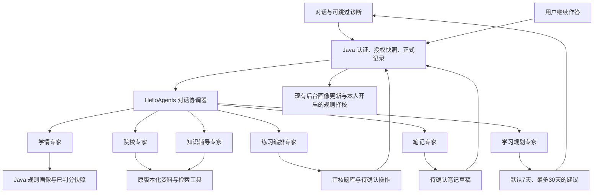

# HelloAgents 对话与多专家重构验证（2026-10-29）

本轮把当前工作树（含原有未提交修改）作为行为基线，将 Python 编排迁移为真实 HelloAgents 扩展，并按用户确认的第13章路线增加对话协调与学习规划。Java 与 Vue 只作契约校验、默认入口、计划展示及兼容调整。代码已迁移，日常运行进程和原 Python 环境未切换；没有提交、推送或部署。

## 依据与实际架构

依据 Datawhale《Hello-Agents》V1.0.3 第7章分层与工具接口、第9章 GSSC，以及第13章类型化数据与专业 Agent 协作。第13章 PDF 页序561—599，协作图573、协作流程575—576、连接复用581；页序从PDF第一页计数。可选本机资料为 `../../../ai-leaning_works/agents架构学习/Hello-Agents-V1.0.3-20260717.pdf`，不作为安装或CI依赖。图片 `360.JPG` 提供诊断、学情和院校联动的业务思路；权重自适应校准未引入，判分和画像继续使用现有 Java 规则。



- [core](../kaoyan-agent/core/)：原生 `HelloAgentsLLM` 的异步扩展、`Message` 转换、继承 `ContextBuilder` 的 GSSC、调用预算及本地增量JSON投影。共享原生异步SDK连接，关闭重试；同步流入口明确要求使用异步流，避免继承默认打印与异常包装。取消、断流或超时关闭响应，不用模型后台线程。
- [agents](../kaoyan-agent/agents/)：协调器和专业 Agent 继承真实 `hello_agents.core.Agent`。原生 `run` 与新增 `arun` 返回字符串，服务兼容适配返回现有字典；实际添加框架消息并在完成、失败或取消后清理。练习总结作为知识辅导的独立受控实现保留。
- [tools](../kaoyan-agent/tools/)：知识检索、院校筛选和排序、授权笔记读取及草稿建议使用真实 `Tool`、`ToolParameter`、`ToolRegistry`。参数使用Pydantic，未知字段、工具、重复名称拒绝；排序行也校验候选及来源结构。工具没有业务写入权限。
- [兼容入口](../kaoyan-agent/conversation.py)、[领域入口](../kaoyan-agent/workflows.py)、[模型入口](../kaoyan-agent/llm_client.py) 委托新实现，移除LangChain／LangGraph／LangSmith的直接依赖和执行路径，消除旧工作流与会话模块循环引用。

框架0.2.8导入会尝试隐式读取 `.env`，适配层仅在框架导入期间关闭该行为并恢复原环境变量；项目 `Settings` 保持唯一配置来源。GSSC继承实际 `build` 流程，候选选择沿用授权投影和原检索，保留原系统规则与JSON用户数据顺序；压缩只规范化JSON，不额外下载分词资源、重筛证据、截断资料或付费总结。

## 功能与安全边界

聊天作为主体，登录／注册无明确业务深链时默认进入 `/tasks`。原首页及其他页面保留。问候、功能说明不调用模型，诊断可以跳过。复合请求只执行所需白名单专家，按依赖形成最多6步的无环计划；无依赖的只读步骤可并行。

例如“分析薄弱点，安排7天复习，并推荐院校”使用学情、规划及院校专家；缺择校条件时保留计划并提示补充。规划可整理为笔记建议；已有笔记使用选中版本生成追加建议，确认前不保存。练习只从审核题库预览并走现有确认建卷，模型不原创正式题目。未知学习时间不编造小时。

内部计划版本2、步骤、已用模型次数与 `result.studyPlan` 的唯一详细契约见[搭建文档](../考研Agent平台搭建文档.md#阅读导航)。公开任务类型、状态、认证头、路径、SSE事件和原结果字段保留；新结构保存在已有JSON字段，无数据库迁移。缺新字段的旧计划按版本1解析，旧历史无需回填。

复合聊天的模型尝试预算由 plan 与 stream 共同计数：解析最多1次、专家阶段合计2次、可选汇总1次，总上限4；共享计数器原子预留，不能按专家重置。解析10秒、专家阶段20秒、汇总10秒，保留Java48秒保护；旧同步入口保持原预算。专家增量不混入同一答案slot，协作阶段显示进度，单专家原有模型流和可选汇总保留增量投影与最终校验。局部失败保留可用结果并注明未完成部分。

授权在每次外发时投影；可选汇总只接收已获授权并经AI路径处理的专家文本及本轮来源，规则产生的私人摘要不会再次外发。引用仍需来自本轮授权资料并校验支持度。原检索阈值、资料版本、院校排序、统计及估分算法保持；背景画像和本人开启的规则推荐不额外调用外部模型。框架没有持久记忆、文件笔记、终端、任意网络或业务库写入工具。

## 环境与检查结果

本机 macOS、Python3.13，独立环境 `.cache/helloagents-venv`；`hello-agents==0.2.8`、`openai==1.109.1`，原FastAPI、Pydantic、Qdrant、FastEmbed版本保持。`pip check` 通过。Java17；浏览器为Chrome，桌面1280与手机390宽度。所有接口链路使用临时H2、随机回环端口、独立浏览器、Redis及模型供应商替身。

| 检查 | 实际结果 |
| --- | --- |
| Python全量 `pytest kaoyan-agent/tests -q` | 297项通过，含原有功能断言 |
| 重构前冻结行为 | 21组合成领域／会话案例逐字段、逻辑模型输入与调用次数一致 |
| 受控SDK冻结请求 | 9组原供应商请求、结果及流式投影一致；保留 `max_completion_tokens` 参数 |
| 新框架与复合执行 | 真实继承及执行、消息清理、工具拒绝、账号／会话隔离、四次预算跨端点共享、并发预算、取消释放、隐私、局部失败、版本化笔记建议通过 |
| Java `bash mvnw -B -ntp verify` | 158项通过，含计划结构、学习计划和复合聊天JSON持久化回归 |
| 前端生产构建 | 通过；保留现有较大chunk提示 |
| 桌面／移动浏览器全量 | 172项通过（桌面／手机），2.4分钟 |
| 隔离HTTP及浏览器 | 15项通过，`.cache/helloagents-current-20261029.json` |
| 连续聊天与重启恢复 | 11项通过，`.cache/helloagents-chat-20261029.json` |
| 学情授权与受控操作 | 17项通过，`.cache/helloagents-learning-20261029.json` |
| 题目检索 | 11项通过，`.cache/helloagents-questions-20261029.json` |
| 学习闭环 | 桌面与手机两组通过：诊断续做、结束前不判分、画像及自动规则推荐；`.cache/helloagents-loop-20261029.json` |
| 题目管理隔离链路 | 10项通过，`.cache/helloagents-question-admin-20261029.json` |
| 离线质量评测 | 指定仓库案例语料后，lexical、BM25、hybrid均10/10；hybrid本次只验证无向量标记时回退BM25 |
| 脚本单元检查与夹具预览 | 8项单元检查通过；10校15专业、160练习题及12审核样例的只读预览通过 |
| 文档、入口、导入格式与差异 | 文档链接、JSON、Python语法、CI入口及 `git diff --check` 通过 |

首次离线评测沿用了本机 `RAG_DATA` 的真实语料配置，结果为6/10：4例引用前缀属于演示语料，所有预期终态仍正确。未改阈值或放宽断言；复测明确传入 `--data kaoyan-agent/knowledge/corpus.json`，三种后端均10/10。原结果保留于 `.cache/helloagents-quality-{backend}-20261029.json`，指定案例语料结果为 `.cache/helloagents-quality-{backend}-fixture-20261029.json`。此评测不证明真实资料覆盖或实际学习效果。

回归中修复了部分更新的 `conditionPatch` 在跨HTTP序列化时补成null、覆盖原条件的问题；未知条件继续保持未设置。浏览器检查修正新增夹具的诊断路径、空会话状态和区域定位器；原删除用例更新为新的功能说明文案。账号切换夹具按认证令牌返回不同账号数据，保留迟到确认不得导航或恢复旧卡片的断言。首次Chrome因受限环境不能启动，改在授权的隔离进程中运行，没有接管日常浏览器。

测试存在Starlette／框架Pydantic的弃用提示；受限环境偶有Python系统缓存／ONNX遥测标识写入警告，不涉及业务数据。没有以这些替身结果声明供应商效果或生产部署成功。

## 运行环境切换

本次只建立并验证独立环境，原 `.cache/chat-venv` 保留。以下是后续主动切换时的命令，本次未据此重启日常服务。环境已存在时不要重建覆盖；新机器可先建立独立虚拟环境：

```bash
python3.13 -m venv .cache/helloagents-venv
.cache/helloagents-venv/bin/python -m pip install -r kaoyan-agent/requirements-dev.txt
.cache/helloagents-venv/bin/python -m pip check
.cache/helloagents-venv/bin/python -m pytest kaoyan-agent/tests -q
```

Java测试需要使用该Python时，在项目根目录设置 `export PYTHON_EXECUTABLE="$PWD/.cache/helloagents-venv/bin/python"`。启动新版Agent的工作目录仍为 `kaoyan-agent`：

```bash
cd kaoyan-agent
../.cache/helloagents-venv/bin/python -m uvicorn main:create_app --factory --host 127.0.0.1 --port 8001
```

Java与前端需要使用本轮重新构建产物，才能校验并展示复合计划。端口已有日常进程时须另行安排切换；本次未停止或替换它们。不要仅替换依赖而将旧LangChain源码直接运行在新环境；完整代码及其锁定依赖应一起切换，回退时使用对应的旧源码和保留环境。

## 未运行与剩余限制

真实供应商、真实token／费用测量、付费模型、日常MySQL／Redis验收、真实整卷估分校准、公网验收及部署均**未运行**。本次没有执行数据库迁移、导入或清理，也未验证Linux CI线上执行结果。未引入AI权重校准，未改变资料内容或已有检索阈值；没有足够证据时仍提示样本或资料不足。每日模型预算仍为单进程内计数，重启会重置。

本轮保留既有未提交修改及并行资料接入工作；那些资料数量、日常库状态与页面成果属于其各自验证记录，不属于本次框架迁移验收。
