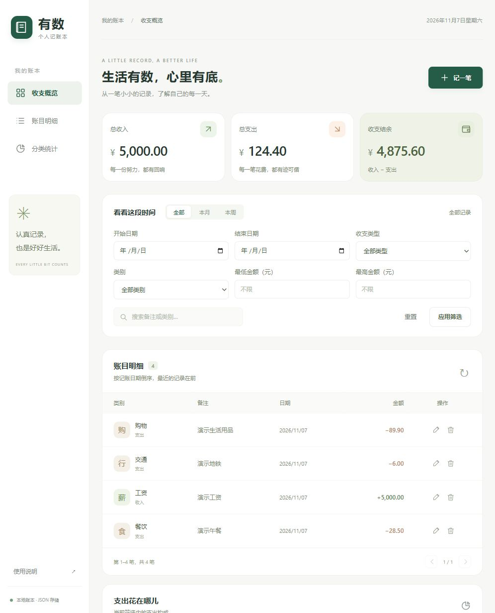

# 有数记账

一个在浏览器中操作、使用本地 JSON 文件保存数据的个人记账本。Python 后端与原生 HTML / CSS / JavaScript 前端分离，无第三方运行依赖。

项目仓库：[fzu-404-team/account-book](https://github.com/fzu-404-team/account-book)。



## 快速运行

需要 Python 3.10 或更新版本，以及支持 `dialog` 元素的现代浏览器（Chrome、Edge、Firefox 或 Safari）。开发验证环境为 Windows、Python 3.13。

```powershell
python app.py --open
```

或在 Windows 中双击 `start.bat`。浏览器打开 http://127.0.0.1:8000 。运行期间保持终端开启，按 `Ctrl+C` 停止服务。

默认端口被占用时：

```powershell
python app.py --port 8001 --open
```

不需要 `pip install`、Node.js 或数据库。不要直接双击 `static/index.html`，页面需要 Python 提供的接口。

## 功能

- 新增收入或支出：日期、金额、类别、备注。
- 编辑记录、二次确认删除；保存成功后同步更新统计。
- 按日期倒序展示记录，每页 8 笔。
- 按日期区间、收支类型、类别、金额区间和备注关键字组合筛选。
- 将全部匹配记录导出为 Excel 可识别的 UTF-8 CSV，使用中文表头并防止备注公式注入。
- 全部、本月、本周快捷筛选；本月和本周统计到今天，本周从周一开始。
- 当前筛选范围内的收入、支出、结余汇总与支出分类环形图。
- 连续月份收支统计接口，包含范围内无记录的月份并支持跨年。
- 空状态、输入校验、保存失败提示、连接失败重试。
- 响应式布局；手机窄屏中的明细表可横向滚动。

## 本地数据

月度统计接口：`GET /api/statistics/monthly?start=2025-12&end=2026-02`。`start` 和 `end` 使用 `YYYY-MM` 格式且包含首尾月份，单次最多查询 120 个月；响应中的 `months` 按月份升序返回，金额字段仍以整数分表示。

```json
{
  "months": [
    {"month": "2025-12", "income_cents": 0, "expense_cents": 0, "balance_cents": 0},
    {"month": "2026-01", "income_cents": 0, "expense_cents": 0, "balance_cents": 0},
    {"month": "2026-02", "income_cents": 0, "expense_cents": 0, "balance_cents": 0}
  ]
}
```

首次保存时自动生成 `data/ledger.json`。路径相对于项目目录，与运行命令时所在的目录无关。不会预置虚构账目。

```json
{
  "version": 1,
  "records": [
    {
      "id": "记录的唯一编号",
      "date": "2026-11-07",
      "kind": "expense",
      "amount_cents": 1250,
      "category": "餐饮",
      "note": "午餐",
      "created_at": "2026-11-07T12:00:00.000000"
    }
  ]
}
```

金额以整数分保存，输入通过 `Decimal` 校验，最多两位小数，单笔上限 9,999,999,999.99 元。金额必须为正，收支方向由 `kind` 决定。

保存采用同目录临时文件、刷新文件缓冲和原子替换。损坏账本会阻止启动并保留原文件；启动后若文件被外部修改，后续写入会被拒绝，重启后读取新文件。请只运行一个访问同一账本的服务进程，外部修改检测不构成跨进程文件锁。

备份：停止程序后复制 `data/ledger.json` 到安全位置。恢复：停止程序后将备份复制回该位置。项目通过 `.gitignore` 排除真实账本。删除不可撤销，没有自动备份。

使用独立账本（例如演示）：

```powershell
python app.py --data .qa/demo.json --port 8001 --open
```

应用只监听本机 `127.0.0.1`，没有登录系统，不用于公网或多人共享部署。

## 模块结构

```text
app.py                 HTTP 服务、接口与命令行入口
ledger/models.py       记录模型、日期/金额/类别校验
ledger/storage.py      JSON 读写与文件保护
ledger/service.py      记录操作、组合查询与汇总统计
static/index.html      页面结构与表单
static/styles.css      页面样式与响应式布局
static/app.js          接口交互、表格、筛选、图表
tests/                 业务与 HTTP 集成测试
docs/                  演示流程、博客模板、协作交付说明
```

## 测试

```powershell
python -m unittest discover -s tests -v
```

测试使用临时目录，不读取或修改正式账本，覆盖金额精度、输入校验、组合筛选、增删改持久化、损坏文件保护、写入失败回滚、外部修改检测、HTTP 接口与访问限制。

## 交付材料

- [演示流程](docs/DEMO.md)
- [博客填写模板](docs/BLOG_TEMPLATE.md)
- [协作与 Release 清单](docs/DELIVERY.md)
- [本次验证记录](docs/VERIFICATION.md)

当前源码包含辅助生成内容，请按课程规则如实说明工具使用、实际作者和成员贡献。团队成员、成员提交记录、实录视频和个人体验需要据实补充。
