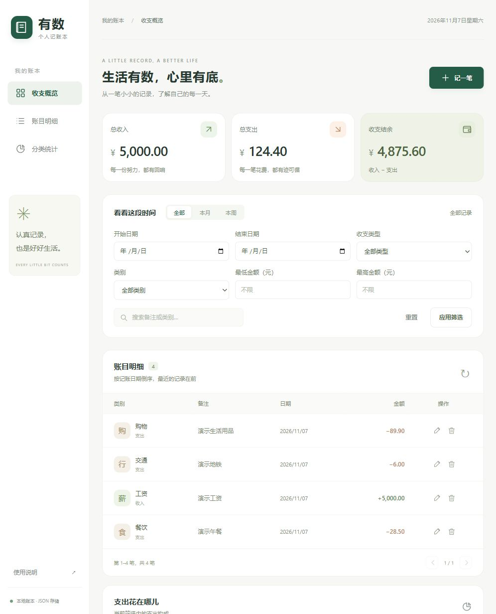
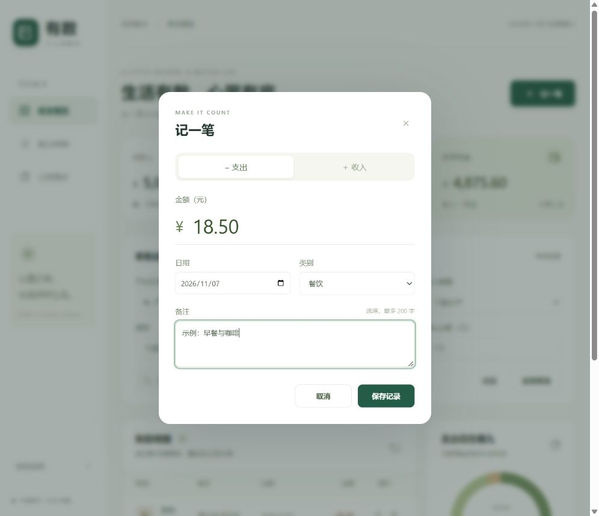

# 有数记账：团队现场编程记录

> 填写说明：方括号为待填写项。分工、耗时、讨论过程、体验和提交链接应以真实活动为准；不要把模板中的提示写成已发生的事实。

| 作业所属课程 | [班级的链接] |
| :--- | :--- |
| 作业要求 | [作业要求的链接] |
| 作业的目标 | 实现本地个人记账软件，练习模块划分、文件持久化、统计查询与 GitHub 协作 |
| 团队名称 | [团队名称] |
| 团队成员名字-学号 | [逐个填写名字和学号] |

## 1. 职责分工与工具使用

| 成员 | 独立完成的模块及具体工作 | 对应提交 / PR |
| --- | --- | --- |
| [姓名] | [真实完成内容] | [链接] |

[据实说明辅助工具使用方式、生成代码范围、人工修改及验证工作，确认符合课程规则。]

## 2. 程序运行环境

- 语言：Python，HTML / CSS / JavaScript。
- 后端：Python 标准库 HTTP 服务；本地 JSON 持久化。
- 运行要求：Python 3.10+，支持 `dialog` 的现代浏览器。
- 实际演示环境：[系统版本、Python 版本、浏览器版本]。
- 启动命令：`python app.py --open`。
- 本地地址：`http://127.0.0.1:8000`；数据文件：`data/ledger.json`。

## 3. 软件截图与视频

以下为独立演示账本的实际截图，仅包含示例数据。请结合最终版本补充筛选截图与可访问的视频链接。

[手机布局截图](screenshots/mobile.jpg)

视频：[待录制并填写链接]

## 4. 关键代码

以下函数可作为讲解候选，请从最终版本截取实际代码，配上注释：

1. `ledger/models.py` 中的 `parse_amount`：用 Decimal 校验金额，再转为整数分，避免浮点累计误差。
2. `ledger/storage.py` 中的 `JsonStore.save`：先写临时文件，再原子替换；写入成功后才更新内存状态。
3. `ledger/service.py` 中的 `LedgerService.query`：统一筛选结果，同时生成列表、总额和分类统计，保证展示口径一致。

## 5. 亮点（选择 1–3 项）

- 金额按整数分保存，结合两位小数与合法日期校验。
- JSON 原子写入、损坏文件保护、写入失败保留原账本。
- 多条件组合筛选，明细、汇总和分类图表同步变化。

[结合最终版本补充实现证据和对应截图。]

## 6. 收获较大的事件（至少 3 项）

| 实际事件 | 问题与尝试 | 花费时间 | 最终处理和收获 |
| --- | --- | --- | --- |
| [事件 1] | [实际过程] | [真实时间] | [真实结果] |
| [事件 2] | [实际过程] | [真实时间] | [真实结果] |
| [事件 3] | [实际过程] | [真实时间] | [真实结果] |

## 7. 每位成员的团队编程体验

### [成员姓名]

[本人填写：承担的工作、遇到的具体困难、与组员的协作、改进方向。]

## 8. SP / PSP 时间记录

[按照课程给出的参考格式填写计划和实际耗时，避免事后编造。]

## 9. GitHub 仓库与协作记录

- 仓库：[fzu-404-team/account-book](https://github.com/fzu-404-team/account-book)
- Release：[v1.0.0 发布链接]
- Commit 历史：[查看实际提交](https://github.com/fzu-404-team/account-book/commits/main/)
- 成员提交 / PR：[逐项列出实际链接]
- 验证结果：[测试命令、实际结果、演示验证情况]

## 10. 贡献评分

[组长依据真实贡献填写。总分满足「小组分数 × 人数」，个人分数按题目要求区分。]
