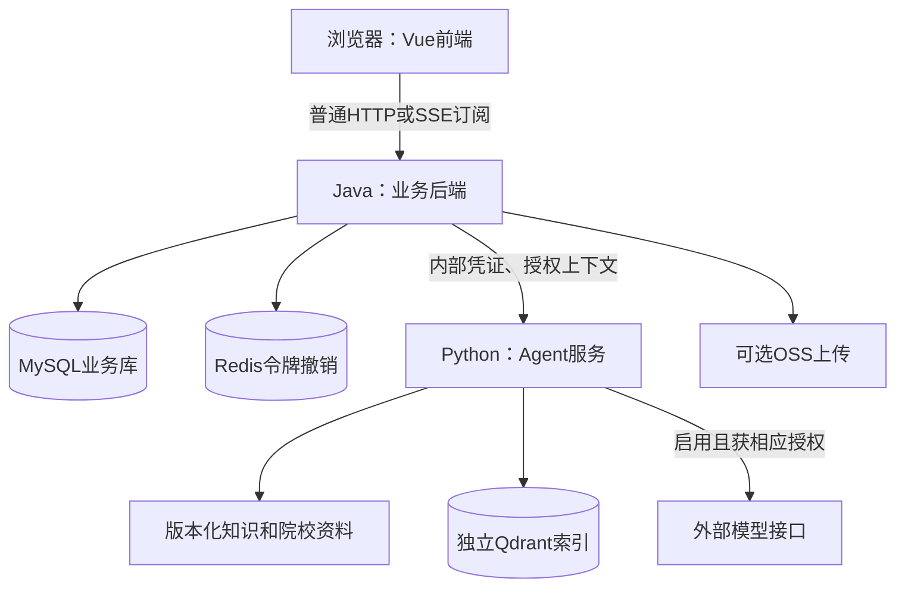

# 考研 Agent 平台：架构与源码导学

源码核对日期：2026-10-25；Git 基线：`369e236`。核对时已有未提交的 README、搭建文档及资料收集相关文件，本导学保留这些修改；行为判断以当前代码为准。本轮只读源码并编写学习材料，没有启动服务、执行迁移、运行应用测试或调用真实模型。

学习目标：理解每个模块的职责、技术的用途，以及登录、作答、聊天三条操作如何穿过代码。默认你会 Java、Python 基础语法，对 Web 框架不熟悉。全部八个单元已展开，配套问题见 [practice.md](practice.md)，可以逐课学习，无须一次读完。

本文是源码学习说明；业务目标与接口契约仍由[搭建文档](考研Agent平台搭建文档.md)、[RAG契约](docs/rag.md)、[连续聊天契约](docs/conversations.md)和[学情助手契约](docs/assistant-learning-contract.md)维护，运行命令以 [README](README.md) 为准。旧文档某些段落保留历史状态，本文不会把其中的未来目标当作当前能力。

## 导航与学习方法

| 单元 | 主题 | 学完能回答的问题 |
| --- | --- | --- |
| [01](#unit-01) | 工程全貌 | 三个应用分别运行在哪里，数据放在哪里？ |
| [02](#unit-02) | 前端组织 | 点击按钮后，页面如何请求数据并更新？ |
| [03](#unit-03) | 登录与权限 | 后端怎样识别账号，并拒绝越权访问？ |
| [04](#unit-04) | 普通业务与数据库 | Controller、Service、Mapper、DTO各自做什么？ |
| [05](#unit-05) | 刷题链路 | 谁判分，题目快照如何保护历史依据？ |
| [06](#unit-06) | Python与RAG | 如何检索资料、筛选院校并约束模型回答？ |
| [07](#unit-07) | 连续聊天与笔记 | 流式回答、恢复、停止、工具与笔记确认如何协作？ |
| [08](#unit-08) | 测试与运行保障 | 测试、迁移和CI分别证明什么？ |

每课按“操作场景 → 主链 → 编号源码阅读 → 分支与结果 → 复述任务”展开。先看主链，再打开链接；不要求背文件名。其他同类文件用职责表定位，遇到具体页面再沿链阅读。

## 01 工程全貌：系统怎样接住一次操作

状态：**已展开**。

### 场景与最少概念

你在浏览器打开平台、登录、做题、提问，背后对应三个独立应用。前端是浏览器执行的界面程序；后端是接收网络请求、执行业务和保存数据的服务；API是双方约定的请求地址和数据格式。

主链：**打开页面 → Vue挂载与路由选择 → 发HTTP请求 → Java认证及业务处理 → 必要时调用Python → Java保存结果 → 页面显示。** 普通查询和作答不必经过Python。

这是代码组织图，不代表这些服务本次已经启动。当前结构是单模块Java业务应用配合Python服务；使用OpenFeign不意味着已经建设服务注册中心、消息队列或多Agent调度。

### 按入口阅读

1. [前端启动](kaoyan-frontend/src/main.ts)：`createApp(App)`创建Vue应用，再注册Pinia、路由、Element Plus，最后挂载到页面的`#app`。输入是前端代码与配置，输出是浏览器中的界面。
2. [前端路由](kaoyan-frontend/src/router/index.ts)：根据地址选择页面。例如`/practice`进入刷题首页；`/tasks`进入助手。`App.vue`中的`router-view`是路由页面的显示位置，登录后的公共布局再组织菜单和内容。
3. [Java入口](kaoyan-B/src/main/java/com/kaoyan/KaoyanApplication.java)：`SpringApplication.run`启动应用；`@MapperScan`发现Mapper接口；`@EnableFeignClients`启用内部HTTP客户端。
4. [Python入口](kaoyan-agent/main.py)：`create_app`加载配置、资料、检索器和模型适配器，注册FastAPI路由；Uvicorn调用这个工厂并接收HTTP连接。
5. [前端构建配置](kaoyan-frontend/vite.config.ts)：开发服务默认5173端口，把`/api`代理给Java，默认目标8080。Python默认入口是8001。端口可配置，Vite开发代理不等于生产环境已经配置好反向代理。

### 文件夹分别装什么

| 位置 | 职责 | 学习时先关注什么 |
| --- | --- | --- |
| `kaoyan-frontend/` | 浏览器界面及前端构建 | `src`写交互，`tests`写浏览器检查，`package.json`声明依赖与命令 |
| `kaoyan-B/` | Java业务应用 | `src/main`为生产代码，`src/test`为测试；`pom.xml`配置依赖与构建 |
| `kaoyan-agent/` | Python检索与模型工作流 | `main.py`接请求，其他模块处理领域任务，`tests`放测试 |
| `config/` | 跨端共享配置 | 来源域名清单由Java和Python共同使用 |
| `scripts/` | 环境准备、数据处理、联调与评测入口 | 逐个看用途；名称包含test不代表所有子命令都只读 |
| `docs/` | 契约、历史验证、资料收集规范 | 区分当前协议、历史记录与生成提示词 |
| `.github/workflows/` | GitHub Actions自动检查 | 规定何时构建、测试及保存失败诊断 |
| `.env.example` | 环境变量示例 | 配置项说明，真实值在本机环境中，不属于前端代码 |
| `.cache`、`target`、`dist`、`node_modules` | 缓存、Java产物、前端产物、依赖 | 不作为第一轮业务源码阅读入口 |

### 四类数据必须分清

| 数据 | 在哪里 | 谁负责写入 |
| --- | --- | --- |
| 账号、作答、收藏、统计、聊天、个人笔记 | MySQL | Java业务代码 |
| 已注销令牌编号及过期时间 | Redis | Java认证代码 |
| 知识、院校的版本化资料副本 | Python读取的语料文件 | 受控资料维护流程；不是聊天时随意改写 |
| 文本向量及检索元数据 | 独立Qdrant | 资料建索引、题目索引流程；不代替业务数据库 |

外部模型接收本次允许发送的输入，返回文本；平台的正式聊天和笔记记录仍由Java保存。浏览器的localStorage目前缓存令牌与展示信息，不承担正式学习记录或服务端权限判断。

### 三种请求的差别

- 登录、查档案、提交答案：浏览器调用Java，Java直接完成业务。
- 原有推荐和批次总结：Java先保存任务，再同步等待Python结果，最后保存终态。
- 连续聊天：发送请求先得到任务编号；Java后台生成，浏览器另行订阅SSE事件获取进度。

代码默认关闭模型，知识检索默认`lexical`。这只是[配置默认值](kaoyan-agent/config.py)，本次没有读取真实`.env`或探测运行中的服务。即使模型关闭，已有规则筛选和来源摘要仍能工作；AI笔记生成会明确不可用。

选读：[三端依赖](kaoyan-frontend/package.json)、[Java依赖](kaoyan-B/pom.xml)、[Python依赖](kaoyan-agent/requirements.txt)。暂缓详细的认证、判分和聊天生命周期，分别在03、05、07单元展开。

复述任务：不用看图，说出“提交答案”和“AI问答”分别经过哪些应用，以及最终是谁保存记录。检查题见[练习01](practice.md#unit-01)。

## 02 前端组织：从按钮到界面变化

状态：**已展开**。

### 场景与主链

以点击登录按钮为例：**`Login.vue.onSubmit` → Pinia的`userStore.login` → `api/auth.ts.login` → Axios请求拦截器 → Java响应 → 响应拦截器解包 → 更新状态 → 路由跳转。** 本课先把Java当作返回JSON的服务，下一课再进入它内部。

Vue的“响应式”是指数据变化后，引用这些数据的界面会更新。例如`loading`变为`true`后，按钮显示加载状态。TypeScript在开发和构建时检查类型，但不能替代后端运行时校验。

### 按调用顺序阅读

1. [Login.vue](kaoyan-frontend/src/views/Login.vue)的模板把输入框绑定到`form`，把按钮绑定到`onSubmit`。`ref`保存单个响应式值，`reactive`组织表单对象；`onSubmit`先校验表单，再调用Store，并用`finally`结束加载状态。
2. [stores/user.ts](kaoyan-frontend/src/stores/user.ts)的`login`调用API，缓存`accessToken`，再请求本人信息；`isLoggedIn`和`isAdmin`是根据状态计算出的界面判断。Pinia让布局、路由和页面共享这些状态。
3. [api/auth.ts](kaoyan-frontend/src/api/auth.ts)只描述路径和输入输出，`login`向`/auth/login`发POST。路径前缀由统一请求配置决定；它不重复实现按钮逻辑。
4. [api/request.ts](kaoyan-frontend/src/api/request.ts)统一设置请求地址、超时和Bearer令牌。响应拦截器将成功的`{code,message,data}`解包成`data`，所以页面拿到的通常已经是业务数据。
5. [router/index.ts](kaoyan-frontend/src/router/index.ts)负责页面选择和进入前检查；[DefaultLayout.vue](kaoyan-frontend/src/layouts/DefaultLayout.vue)负责菜单、头部、退出及助手显示。实际权限还需要Java检查。

账号切换后，旧请求即使晚到也不能更新新账号界面。`request.ts`在请求时记住令牌，响应时比较当前令牌；聊天组件还有自己的请求代次校验，详见07单元。

### 前端代码职责地图

| 模块 | 文件与用途 |
| --- | --- |
| 页面入口 | `main.ts`装配应用；`App.vue`提供顶层路由出口；`router/index.ts`声明路由 |
| 布局 | `layouts/DefaultLayout.vue`组织常规页面；登录、注册等页面不经过该布局 |
| 账号 | `views/Login.vue`、`Register.vue`、`Profile.vue`；配合`api/auth.ts`、`user.ts`、`file.ts` |
| 题目与复习 | `PracticeHome.vue`、`PracticeSession.vue`、`WrongBook.vue`、`Favorite.vue`、`Statistics.vue`；对应`api/practice.ts`、`question.ts`、`mark.ts`、`stat.ts` |
| 资源与推荐 | `DocumentList.vue`、`SchoolList.vue`、`SchoolDetail.vue`；对应`api/document.ts`、`school.ts`、`recommend.ts` |
| 助手与历史 | `ChatAssistant.vue`承载聊天；`TaskList.vue`是助手包装页；`TaskHistory.vue`展示原任务历史；对应`api/conversation.ts`、`task.ts`、`privacy.ts` |
| 助手在布局中显示 | 当前`DefaultLayout.vue`在`/tasks`直接显示`ChatAssistant`，其他适用页面可显示紧凑侧栏；不要把包装页当成唯一实际挂载点 |
| 笔记 | `PersonalNotes.vue`组织列表、编辑和历史，接口位于`api/conversation.ts`，沿用个人文档API |
| 管理 | `views/admin/AdminQuestions.vue`、`AdminDocuments.vue`；`QuestionEntryForm.vue`复用录题表单 |
| 共用展示 | `TaskResultView.vue`渲染任务结果；`SafeMarkdown.vue`渲染受限制的Markdown；`ConversationListItem.vue`复用会话行 |
| 共享状态与逻辑 | `stores/assistant.ts`共享助手开关、所选笔记和刷新信号；`composables/assistant-page.ts`让页面提供助手上下文 |
| 类型与工具 | `types/api.ts`描述数据；`types/question-entry.ts`维护录题类型与辅助定义；`utils/question-history.ts`处理历史展示；`utils/assistant-resource.ts`处理资源跳转和安全来源URL |
| 样式 | `styles/index.scss`提供全局样式，页面内的`scoped`样式限制在组件范围 |

`composables`是复用Vue状态与生命周期逻辑的函数；`utils`通常承担不依赖完整页面的辅助处理。页面不应各自复制一套登录、错误处理或HTTP配置。

### 本课涉及的技术

| 技术 | 为什么需要 | 本项目落点 |
| --- | --- | --- |
| Vue 3、单文件组件 | 将模板、交互与样式组织在一起 | 各`.vue`文件；组合式API使用`ref`、`computed`、`watch` |
| Vue Router | 地址与页面对应，支持登录后跳转 | 路由表、守卫、嵌套路由 |
| Pinia | 跨组件共享状态 | 用户Store、助手Store |
| Element Plus及图标 | 复用表单、表格、弹窗、菜单等控件 | 页面中的`el-*`组件及图标 |
| TypeScript、vue-tsc | 尽早发现字段或调用类型错误 | 类型文件及生产构建中的类型检查 |
| Vite、npm、Sass | 开发服务、依赖管理、打包及样式预处理 | `vite.config.ts`、`package.json`、SCSS |
| Axios | 统一普通HTTP请求及拦截器 | `api/request.ts` |
| ECharts | 把服务器统计绘成图表 | `views/Statistics.vue` |

Vite配置中的`@`映射到`src`，所以`@/api/auth`只是更短的源码导入路径。自动导入插件帮助解析常用组件，不是额外的后端服务。

### 返回与失败

成功时Store保存令牌、读取本人信息，页面跳转。普通请求401会清除当前会话并转登录；403提示无权访问。同步请求超时只代表浏览器停止等待，任务可能已在后端创建，页面提示先查看记录。表单校验用于尽早反馈，服务端仍须独立校验。

选读：[前端类型](kaoyan-frontend/src/types/api.ts)、[统计页](kaoyan-frontend/src/views/Statistics.vue)。暂缓SSE、Markdown及笔记差异，归07单元。

复述任务：解释为什么一个登录操作要经过页面、Store和API封装，以及它们各自的输入输出。检查题见[练习02](practice.md#unit-02)。

## 03 登录与权限：服务器如何知道你是谁

状态：**已展开**。

### 场景与概念

认证回答“你是谁”，授权回答“你能做什么”。登录成功后，JWT作为后续请求的身份凭证。JWT带签名，可以验证是否被篡改；它并不是加密保险箱，不应放密码等秘密。

两条主链：**账号密码 → 登录Controller → 用户Service → BCrypt比对 → 签发accessToken**；随后是**Bearer令牌 → 认证过滤器 → 校验签名与撤销状态 → 读取当前账号 → 设置安全上下文 → 业务接口**。

### 按调用顺序阅读

1. [AuthController.login](kaoyan-B/src/main/java/com/kaoyan/controller/AuthController.java)接收`LoginRequest`，`@Valid`触发参数校验，再调用`UserService.login`。`@RestController`表示方法结果序列化为HTTP响应；`@PostMapping`将路径绑定到方法。
2. [UserServiceImpl.login](kaoyan-B/src/main/java/com/kaoyan/service/impl/UserServiceImpl.java)查用户、调用`passwordEncoder.matches`比较原始密码与BCrypt哈希、检查账号是否启用。BCrypt是单向密码哈希，登录时不把保存值“解密”。
3. [SecurityConfig.passwordEncoder](kaoyan-B/src/main/java/com/kaoyan/config/SecurityConfig.java)提供BCrypt组件；[JwtService.generateAccess](kaoyan-B/src/main/java/com/kaoyan/security/JwtService.java)签发令牌，包含用户编号、类型、唯一编号`jti`和有效期。
4. [JwtAuthenticationFilter.doFilterInternal](kaoyan-B/src/main/java/com/kaoyan/security/JwtAuthenticationFilter.java)处理后续请求：提取Bearer令牌，验证签名、签发者、过期时间及access类型，并向Redis检查是否撤销。然后重新读取账号，使用数据库中的当前状态和角色，创建Spring Security认证对象。
5. [UserContext](kaoyan-B/src/main/java/com/kaoyan/security/UserContext.java)从安全上下文读取当前用户编号；Controller把它传给Service。业务不会因为请求正文写了别人的`userId`就信任该归属。
6. [SecurityConfig.filterChain](kaoyan-B/src/main/java/com/kaoyan/config/SecurityConfig.java)配置公开认证入口、管理接口角色要求和其他接口认证要求。资源Service还需检查账号归属。

过滤器是进入Controller前的一道处理步骤。Spring Security通过过滤器链统一保护请求；Pinia或前端路由守卫只控制界面体验。

### 注册、退出与失败分支

注册调用`UserServiceImpl.register`：检查用户名和密码、哈希密码、固定创建`STUDENT`账号。公开请求不能直接授予管理员角色。

退出调用`AuthController.logout → UserServiceImpl.logout → JwtService.revoke`，将`jti`写入Redis，保留到令牌过期。删除浏览器令牌只是让当前浏览器不再发送；Redis撤销使持有同一旧令牌的后续请求也被拒绝。它不是把该账号全部令牌自动撤销。

| 情况 | 当前代码行为 |
| --- | --- |
| 用户不存在或密码错误 | 登录401；已禁用账号登录403 |
| 令牌损坏、过期、类型不对或已撤销 | 无法建立有效认证，受保护接口返回401 |
| 普通学生请求管理接口 | 403 |
| 查询其他账号的私有会话等资源 | 在相应归属检查处返回404 |
| 登录后的账号角色发生变化 | 过滤器重新查数据库，按当前角色判断 |

当前登录只返回accessToken；虽然存在refresh接口和`generateRefresh`方法，登录没有下发refreshToken，不能把它讲成已经实现自动续期。Redis当前用于撤销判断，不是所有业务数据的缓存；不可用会影响受保护请求。

`User.passwordHash`使用`@JsonIgnore`，注册也主动清掉返回对象中的哈希。但`/users/me`和注册仍存在返回User实体的实现，因此不能概括成“所有账号响应都是专用白名单DTO”；源码学习要同时看序列化注解与真正返回字段。

选读：[JwtServiceTest](kaoyan-B/src/test/java/com/kaoyan/security/JwtServiceTest.java)、[JwtAuthenticationFilterTest](kaoyan-B/src/test/java/com/kaoyan/security/JwtAuthenticationFilterTest.java)。暂缓后台生成中对令牌及隐私的再次检查，归07单元。

复述任务：从“收到accessToken”开始，解释下一次请求怎样变成可信的当前用户；再解释退出改变了什么。检查题见[练习03](practice.md#unit-03)。

## 04 普通业务与数据库：从HTTP到持久化

状态：**已展开**。

### 场景与主链

以修改目标院校、专业和报考年份为例：**Profile页面 → 用户API → 认证过滤器 → `UserController.updateProfile` → `UserServiceImpl.updateProfile` → MyBatis-Plus → MySQL → 统一响应。** 持久化指把数据保存到数据库，服务重启后仍可读取。

### 逐层阅读

1. [Profile.vue](kaoyan-frontend/src/views/Profile.vue)组织表单；[api/user.ts](kaoyan-frontend/src/api/user.ts)发送更新请求。它们提供要修改的字段，不决定数据库记录的归属。
2. [ProfileRequest](kaoyan-B/src/main/java/com/kaoyan/dto/request/ProfileRequest.java)描述允许接收的档案字段；[UserController.updateProfile](kaoyan-B/src/main/java/com/kaoyan/controller/UserController.java)从`UserContext.currentUserId()`取归属并调用Service。DTO是跨接口传递数据的对象；字段是否有长度、格式约束还要逐项看注解与Service，不能因写了`@Valid`就推断全部校验完备。
3. [UserServiceImpl.updateProfile](kaoyan-B/src/main/java/com/kaoyan/service/impl/UserServiceImpl.java)查本人记录、更新字段。Service承担业务规则和事务，Controller不应直接拼SQL。
4. [UserMapper](kaoyan-B/src/main/java/com/kaoyan/mapper/UserMapper.java)配合[User实体](kaoyan-B/src/main/java/com/kaoyan/entity/User.java)映射表和字段。MyBatis-Plus为常见查询、更新和分页减少重复SQL；复杂查询仍有Mapper注解或XML。
5. [Result](kaoyan-B/src/main/java/com/kaoyan/common/Result.java)将结果包装为`{code,message,data}`；[GlobalExceptionHandler](kaoyan-B/src/main/java/com/kaoyan/common/GlobalExceptionHandler.java)将业务异常、参数错误等转换为统一错误响应，前端拦截器据此显示反馈。

Java内部是方法调用，Java与浏览器、Python之间是HTTP请求。JSON序列化是将Java对象转成网络文本，反序列化则把收到的JSON转换为对象。Java使用Jackson处理这些转换。

### Java目录与业务职责地图

| 层或模块 | 作用与代表代码 |
| --- | --- |
| `controller/` | HTTP入口；认证、用户、任务、推荐、院校、资料、题目、练习、标记、统计、聊天、笔记、隐私和上传各有Controller |
| `dto/request/`、`dto/query/` | 请求正文和查询参数；例如答案请求、录题请求、分页查询 |
| `dto/response/` | 对外展示数据；例如学生题目、判分、历史回顾、任务视图，控制哪些字段能公开 |
| `dto/agent/`、`feign/` | Java到Python的同步契约与HTTP客户端；部分旧请求类仍在目录中，实际同步主链以`AgentRequest/AgentResponse`为准 |
| `service/`、`service/impl/` | 业务接口及实现；新增聊天、笔记等也有直接位于`service/`的具体类，不是所有逻辑都在`impl/` |
| `mapper/`、`resources/mapper/` | MyBatis数据访问及SQL映射；`SchoolMapper.xml`包含院校相关查询 |
| `entity/` | 表对应的Java对象；账号、任务、资料、学校、专业详情、题目、作答、标记和统计等 |
| `security/`、`config/` | 当前用户、令牌、权限以及分页、内部调用、文档、OSS等配置 |
| `common/`、`util/` | 统一响应、分页、异常、字段自动填充，以及ID、日期、OSS辅助逻辑 |

| 业务 | 主要Service | 数据与边界 |
| --- | --- | --- |
| 档案 | `UserServiceImpl` | 本人账号及目标条件；个人资料不会因一句聊天条件补丁自动被改写 |
| 院校库 | `SchoolServiceImpl`、`SchoolDetailServiceImpl` | 查询MySQL学校和专业详情；与Python版本资料中的推荐候选不是同一条数据读取链 |
| 推荐 | `RecommendServiceImpl`、`TaskServiceImpl` | 推荐进入统一任务流程；旧`RecommendRecord`实体/Mapper保留，不是新推荐的存储主链 |
| 公共资料 | `DocumentServiceImpl` | 管理草稿、审核与已发布列表；数据库资料发布不等于已经自动加入Python知识库 |
| 题目管理 | `QuestionServiceImpl` | 录题、来源、审核、启停和版本校验；学生展示使用不含答案的DTO |
| 刷题、错题、统计 | `PracticeServiceImpl`、`UserQuestionMarkServiceImpl`、`StudyStatServiceImpl` | 本人记录、快照和确定性判分，下一课展开 |
| 聊天和笔记 | `ConversationService`、`PersonalDocumentService`、`ChatRepository` | 通过JdbcTemplate进行增量聊天表及笔记表操作，第07课展开 |
| 学情和题目搜索 | `AssistantLearningService`、`QuestionSearchService`、`LearningTopic` | Java确定读写范围，Python只做允许的主题与语义匹配 |
| 隐私及引用 | `AssistantPrivacyService`、`ReferenceSourcePolicy` | 分类授权、端点绑定及来源校验 |

题目管理中的`update`只允许修改待审核或已驳回题，已发布题禁止原地编辑；审核、修改及启停还会检查请求版本。这与“已经有完整历史版本发布系统”是不同的能力，后者仍待建设。

### 技术为什么放在这些位置

Spring Boot负责自动配置与组件装配，Spring MVC负责将HTTP映射到Controller。依赖注入是让框架创建并连接组件；`@Service`、构造器及`@RequiredArgsConstructor`让Service拿到所需Mapper等对象。Lombok在编译时生成构造器、getter/setter等样板代码，不替你实现业务规则。

事务把多次数据库修改组织成一次成功或回滚。例如作答成功、错题标记和统计不能随意各存一半。`@Transactional`用于声明事务，聊天也使用`TransactionTemplate`显式划分事务。等待模型期间不应持有数据库长事务，任务采用“短事务预占 → 外部调用 → 短事务保存结果”。

MyBatis-Plus不是唯一持久化方式：[ChatRepository](kaoyan-B/src/main/java/com/kaoyan/service/ChatRepository.java)使用Spring的JdbcTemplate执行参数化SQL、读取JSON和分页。它与Mapper都访问业务数据库；Python没有因此获得业务库连接权。

选读：[MybatisPlusConfig](kaoyan-B/src/main/java/com/kaoyan/config/MybatisPlusConfig.java)、[QuestionServiceImpl](kaoyan-B/src/main/java/com/kaoyan/service/impl/QuestionServiceImpl.java)、[DocumentServiceImpl](kaoyan-B/src/main/java/com/kaoyan/service/impl/DocumentServiceImpl.java)。题目版本不匹配等业务冲突返回409，不应被页面解释成已保存。

复述任务：用修改档案的例子分别说明DTO、实体、Controller、Service、Mapper的输入输出。检查题见[练习04](practice.md#unit-04)。

## 05 刷题链路：创建、判分与历史依据

状态：**已展开**。

### 场景与主链

你选择科目并创建5题练习，在第一题选择B，点击提交：**刷题首页 → 创建批次 → 为题目建立有序记录和快照 → 练习页加载 → 提交B → Java校验并判分 → 保存作答、错题及统计 → 返回判分结果和解析。** “5题”和选项B是教学输入，不代表真实题库里B一定正确。

快照是当时数据的副本。它使新批次判分有固定依据，而不是每次都读取可能已经修改的标准答案。

### 按数据变化阅读

1. [PracticeHome.vue](kaoyan-frontend/src/views/PracticeHome.vue)通过[api/practice.ts.startSession](kaoyan-frontend/src/api/practice.ts)发送科目、数量等条件；[PracticeController.start](kaoyan-B/src/main/java/com/kaoyan/controller/PracticeController.java)带当前账号调用`startSession`。
2. [PracticeServiceImpl.startSession](kaoyan-B/src/main/java/com/kaoyan/service/impl/PracticeServiceImpl.java)限制1—50题，支持普通、本人错题、本人收藏来源。筛选可练习题目，为每道题创建`practice_record`，写入顺序、`gradingStatus=valid`及`question_snapshot`；零候选不创建空批次。`snapshotAtCreation`区分新固定快照与旧批次兼容行为。
3. [PracticeSession.vue](kaoyan-frontend/src/views/PracticeSession.vue)的`readRecords → navigate/findNext`按记录顺序寻找未答题，再请求学生题目详情。未提交前的详情通过[StudentQuestionVO](kaoyan-B/src/main/java/com/kaoyan/dto/response/StudentQuestionVO.java)隐藏标准答案和解析。
4. 页面的`submit`调用`answerQuestion`，正文只有`questionId`与`answer`；Controller把当前账号、路径批次号和答案交给`PracticeServiceImpl.answer`。
5. `answer`查本人该批次记录，检查未答、题目仍可练习及判分配置；新批次从创建快照提取标准答案，旧未答批次保留代码中的兼容路径。将用户选项规范成A—D后比较，计算`isCorrect`。
6. Service用“仍未答且valid”的更新条件保存结果，失败则409；错答调用`markWrong`，随后调用`studyStatService.accumulate`。这些操作在作答事务内完成。返回[AnswerVO](kaoyan-B/src/main/java/com/kaoyan/dto/response/AnswerVO.java)，包含服务器判分及本次允许查看的答案和解析。
7. 页面使用服务器的`isCorrect`、`userAnswer`和反馈对象显示结果，不再自行比较标准答案。选择B但尚未点提交，不会保存正式作答或计入错误。

### 历史回顾与统计

[QuestionHistoryView](kaoyan-B/src/main/java/com/kaoyan/service/QuestionHistoryView.java)和历史展示DTO区分未答、可用、部分字段缺失、快照缺失及不可用。已答的历史答案和解析来自保存的快照，不能拿现行题目补造旧依据；手动收藏不等于已经答过，也不会因此开放标准答案。

[StudyStatServiceImpl](kaoyan-B/src/main/java/com/kaoyan/service/impl/StudyStatServiceImpl.java)除了维护统计，还从有效、已判分的作答计算查询结果。学情查询默认按上海日期近30天统计，区分作答次数、去重题数和当前错题本题数；错题本题数不等于这段时间答错次数。未记录的学习时长、提示辅助和独立作答不推算。

### AI总结是另一条调用链

**`triggerAiSummary` → `PracticeController.aiSummary` → `TaskServiceImpl.submit(PRACTICE_SUMMARY)` → 读取本人已判分快照 → Feign调用Python → 保存Task → 页面显示。**

[TaskServiceImpl.buildRequest](kaoyan-B/src/main/java/com/kaoyan/service/impl/TaskServiceImpl.java)在创建任务前检查：有效项目全部已答、快照非空、最多50题。缺历史快照返回409，不占本次任务额度，不用新题补旧快照。Python接收的是已判分副本；模型只可解释，不能重新决定正误。

### 必须看清的失败与当前缺口

| 情况 | 当前处理 |
| --- | --- |
| 非法选项或该题无对应选项 | 400，不完成判分保存 |
| 不存在或非本人的作答记录 | 404 |
| 重复提交、重叠更新未赢得写入 | 409，不重复累计同条记录 |
| 明确不可用题目或详情404 | 页面提示并跳过；不写作答、错题或统计 |
| 网络失败 | 页面保留重试，不能当成题目撤回直接跳过 |
| 提交404/409 | `recoverSubmission`重查本人记录与题目，确认是否已有结果或题目确实不可用 |

当前已具备新批次创建快照和上述同条记录保护，但完整clientRequestId重放、不同作答并发统计仍不能据此声称全部闭环。服务端草稿、审核提示辅助标记、正式结束状态等仍待建设；页面`finished`变量不等于数据库中已有正式批次状态。当前放弃接口还会删除批次记录，与未来保留已答记录的正式结束设计不同。

选读：[PracticeAnswerSafetyTest](kaoyan-B/src/test/java/com/kaoyan/PracticeAnswerSafetyTest.java)、[前端作答安全检查](kaoyan-frontend/tests/practice-answer-safety.spec.ts)、[恢复检查](kaoyan-frontend/tests/practice-recovery.spec.ts)。暂缓模型总结内部实现，归06单元。

复述任务：如果底层题目内容日后发生变化，分别解释新批次判分、历史回顾和当前题目可用性检查读取什么。这里讨论快照保护的边界，不表示当前管理API允许原地修改已发布题。检查题见[练习05](practice.md#unit-05)。

## 06 Python与RAG：先找依据，再组织回答

状态：**已展开**。

### 场景与主链

以明确的知识问答“TCP如何实现可靠传输”为例。先沿同步入口学习内部处理：**Java组装请求 → 内部认证 → Pydantic校验 → 选择问答工作流 → 检索资料 → 返回来源摘要或模型解释 → 校验结构与引用 → Java复核并保存。** 连续聊天复用这些能力，但多了计划与流事件，下一课展开。

RAG是“检索增强生成”：先找到与问题有关的资料，再把问题和资料交给模型。它没有把资料训练进模型参数，也不能保证模型不会说错，因此还需要结果校验与内容核对。

### 从HTTP进入领域代码

1. [AgentFeignClient.chat](kaoyan-B/src/main/java/com/kaoyan/feign/AgentFeignClient.java)发送`AgentRequest`和`X-Internal-Key`，目标是`POST /internal/rag/chat`。这个内部凭证用于服务之间认证，与学生JWT职责不同。
2. [main.py.create_app](kaoyan-agent/main.py)装配`Settings → Corpus → Retriever → ModelClient → Workflows`。FastAPI负责路由和依赖认证，Uvicorn负责运行HTTP服务。
3. [schemas.py](kaoyan-agent/schemas.py)用Pydantic定义`ChatRequest`、`Profile`、`QuestionSnapshot`及输出模型；`StrictModel`拒绝额外字段，`task_fields`检查任务与字段是否匹配。请求错误422，内部凭证错误401。
4. [Workflows.run/_run](kaoyan-agent/workflows.py)按明确任务类型调用`qa`、`schools`或`summary`；只有`CHAT`才需识别意图。固定工作流意味着分支由代码约束，模型不能自行增加任意SQL、文件或网络工具。
5. `qa`先用科目提示检索，无结果时可去掉弱科目提示重查。无资料返回`UNSUPPORTED`；有资料先构造确定性来源摘要，再判断是否允许调用模型。
6. Java的[validateResponse](kaoyan-B/src/main/java/com/kaoyan/service/impl/TaskServiceImpl.java)和[ReferenceSourcePolicy](kaoyan-B/src/main/java/com/kaoyan/service/ReferenceSourcePolicy.java)继续检查任务编号、结构、版本、候选及来源。通过后才保存结果。

### 资料如何变成可检索内容

[retrieval.py.Corpus](kaoyan-agent/retrieval.py)读取配置指定的JSON语料，检查资料领域、核验状态、来源定位、版本和许可字段，再用[source_policy.py](kaoyan-agent/source_policy.py)检查来源域名。规范化JSON的SHA256摘要生成`releaseId`，从而将结果绑定到资料版本。

代码能检查`verified`等状态和元数据是否符合契约，但不能凭这些字段证明全文正确或许可有效；来源与内容仍需真实核对和审核。仓库基线语料与本机实际加载语料也可能不同，应以配置和对应记录区分。

资料按450字符窗口、350字符步长切块，即相邻块最多重叠100字符；每块仍保留来源和原文定位。这里是固定字符窗口，不应讲成已经实现智能语义切块。知识摘要与招生结构化记录的用途不同。

| 检索方式 | 基础解释 | 当前实现 |
| --- | --- | --- |
| `lexical` | 比较问题与资料的词项、关键词 | `Corpus.lexical`，默认，不下载向量模型 |
| `bm25` | 按词项频率、稀有程度和长度修正排序 | `BM25Index`，中文单字/双字和ASCII词的轻量实现，没有使用jieba或rank-bm25 |
| `qdrant` | 文本转数字向量，寻找含义接近的资料 | FastEmbed生成向量，Qdrant保存向量并检索；分数不是事实正确概率 |
| `hybrid` | 合并关键词排序与向量排序 | `Retriever.search`用RRF按排名融合；向量索引缺失等已处理情况可回退BM25 |

Embedding模型负责将文本转换为数字向量；生成式大模型负责输出回答，两者职责不同。FastEmbed默认使用配置中的中文模型`BAAI/bge-small-zh-v1.5`。Qdrant既支持本地持久模式，也有远程配置；本地模式按项目运行约束单进程使用。

[ingest.py](kaoyan-agent/ingest.py)的`VectorIndex.build`用于建立资料索引，集合绑定语料与模型，全部写入后再发布就绪标记；旧集合保留。它不是Java业务表迁移，也不会把MySQL整库交给Python。

### 模型、提示词与输出校验

[llm_client.py.ModelClient](kaoyan-agent/llm_client.py)使用LangChain的`ChatPromptTemplate`和`ChatOpenAI`，通过OpenAI兼容客户端访问配置的模型服务。“兼容”描述API形状，不限定实际供应商。

提示词在[prompts目录](kaoyan-agent/prompts)；[prompts.py.get](kaoyan-agent/prompts.py)加载模板。当前同步工作流使用知识问答、院校解释、练习总结和意图模板；文件存在不代表所有模板都被主链使用。用户问题、历史和资料作为数据传入，不获得修改系统规则的权力。

模型先输出符合约定的JSON，再由Pydantic校验；知识回答的来源编号只能取自本次检索。`grounding.py.verify`进一步比较结论和所引原文的词项、数字等，给出支持度。知识回答不支持时保留来源摘要；部分支持保留提示。这是词项核对基线，无法可靠识别所有否定、矛盾和同义表达，不等于事实核查已经完成。

`ModelBudget`记录单Python进程的UTC每日尝试数，失败也消耗尝试；重启会重置。SDK关闭自动重试，单次调用有超时；请求上下文还有调用次数限制。不能把它称为跨重启的供应商账单硬上限。真实外发还受授权条件约束，见07单元。

### 另外两种领域工作流

- `schools`：从版本化专业副本读取候选，按年份、专业、学位、明确学习方式、考试科目及required地区筛选；按地区偏好、更新日期、稳定编号排序，最多5个。缺条件追问，无匹配不自动换年份。模型只解释确定的候选，不根据向量分数判断招生年份，也不预测录取概率。
- `summary`：统计Java传来的`correct`等判分事实，生成正确题数、正确率及复习线索；模型可解释，但不能改变标准答案或作答记录。

### Python文件职责地图

| 文件/目录 | 负责什么 |
| --- | --- |
| `main.py` | 应用工厂、内部认证、同步/计划/流式及题目索引接口、生命周期清理 |
| `config.py` | 环境配置与合法性检查；不保存真实密钥 |
| `schemas.py` | 跨端输入输出、条件、计划、文档建议等契约 |
| `workflows.py` | 问答、院校筛选和总结固定流程 |
| `retrieval.py`、`ingest.py` | 资料版本、切块、四种检索与资料建索引 |
| `source_policy.py`、`grounding.py` | 来源域名与引用支持度核对 |
| `llm_client.py` | 模型适配、超时、预算、JSON解析及真实流式正文投影 |
| `conversation.py` | 解析会话意图、Runnable分支、受限工具与结果装配 |
| `learning.py` | 本地学情意图、类别授权投影、规则摘要等 |
| `question_search.py` | 独立题目语义索引、状态与授权候选匹配；不承担正式判分 |
| `knowledge/`、`prompts/` | 资料副本与提示模板；配置决定加载哪份语料 |
| `handlers/__init__.py` | 当前目录占位，不是主工作流的路由实现 |
| `requirements*.txt`、`langchain-constraints.txt`、`tests/` | 依赖与传递版本约束、测试 |

注意两组同名状态：`status=SUCCESS`是处理成功，`result.outcome=COMPLETED/NEEDS_INPUT/UNSUPPORTED`才表示领域结果；HTTP200不等于已经找到可回答依据。`explanationMode=rules/ai/fallback`表示解释来源方式。

选读：[test_quality.py](kaoyan-agent/tests/test_quality.py)、[test_workflows.py](kaoyan-agent/tests/test_workflows.py)、[共享来源清单](config/reference-hosts.json)。暂缓聊天历史、学情授权和题目操作，归07单元。

复述任务：假设模型输出一个并未检索到的来源编号，解释哪些层会校验，以及原有规则结果为什么还能保留。检查题见[练习06](practice.md#unit-06)。

## 07 连续聊天与笔记：后台工作怎样被页面看到

状态：**已展开**。

### 场景与主链

你在助手输入“TCP如何实现可靠传输”。**发送问题 → Java短事务保存消息与生成任务 → 立即返回编号并在后台处理 → Python解析计划 → Java校验并读取必要上下文 → Python流式生成 → Java校验和保存终态 → SSE通知浏览器。**

异步表示请求返回时后台工作未必完成；流式表示结果可以分批传来。这两件事不同。SSE是服务器通过一个HTTP响应持续发送文本事件；本项目用带Bearer请求头的Fetch读取它，没有使用WebSocket。

### 先追发送，再追订阅

1. [ChatAssistant.vue.send](kaoyan-frontend/src/views/ChatAssistant.vue)整理问题、`clientRequestId`、可选笔记和页面上下文，经[api/conversation.ts.sendMessage](kaoyan-frontend/src/api/conversation.ts)发出。必要时先创建会话。
2. [ConversationController.send](kaoyan-B/src/main/java/com/kaoyan/controller/ConversationController.java)带当前账号调用[ConversationService.send](kaoyan-B/src/main/java/com/kaoyan/service/ConversationService.java)。Service检查归属、请求编号、会话是否空闲、所选笔记版本，在短事务中保存消息并`reserve`一个RUNNING任务及生成记录。
3. `dispatch`把工作交给有界线程池，安排超时保护，再让发送请求返回编号。相同请求编号和内容会重放原编号，不再派发；同编号不同内容409。同会话有活动生成时拒绝新问题。
4. 浏览器调用`subscribeGeneration`，GET对应任务的`/stream`；Java的`subscribe`先发`snapshot`，再注册后续事件监听。**订阅只观察已创建任务，不创建生成，也不消耗新的模型次数。**

### 后台生成的实际调用顺序

5. `ConversationService.generate`先检查当前授权，向Python的`/internal/rag/conversation/plan`发请求；Python的`ConversationWorkflow.plan → resolve`使用本地解析或允许的模型解析，产出受限制的计划。
6. Java执行`validatePlan → resolveTargets → AssistantLearningService.read`：根据本人范围和计划读取错题、收藏、统计、公开题目等。它决定最终对象范围，不直接相信模型提供的编号或写操作。
7. Java再次检查授权，把必要上下文与`preparedPlan`发送到`/internal/rag/conversation/stream`。Python的[ConversationWorkflow](kaoyan-agent/conversation.py)使用`RunnableLambda | RunnableBranch`进入普通回答、笔记建议或学情分支，复用已准备计划。
8. 模型启用且授权允许时，[ModelClient](kaoyan-agent/llm_client.py)读取真实SDK流，将部分JSON中的允许正文投影成`delta`；路由结果和内部推理不展示。模型关闭时返回规则结果，不把完整文本逐字切开冒充模型流。
9. Python最终发送`result`；Java复核结构、来源、会话条件及笔记建议。`terminate`用条件更新竞争唯一终态，保存数据库后才广播`completed`；失败和取消也会保存状态并清理活动占用、草稿及连接。

LangChain在这里提供模板、可组合分支、检索器和工具包装；实际调用路线受代码控制。LangGraph虽为依赖树的一部分，当前并未承担另一套持久会话或自主Agent循环。聊天历史保存在Java的MySQL表中，由Java选择最近3轮成功历史；失败、取消和未完成草稿不充当下一轮正式历史。

### SSE事件、恢复与停止

| 事件/动作 | 输入或意义 | 页面/后端结果 |
| --- | --- | --- |
| `snapshot` | 当前任务完整状态、版本、草稿或结果 | 页面从快照恢复，无须重新提问 |
| `stage` | 当前处理阶段 | 更新进度提示 |
| `delta` | 正文槽位、版本、Unicode码点偏移和新增文本 | 检查连续性后追加；旧版本忽略，位置不连续重新获取快照 |
| `completed/failed/cancelled` | 完整终态快照 | 显示正式结果或失败原因，结束本次订阅 |
| 网络断开 | 当前订阅无法继续接收 | 重连后重新订阅原任务；不等于取消后台生成 |
| 显式停止 | POST对应任务的`/cancel` | 保存CANCELLED，并关闭上游；完成与停止只有一个终态生效 |
| 重启 | 启动时`recover`发现RUNNING遗留记录 | 标记中断失败；不会自动恢复模型从中间继续生成 |

浏览器有无数据超时和有限重连逻辑，Java发送心跳；生成草稿约每500毫秒保存一次，因此崩溃前最后一段可能未落库。正式终态立即保存。账号切换、切换会话或卸载时，前端中断旧订阅并用请求代次防止迟到响应污染界面。

普通失败/停止的重试只允许最后一问，创建新的生成尝试，保留之前记录并计入额度。代码还对“题目索引未就绪”的特定成功但未覆盖结果开放最后一问重试；不能将重连与这种重试混为一谈。

### 学情、主题检索与受控操作

[AssistantLearningService](kaoyan-B/src/main/java/com/kaoyan/service/AssistantLearningService.java)负责本人学习记录读取及操作记录；[QuestionSearchService](kaoyan-B/src/main/java/com/kaoyan/service/QuestionSearchService.java)提供Java允许的公开题目副本和候选集合；Python的[QuestionIndex](kaoyan-agent/question_search.py)做标签匹配及本地向量匹配，返回编号、版本、方法和分数。

题目索引与知识资料索引独立：题干、选项、知识点参与检索，标准答案和个人作答不参与公共语义匹配；历史覆盖快照仅在内存匹配。索引未就绪时不拿旧集合执行操作，也不混入无关题补数量。

以“将错题本中涉及二叉树的题目加入收藏”为例：解析主题和操作 → Java限定本人错题候选 → Python匹配 → Java保存待确认操作 → 页面预览 → 用户确认 → Java再次检查归属、版本与内容指纹后执行。主题操作即使只有一题也先预览；来自明确来源回答的直接单题收藏有受控直接执行路径。删除错题标记、取消收藏、创建练习也由Java处理，模型不能通过一句“已完成”代替真实业务结果。

### 隐私是两个独立边界

- **本人数据访问**：Java依据当前账号读取本人记录，不能读取其他账号的数据。
- **外发模型授权**：[AssistantPrivacyService](kaoyan-B/src/main/java/com/kaoyan/service/AssistantPrivacyService.java)保存是否允许模型及错题、收藏、统计、档案、笔记类别，绑定接收端点和授权版本；Python的[learning.py](kaoyan-agent/learning.py)继续按类别投影必要上下文。个人笔记还要逐份选择。

能在平台内读取本人错题，不等于默认允许把它发给外部模型。后台处理前后仍会检查令牌、账号和授权变化；撤回授权会触发活动任务处理。聊天副本按30天保留与主动清除规则处理，原始学习记录和已保存个人笔记独立保留；不能推断供应商或备份也已同步删除。

### AI笔记建议怎样变成正式笔记

**选择笔记及版本 → Python生成`documentProposal` → 前端预览与编辑差异 → 用户确认 → Java `apply → PersonalDocumentService.save` → 保存新历史版本。**

[PersonalNotes.vue](kaoyan-frontend/src/views/PersonalNotes.vue)提供独立手动编辑，[ChatAssistant.vue](kaoyan-frontend/src/views/ChatAssistant.vue)提供建议预览。`diff`的`diffLines`比较修改前后；[SafeMarkdown.vue](kaoyan-frontend/src/components/SafeMarkdown.vue)用Markdown-it转换格式，禁用原始HTML、远程图片，并以DOMPurify清洗输出，链接仅接受响应授权的HTTPS地址。这些处理减少模型或用户文本变成危险页面内容的风险。

[PersonalDocumentService.save](kaoyan-B/src/main/java/com/kaoyan/service/PersonalDocumentService.java)检查`baseVersion`，旧版本409，不能静默覆盖。`source_task_id`用于同次建议确认的重复处理，重复确认返回该次保存版本。生成成功只代表建议已经产生，尚未确认就不会修改正式笔记。个人笔记也不会自动进入公共知识库。

选读：[ConversationIntegrationTest](kaoyan-B/src/test/java/com/kaoyan/ConversationIntegrationTest.java)、[test_conversation.py](kaoyan-agent/tests/test_conversation.py)、[test_learning_privacy.py](kaoyan-agent/tests/test_learning_privacy.py)、[前端会话测试](kaoyan-frontend/tests/conversation.spec.ts)。本课首次阅读可暂缓正则细节与索引内部调参，先掌握入口、归属和终态。

复述任务：同一个生成任务依次经历发送、断线、重连、完成，说明哪些请求可能触发模型，以及什么时刻可以把笔记称为已经保存。检查题见[练习07](practice.md#unit-07)。

## 08 测试与运行保障：怎样判断代码确实有效

状态：**已展开**。

### 场景与主链

假设有人修改判分或检索逻辑：**修改相关代码 → 运行对应检查 → 必要时隔离跨端联调 → 查看报告的环境与覆盖 → 记录实际结论。** 本课解释现有入口，本轮没有执行这些应用检查。

单元测试侧重函数或组件；集成测试侧重多个组件协作；浏览器测试观察页面交互。替身是模拟数据库、模型或接口的测试对象，其通过结果不能自动扩大到真实服务效果。

### 按检查入口阅读

1. [Java POM](kaoyan-B/pom.xml)和`mvnw`定义Java17目标、依赖、编译与测试。`./mvnw -B verify`是Java变更的现有检查入口；测试使用Spring Boot Test等，H2仅在测试依赖中。H2通过不等于MySQL所有语义已验证。
2. [Python测试目录](kaoyan-agent/tests)覆盖契约、工作流、来源、授权、Qdrant和模型预算等；pytest负责发现、组织和执行测试，pytest-asyncio支持异步案例。默认测试中的模型替身不会证明真实供应商调用成功。
3. [前端package.json](kaoyan-frontend/package.json)的`build`先检查Vue/TS类型再打包；[Playwright配置](kaoyan-frontend/playwright.config.ts)和[测试目录](kaoyan-frontend/tests)组织浏览器检查。生产构建通过只说明类型与构建完成，不等于用户全流程已经通过。
4. [CI工作流](.github/workflows/ci.yml)在配置的push/PR条件下执行Python、Java、前端、文档/契约及隔离链路检查；失败时保存诊断。仓库存在CI文件不等于当前远端运行已经通过。
5. 需要跨端验证时查看[README](README.md)中的隔离条件，再按已有脚本构建依赖并运行；不能直接用日常数据库或浏览器资料做清空重置测试。

### 选什么证据回答什么问题

| 想确认的问题 | 当前代码/检查入口 | 不能据此扩大声称的结论 |
| --- | --- | --- |
| 参数、引用、规则分支正确吗 | `kaoyan-agent/tests`、Java相应测试 | 全领域知识或真实供应商表现 |
| Java确实调用Python吗 | Java链路测试、`scripts/smoke-current.py` | 真实MySQL/Redis/付费模型均通过 |
| 聊天流和笔记确认能跨端协作吗 | `scripts/smoke-chat.py`及其场景参数 | 公网长期稳定、真实用户效果 |
| 页面能提交并显示服务端判分吗 | Playwright作答测试与隔离浏览器链路 | 真实手机和完整刷题目标全部完成 |
| 本地语义模型实际能召回吗 | `scripts/verify-question-semantic.py` | 所有短主题都能找全 |
| 引用是否支撑结论 | `scripts/eval-quality.py`和人工案例核对 | 自动词项支持度等于事实真伪证明 |

脚本属于运维与开发辅助代码，需按用途阅读：`init-env.py`准备配置；`start-backend.ps1`读取环境并启动Java；`check-*`检查结构/契约；`browser-*.cjs`执行页面场景；`smoke-*`组织隔离服务；`eval-quality.py`评测检索和引用；`feature-test.py`组织独立环境；`import-real-data.py`等处理数据；`prepare-question-model.py`准备本地模型；`maintain-question-index.py`维护题目索引。数据类脚本预览和实际写入有不同参数，不能把它们当作一般测试随意运行。

### 数据库迁移与配置

[db目录](kaoyan-B/src/main/resources/db)保存初始化和增量脚本：V7增加作答快照，V8增加任务软删除，V9增加题目来源；V10增加会话/消息/生成，V11增加个人文档及版本，V12增加隐私和助手操作。当前是显式核对后应用迁移，没有全仓自动迁移闭环。V1含DROP TABLE，仅适用于明确可丢弃的独立初始化库；本次不执行任何迁移。

Java的[application.yml](kaoyan-B/src/main/resources/application.yml)用环境占位符读取数据库、Redis、JWT和内部调用配置；Python的[Settings](kaoyan-agent/config.py)读取模型及检索配置。真实模型密钥只在Python侧；内部凭证两端一致。前端构建变量会进入浏览器使用，不能放模型密钥。

Maven Wrapper帮助按项目配置启动Maven；npm按锁文件安装前端依赖；Python requirements和约束文件固定依赖版本。这些解决构建与依赖复现，不等于数据库结构或生产环境已经准备好。

### 辅助技术与剩余边界

- Springdoc/OpenAPI描述接口，Swagger UI和Knife4j提供可浏览、可调试的文档界面；不是认证或业务实现本身。
- [FileController](kaoyan-B/src/main/java/com/kaoyan/controller/FileController.java)、[OssUtil](kaoyan-B/src/main/java/com/kaoyan/util/OssUtil.java)提供可选文件上传；没有配置OSS不影响核心服务的设计启动入口，但文件接口不可用。个人Markdown笔记保存在业务库，与上传对象不是一回事。
- 完整刷题草稿/结束状态、正式资料在线不可变发布、广覆盖资料审核、多实例可靠性、跨重启模型预算和公网交付仍不能由已有基础测试推导为完成。
- 历史验证报告只能说明其日期、代码及环境的结果。本次仅增加学习文档，不刷新历史测试数量，也不重跑真实业务、模型或部署检查。

复述任务：若“构建成功、浏览器模拟接口测试通过”，你能确认哪些内容，还需要哪些证据才能确认真实模型与MySQL链路？检查题见[练习08](practice.md#unit-08)。

## 三条流程复述卡

| 操作 | 代码主线 | 最终产生什么 |
| --- | --- | --- |
| 登录 | 页面 → 用户Store → auth API → AuthController → UserServiceImpl → BCrypt/JwtService | accessToken；随后请求由过滤器识别当前账号 |
| 提交一道题 | PracticeSession → practice API → PracticeController → PracticeServiceImpl → 判分/错题/统计 | 已判分作答与服务器反馈；普通提交不调用模型 |
| 向助手提问 | ChatAssistant → conversation API → ConversationService预占 → 后台计划/读取 → Python工作流 → 校验保存 → SSE | 持久生成记录及结果；建议笔记仍需确认保存 |

如果某个文件或概念看不懂，可继续按单元追问。先自己复述，再对照主链和练习；本材料聚焦架构与代表调用链，不要求从第一行到最后一行通读所有文件。后续源码变化时应重新核对相关单元，不能把本次静态说明当作永久不变的运行事实。

本次学习材料校验：已检查本地链接与显式锚点、代码围栏、八个单元编号及24道练习题的对应关系。应用测试、数据库、运行服务、真实模型与部署检查均未运行。
